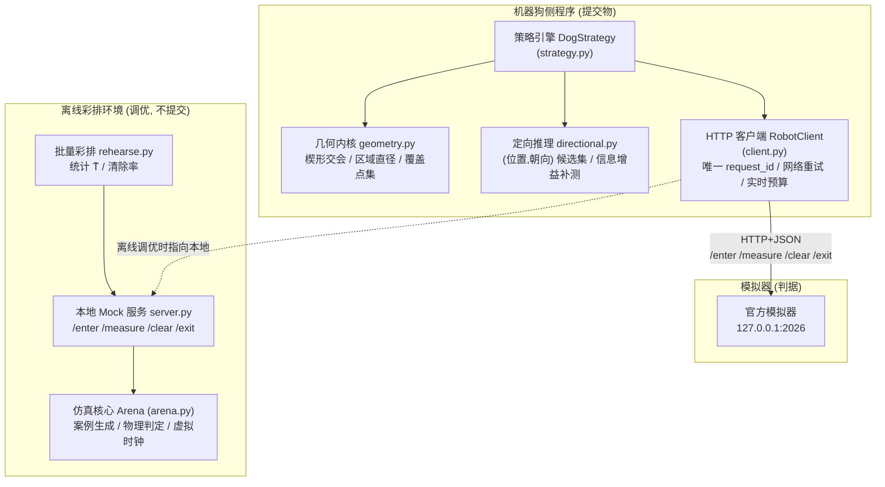
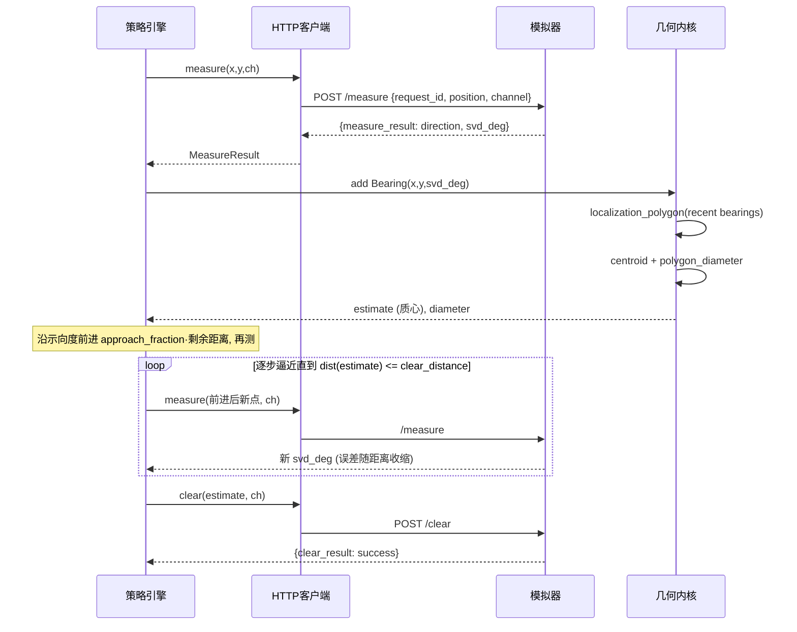
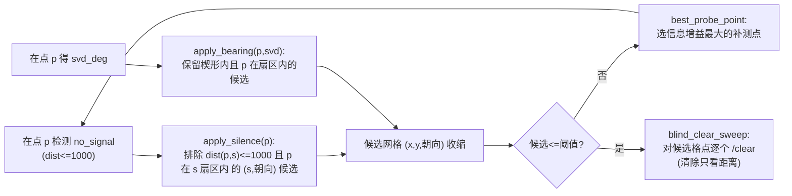

# 设计文档：无线电干扰源的快速自动定位与清除

> 本文档写于 2026-09-10，赛前设计阶段，作为 Design-First 工作流的产物。
> 文中部分参数是设计时取值，最终交付版参数以 `src/b_sim/` 代码与论文为准
> （例如覆盖环从设计期的 1250 m×12 站位收敛到 1150 m×6 站位、外环 1870 m）。
> 保留原文是为了留下"为什么这样设计"的完整推理链。


> Feature: `b-radio-interference-locate-clear` · Workflow: Design-First · Type: Feature
>
> 本设计文档同时给出**高层设计**（系统架构、模块划分、数据流、各子问题数学模型、覆盖站位设计依据）与**低层设计**（算法伪代码、函数签名、HTTP 协议处理、面向性质测试的正确性性质）。所有函数签名、常量与算法均以仓库中已实现的 `src/b_sim/` 模块为根据（`geometry.py`、`directional.py`、`strategy.py`、`arena.py`、`client.py`、`coverage_design.py`），并在本文中形式化、补全其数学论证以达到论文水准。代码示例使用 Python（现有实现语言）。

---

## 1. Overview

题目要求一只机器狗在半径 `R = 1800 m` 的圆形目标区域内，对数量未知（10–16 个）、各占互不相同频道（1–20 中的某些）的无线电干扰源，进行**快速自动定位与清除**。评分指标为**平均定位清除时间** `T̄ = 总虚拟时间 / 已清除个数`（越小越好）。

机器狗只有一种传感能力：在**静止**状态下对某一频道检测 5 s，得到三种结果之一——`no_signal`（该点收不到该频道信号）、`near`（距离 ≤ 5 m，信号过强无法定向，可直接清除）、`direction`（返回带 ±1° 误差的示向度 `svd_deg`）。清除 `/clear` 与辐射方向无关，只要机器狗落在目标源 20 m 内即成功。移动 5 m/s、切频 1 s。

本方案的核心工程判断（均由离线仿真反复验证并在本文形式化为带论证的设计决策）是：

1. **逐步逼近式归航**而非远距离一次性交会——示向度 ±1° 误差在距离 `r` 处引起横向定位误差 `≈ r·tan(1°)`（1500 m 处 ≈ 26 m > 清除半径 20 m；100 m 处 ≈ 1.7 m），故"边靠近边重测"让几何误差随距离自然收缩。
2. **环形补扫是主路径而非兜底**——约 51% 的源在原点收不到信号；按"最坏覆盖间隙 < 接收半径下限 1000 m"选定"原点 + 12 站位 @1250 m"（13 站位，最坏间隙 670 m）保证发现任一全向源。
3. **检测预算必须拆成搜索段与归航段**——拿到首个示向度后重置归航预算，避免搜索阶段耗尽额度导致"已能定位却被判放弃"。
4. **定向源靠推理 + 盲清除**而非盲目加密站位——把"无信号"当作约束压缩 `(位置, 朝向)` 候选网格，再对候选格点直接 `/clear`（清除只看距离，与辐射方向无关）。

离线仿真结果：Q3（全向）60/60 全清、`T̄ ≈ 464 s`；Q4（含 5 个定向源）40/40 全清、`T̄ ≈ 1275 s`。官方模拟器彩排：Q3 `489.4 s`、Q4 `1397.4 s`。官方日志时间构成：移动 ≈ 81%、检测 ≈ 18%、清除 < 1%——**移动是唯一数量级级别的优化杠杆**。

---

## 2. High-Level Design

### 2.1 系统架构



策略引擎与三个支撑模块构成提交程序；离线的 `arena.py + server.py + rehearse.py` 复刻官方物理规则，用于无限次彩排调参，任何与官方不一致处以官方实测为准。

### 2.2 模块划分与职责

| 模块 | 职责 | 对应子问题 |
| --- | --- | --- |
| `geometry.py` | 楔形（±1° 扇形）半平面交会 → 凸定位多边形；区域直径；外接圆覆盖判定；最小二乘交点；覆盖点集构造与数值校验 | Q1、Q2 内核；Q3/Q4 定位内核 |
| `directional.py` | 定向源 `(x, y, 朝向)` 三维候选网格的约束更新（沉默/示向度）、信息增益最大补测点选择、候选盲清除支撑 | Q4 |
| `strategy.py` | 顶层情节循环：原点普扫 → 归航清除 → 环形补扫 → 复活重试 → 内圈重测 →（Q4）信念搜索 → 盲清除；沿示向度逐步逼近、dog-leg 交会、螺旋补点、射线盲清除 | Q3、Q4 |
| `arena.py` | 案例生成（均匀位置、`[1000,1500]` 接收半径、无重复频道、确定性 ±1° 误差场）、检测/清除判定、虚拟时钟推进 | 离线判据 |
| `client.py` | HTTP+JSON 串行动作、唯一 `request_id`、网络重试复用原请求、`accepted` 校验、现实时间预算 | 协议层 |
| `coverage_design.py` | 覆盖站位设计的数值依据（最坏覆盖间隙、原点盲区比例、定向可见率） | Q3/Q4 站位论证 |

### 2.3 数据流

**定位—清除主数据流（Q3 全向）：**



**定向推理数据流（Q4）：**



### 2.4 覆盖站位设计依据（`coverage_design.py`）

题面保证有效接收半径 `R_s ∈ [1000, 1500] m`。若目标区域内**任意一点**到某个站位的距离 `≤ 1000 m`（下限），则任一全向源必在某站位可见 → 一定能被发现。定义**最坏覆盖间隙** `g(stations) = max_{p∈区域} min_{station} ||p − station||`；设计要求 `g < 1000`。

| 布局 | 站位数 | 最坏间隙 (m) | 保证发现 |
| --- | --- | --- | --- |
| 仅原点 | 1 | 1800 | 否 |
| 原点 + 1250 m × 12 | 13 | **670** | **是** |
| 双环 (950×8 + 1560×14) | 23 | 539 | 是（成本 +77%） |

结论：**原点 + 1250 m 环 12 站位（13 站位）** 即可保证发现任一全向源，较双环方案成本低约 43%。原点盲区比例约 **51%**（100 案例统计），故环形补扫是主路径。

对定向源（仅 ±90° 扇区可见），盲目加密站位有天花板（实测 37 站位仅 98.7% 可见率、成本翻倍），故 Q4 改用推理 + 盲清除（见 §3.4、§4.6–4.8）。外环半径经 200 案例 × 5 定向源实测取 **1750 m × 18 站位**（1560 m 差 40 m 够不到贴边源）。


---

## 3. Mathematical Models (Q1–Q4)

### 3.1 Q1: 交会定位区域直径与外接圆覆盖判定

**几何模型。** 在检测点 `p_i = (x_i, y_i)` 得到示向度 `θ_i = svd_deg_i`，真实方位落在 `[θ_i − 1°, θ_i + 1°]`。该观测把源约束在一个以 `p_i` 为顶点、张角 `2° = 2·ε`（`ε = 1°`）的**楔形** `W_i`。楔形是两个半平面的交：

- 下边界射线（方向 `θ_i − ε`）左侧：保留逆时针一侧；
- 上边界射线（方向 `θ_i + ε`）右侧。

对方向 `φ` 的射线，其左侧法向为 `(−sin φ, cos φ)`，半平面写成 `a·x + b·y ≤ c`。多个观测的**定位区域**为各楔形之交：
```
P = ⋂_i W_i = ⋂_i (H_i^low ∩ H_i^up)
```
`P` 是凸多边形（半平面交）。从一个足够大的初始矩形出发，用 Sutherland–Hodgman 逐半平面裁剪即可得到 `P` 的顶点（逆时针）。

**区域直径。** 凸多边形的直径（任意两点最大距离）必在**顶点对**上取到：
```
D(P) = max_{u,v ∈ vertices(P)} ||u − v||
```
（凸集上距离函数是凸的，最大值在极点取到。）暴力枚举顶点对即可；顶点数很小（≤ 观测数的常数倍），`O(m²)` 足够。这就是"多边形定位区域直径"的算法。

**外接圆覆盖判定（题目第二问）。** 记以直径两端点 `A, B` 为直径的圆 `C`：圆心 `M = (A+B)/2`、半径 `r = D/2`。**结论：以区域直径为直径的圆不一定能覆盖该区域。**

- 证明思路（反例族）：取正三角形，其直径 `D` = 边长 `L`（任两顶点距离相等）。以任一边为直径的圆半径 `L/2`，圆心在该边中点，但第三个顶点到该中点的距离为 `L·(√3/2) ≈ 0.866 L > L/2`，落在圆外。故不覆盖。
- 上界（Jung 定理，平面情形）：任一直径为 `D` 的平面凸集，其**最小外接圆半径** `r* ≤ D/√3 ≈ 0.577 D`。因此"直径圆"（半径 `D/2 = 0.5 D`）在最坏情形不足以覆盖；能覆盖当且仅当最远顶点到 `M` 的距离 `≤ D/2`。
- 判定式：`covers ⟺ max_{v ∈ vertices} ||v − M|| ≤ D/2`。

工程上定位区域通常狭长（两条近似平行的窄楔相交），此时直径圆常能覆盖；但需按判定式逐案例检验，不能默认成立。

### 3.2 Q2: 第二检测点的选择策略与候选区域

**问题。** 已在 `p_1` 得到源的示向度 `θ_1`（误差 ±ε），求第二检测点 `p_2` 的选择策略与候选区域，使交会定位良态。

**几何驱动。** 两条示向线（近似）交于源 `s`，交会角 `α`（两射线夹角）决定定位精度。设两检测点到源的距离分别为 `d_1, d_2`，示向度误差 `ε`。一阶误差传播下，定位区域沿"平分线方向"的展宽 `≈ (d_1 + d_2)·ε / sin α`（`sin α` 越大越好）。因此：

- **交会角约束**：取 `α ∈ [60°, 120°]`（`sin α ≥ √3/2`），避免小交会角（近共线）导致误差放大；`α = 90°` 最优。
- **接收半径约束**：`p_2` 必须仍落在源的有效接收半径内（`d_2 ≤ R_s`，`R_s ∈ [1000,1500]` 未知，保守用下限 1000 m），否则 `p_2` 处 `no_signal`，交会失败。
- **误差随距离收缩**：横向误差 `≈ d_2·ε`，故 `p_2` 越靠近源越好——这与"沿示向度逼近"一致。

**候选区域推导。** 源位于 `p_1` 沿 `θ_1` 方向的射线附近（距离 `d_1` 未知但 `≤ R_s`）。以 `p_1` 为顶点、`θ_1 ± ε` 为边的楔形是源的可行区。要使从 `p_2` 观测的交会角落在 `[α_min, α_max]`，`p_2` 应位于**相对示向线偏转 `α` 的方向**上。工程实现取一个稳健的固定偏转（`dogleg_offset_deg = 32°`）并沿示向度方向前进（`dogleg_length_m = 380 m`），得到候选点集：
```
p_2 ∈ { p_1 + L·(cos(θ_1 ± δ), sin(θ_1 ± δ)) : δ ∈ {32°, 16°, 0°}, L ≈ 380 m }
```
角度从大到小逐级退让，最终退化为沿示向度直行——保证即便偏转走出接收半径也能回落到"沿示向度单调靠近"的安全路径。**候选区域** = 该楔形前方、交会角 `∈ [60°,120°]` 且 `d_2 ≤ 1000 m` 的环状扇形带。

> 关键教训（写入论文）：**不可做大幅横向平移**取 `p_2`。横向平移易走出接收半径 → `no_signal`（实测把清除率从 81% 打到 45%）。必须"沿示向度前进 + 小角度偏移"。

### 3.3 Q3: 搜索—覆盖—归航模型（全向）

**目标。** 单狗从原点、初始频道 1，清除全部 10–16 个全向源，最小化 `T̄ = 总虚拟时间 / 清除数`。

**三阶段模型：**

1. **搜索（覆盖）**：站位集合 `S = {原点} ∪ Ring(1250, 12)`（必要时加 `Ring(1750, 18)`）。由 §2.4，`g(S) < 1000 ≤ R_s`，保证任一源至少被一个站位发现。每站位按频道号顺序遍历（减少切频，但切频代价与频道无关）。
2. **归航**：对已有示向度的频道，用 §3.1 楔形交会得区域质心 `estimate` 与直径 `diameter`；沿示向度方向前进 `approach_fraction·剩余距离`（带小横向偏移保持交会角），在更近处重测。误差 `≈ d·tan(1°)` 随 `d` 收缩，当 `dist(estimate) ≤ clear_distance_m (55 m)` 时发 `/clear`。
3. **补扫/重试**：仍沉默的频道走覆盖环；放弃过的频道在补扫后**复活**（新观测改善几何）；对"原点可见但环站位全部超出其接收半径"的近距离源做**内圈重测**（原点 + 小三角基线）。

**成本模型。** 单动作虚拟耗时：移动 `||Δ||/5 s`、切频 `+1 s`、检测 `+5 s`、清除成功 `+5 s`/失败 `+3 s`。总时间中移动占 ≈ 81%，故就近排序（`_home_all`/`_walk_ring` 按距离贪心）压缩空驶是主要优化。

### 3.4 Q4: 定向源 (位置, 朝向) 约束满足 / 候选消除模型

**观测语义。** 定向源 `s` 有朝向 `φ_s`、半角 90°。在点 `p` 对其频道检测得 `no_signal`，当且仅当
```
dist(p, s) > R_s   或   |bearing(s→p) − φ_s| > 90°   (p 在扇区外)
```
由于 `R_s ≥ 1000` 未知，取保守下限：**若 `dist(p, s) ≤ 1000` 且仍 `no_signal`，则必然是"p 在扇区外"**。这是一条硬约束——用来消除候选状态。

**候选网格。** 状态是三维 `(x, y, φ)`：位置离散步长 120 m（约 700 格点），朝向步长 30°（12 个），全域约 8500 个初始候选。约束更新：

- **沉默约束** `apply_silence(p)`：删除所有满足 `dist(p,s) ≤ 1000 ∧ p 在扇区内` 的候选（它们与观测矛盾）。
- **示向度约束** `apply_bearing(p, θ)`：保留 `bearing(s→p̄?)` 落在楔形内且 `p` 在扇区内的候选。

实测 10 次沉默观测把 8508 候选压缩到 2166（真值始终保留）。

**信息增益补测点。** 选下一个检测点 `p*` 最大化"若再无信号可排除的候选比例"减去移动折价：
```
p* = argmax_p [ (可被 p 沉默排除的候选数 / 总候选数) − λ·dist(p, current) ]
```
候选观测点**不能只用候选源位置**——朝外辐射的源只在其"外侧"可见，故沿每个候选朝向前方按若干距离生成探测点。

**盲清除收尾。** `/clear` 判定只看距离（`≤ 20 m`），与辐射方向无关。当候选压缩到少数格点时，逐个格点盲清除比继续找信号便宜。每个候选格点在其 120 m 网格内按 20 m 清除半径布点覆盖。实测盲清除把全清局数从 11/20 提到 17/20。


---

## 4. Low-Level Design: 函数签名与算法伪代码

物理常量（`arena.py`）：`ARENA_RADIUS=1800`, `SPEED_MPS=5`, `MEASURE_SECONDS=5`, `CHANNEL_SWITCH_SECONDS=1`, `CLEAR_SUCCESS_SECONDS=5`, `CLEAR_FAIL_SECONDS=3`, `NEAR_THRESHOLD_M=5`, `CLEAR_RADIUS_M=20`, `RECEPTION_MIN_M=1000`, `RECEPTION_MAX_M=1500`, `ERROR_ABS_MAX_DEG=1`, `DIRECTIONAL_HALF_ANGLE_DEG=90`, `MAX_VIRTUAL_SECONDS=360000`(100h), `MAX_REAL_SECONDS=1200`(20min)。

### 4.1 核心数据类型

```python
@dataclass(frozen=True)
class Bearing:                    # 一次示向度观测
    x: float; y: float; svd_deg: float

@dataclass
class Jammer:                     # 干扰源真值 (仅离线 arena)
    channel: int; x: float; y: float; reception_radius_m: float
    directional_deg: float | None = None      # None = 全向
    cleared: bool = False

@dataclass
class MeasureResult:              # 客户端返回
    result: str                   # "no_signal" | "near" | "direction"
    svd_deg: float | None
    virtual_time_s: float
```

### 4.2 区域直径与外接圆覆盖（Q1）

```python
def wedge_half_planes(b: Bearing, error_deg: float = 1.0) -> list[tuple[float,float,float]]:
    """一次观测的 2·error 楔形 = 两个半平面 (a,b,c) with a·x+b·y<=c。"""

def clip_polygon(poly: list[tuple[float,float]], plane) -> list[tuple[float,float]]:
    """Sutherland-Hodgman 半平面裁剪凸多边形。"""

def localization_polygon(bearings, *, error_deg=1.0, bound=4*ARENA_RADIUS)
        -> list[tuple[float,float]]:
    """多观测楔形交 → 凸定位区域顶点(逆时针); 空则 []。"""

def polygon_diameter(poly) -> tuple[float, tuple[float,float], tuple[float,float]]:
    """(直径 D, 端点 A, 端点 B); 顶点对枚举。"""

def circle_on_diameter_covers(poly) -> tuple[bool, float]:
    """以直径为直径的圆(圆心=直径中点)是否覆盖区域; 返回 (覆盖?, 最远顶点/半径)。"""
```

```
ALGORITHM RegionDiameterAndCover(bearings)
  poly ← BigSquare(bound = 4R)
  FOR each b IN bearings:
      FOR each plane IN wedge_half_planes(b):
          poly ← clip_polygon(poly, plane)
          IF poly is empty: RETURN (empty region)
  # 直径
  D ← -1; (A,B) ← (poly[0], poly[0])
  FOR i < j IN vertices(poly):
      d ← ||poly[i] - poly[j]||
      IF d > D: D, (A,B) ← d, (poly[i], poly[j])
  # 覆盖判定
  M ← (A+B)/2 ; r ← D/2
  worst ← max_{v in poly} ||v - M||
  RETURN D, (A,B), (worst <= r + 1e-7)      # Jung: 不一定覆盖
```

### 4.3 位置估计（交会质心，退化用最小二乘）

```python
def centroid(poly) -> tuple[float,float]                       # 凸多边形面积质心
def least_squares_intersection(bearings) -> tuple[float,float] | None
def estimate_position(bearings) -> tuple[float,float] | None   # 优先质心, 退化最小二乘
def bearing_spread_deg(bearings) -> float                      # 最大交会角(良态判据)
def lateral_error_at(range_m, error_deg=1.0) -> float          # r·tan(error): 逼近必要性
```

### 4.4 第二检测点候选区域生成（Q2）

```python
def second_point_candidates(p1: tuple[float,float], theta1: float,
                            *, offsets=(32.0,16.0,0.0), length=380.0,
                            recep_lower=1000.0) -> list[tuple[float,float]]:
    """沿示向度方向前进+小角度偏移生成 p2 候选; 交会角良态且 d2<=下限。"""
```

```
ALGORITHM SecondPointCandidates(p1, theta1)
  cands ← []
  FOR δ IN (32°, 16°, 0°):                      # 大→小逐级退让
      FOR sign IN (+1, -1) if δ>0 else (+1):
          φ ← theta1 + sign·δ
          p2 ← p1 + length·(cos φ, sin φ)
          IF ||p2|| <= ARENA_RADIUS: cands.append(p2)   # 留在区域内
  RETURN cands   # 使用时逐个验证: 交会角∈[60,120], no_signal 则退让
```

### 4.5 沿示向度逐步逼近归航（Q3 核心）

```python
def _dogleg(state) -> bool:        # 单条示向度时构造交会基线(沿示向度+小偏移)
def _step_closer(state, distance) -> bool:   # 朝 estimate 前进 approach_fraction, 带横向偏移
def _spiral(state) -> bool:        # 清除失败后绕 estimate 螺旋补点
def _home_channel(state) -> bool:  # 把一个频道推进到清除完成; False=放弃
```

```
ALGORITHM HomeChannel(state)          # 逐步逼近, 误差随距离收缩
  WHILE not stop():
      budget ← max_homing_measures (+加码 if 窄扇区)
      IF state.homing_measures >= budget: RETURN FinalAttempt(state)
      IF state.clear_attempts >= max_clear: RETURN RayBlindClear(state)
      IF consecutive_silent >= tolerance:
          RETURN RayBlindClear(state) if has_bearing else False
      IF estimate is None:                 # 只有一条示向度
          IF not Dogleg(state): RETURN False   # 沿示向度前进取第二观测
          CONTINUE
      d ← ||estimate - pos||
      IF d <= clear_distance_m (55):
          IF ClearAt(estimate): RETURN True
          RETURN Spiral(state)
      StepCloser(state, d)                 # 前进 approach·d, 横向 lateral·d, 重测
      # 关键: 沿示向度前进(单调靠近, 信号更强); 禁止大幅横向平移
```

### 4.6 搜索/归航预算拆分

```python
@dataclass
class ChannelState:
    channel: int
    bearings: list[Bearing]
    measure_count: int = 0        # 全程检测数(含搜索)
    homing_measures: int = 0      # 归航检测数; 拿到首个示向度后才起算
    consecutive_silent: int = 0
    exhausted: bool = False       # 本轮放弃(补扫后可复活)

    def add_bearing(self, x, y, svd):
        first = not self.bearings
        self.bearings.append(Bearing(x,y,svd)); self.consecutive_silent = 0
        if first:                 # 拿到首个示向度 → 重置归航预算
            self.homing_measures = 0
            self.exhausted = False
        self._refresh()           # 重算 estimate/diameter (只用最近 4 条)
```

> 教训：搜索段与归航段**共享**预算曾害死一个案例——搜索阶段把额度烧光后，一条 413 m 偏差的示向度让候选压到 2 格点即被判耗尽。拿到首个示向度后**必须重置** `homing_measures`。

### 4.7 定向候选消除与信息增益补测（Q4）

```python
GRID_STEP_M = 120.0 ; HEADING_STEP_DEG = 30.0

def in_beam(sx, sy, heading_deg, px, py) -> bool:   # p 是否在 s 的 ±90° 扇区内

@dataclass
class DirectionalBelief:
    candidates: set[tuple[int,int,int]]   # (位置索引, 朝向索引, tag)
    @classmethod
    def fresh(cls) -> "DirectionalBelief"          # 全网格 (x,y,φ)
    def apply_silence(self, px, py) -> None        # 删除 dist<=1000 且 p 在扇区内 的候选
    def apply_bearing(self, px, py, svd, tol=1.0) -> None
    def candidate_positions(self) -> list[tuple[float,float]]
    def best_probe_point(self, current, limit=260) -> tuple[float,float] | None
    @property
    def alive(self) -> bool
```

```
ALGORITHM ApplySilence(belief, p):        # 沉默 = 约束
  survivors ← {}
  FOR (pi,hi,tag) IN belief.candidates:
      s ← positions[pi]
      IF dist(p,s) <= 1000 AND in_beam(s, headings[hi], p):
          CONTINUE          # 与观测矛盾, 剔除
      survivors.add((pi,hi,tag))
  belief.candidates ← survivors

ALGORITHM BestProbePoint(belief, current):   # 最大期望熵减近似
  probes ← ProbeCandidates(belief)           # 沿每个候选朝向前方生成点(非候选位置!)
  best ← -inf
  FOR p IN probes:
      gain ← |{c in candidates : dist(p,s)<=1000 and in_beam}| / |candidates|
      score ← gain - dist(p,current)/500 · 0.05     # 移动折价
      IF score > best: best, p* ← score, p
  RETURN p*
```

> 教训：`ProbeCandidates` **不能只用候选源位置**当观测点。朝外辐射的源只在其外侧可见，故沿候选朝向前方按距离 `(2·step, 4·step, 0.75·1000)` 生成探测点并裁剪进区域。

### 4.8 盲清除（Q4 收尾）与射线盲清除（归航兜底）

```python
def _blind_clear_sweep(self, max_targets=24) -> None:
    """对候选格点直接 /clear(不要求先看见); 按候选密度加权取前 max_targets 个。"""

def _grid_cover_points(cx, cy, cell=120.0, radius=20.0) -> list[tuple[float,float]]:
    """在 120 m 网格内按 20 m 清除半径布点, 保证覆盖该格。"""

def _ray_blind_clear(self, state) -> bool:
    """沿单条示向度射线铺点盲清除: 方向已知/距离未知时的最后手段。
    间距 <2·20 m; 远处按 ±1° 横向偏差在射线两侧补点; 独立计数上限。"""
```

```
ALGORITHM RayBlindClear(state):     # 清除只看距离, 与辐射方向无关
  IF no bearing OR state.ray_swept: RETURN state.cleared
  state.ray_swept ← True
  (ox,oy,θ) ← last bearing ; (ux,uy) ← (cos θ, sin θ) ; (nx,ny) ← (-uy, ux)
  r ← step (32 m)
  WHILE r <= ray_clear_max_range (1600):
      offsets ← [0] ; IF r·rad(1°) > lateral: offsets ← [0, +lat, -lat]
      FOR off IN offsets:
          p ← (ox,oy) + r·(ux,uy) + off·(nx,ny)
          IF ||p|| <= R + 20 AND ClearAt(p, ch): RETURN True
      r ← r + step
  RETURN state.cleared
```

### 4.9 顶层情节策略循环

```python
class DogStrategy:
    def run(self) -> dict:
        self.client.enter()
        if config.directional_probe:                 # Q4
            for st in channels.values(): st.belief = DirectionalBelief.fresh()
        if config.sweep_origin: self._sweep_at((0,0), range(1,21))   # 阶段1 原点普扫
        self._home_all()                              # 阶段2 归航清除
        self._probe_ring()                            # 阶段3 覆盖环补扫
        self._revive_exhausted(); self._home_all()    # 复活重试
        self._inner_retry()                           # 内圈重测(近距离源)
        if config.directional_probe:                  # Q4 收尾
            self._belief_search(); self._home_all(); self._blind_clear_sweep()
        self.client.exit()
        return self.summary()
```

```
ALGORITHM HomeAll():                  # 就近优先, 压缩空驶(移动占 81%)
  WHILE not stop():
      targets ← [st for st in channels if st.active]   # 有示向度且未清未弃
      IF empty(targets): RETURN
      targets.sort(key = range_to(st))                 # 贪心最近
      IF not HomeChannel(targets[0]): targets[0].exhausted ← True
```

### 4.10 HTTP 协议处理（`client.py`）

- **唯一 request_id**：每个新动作生成 `f"{tag}-{seq}"`；**仅网络异常重试时复用原请求体与原 ID**（幂等），避免重复计费或状态错乱。
- **双重校验**：同时检查 `http_status == 200` 且 `body["accepted"] is True`；`accepted=false` 时 `virtual_time_s` 不代表当前虚拟时刻，抛 `ProtocolError`。
- **网络重试**：`URLError/Timeout/ConnectionError` 退避重试 `max_network_retries=3` 次；耗尽抛 `TestEnded`。
- **现实时间预算**：用 `/enter` 返回的 `remaining_real_duration_s` 与 `time.monotonic()` 计算 `real_budget_left_s()`，不假定固定 1200 s；策略在 `real_time_reserve_s=15 s` 前收尾。
- **时间记账**：客户端每次动作后更新 `virtual_time_s`；策略侧 `_stop()` 同时看现实与虚拟预算（虚拟上限 `0.9·100h`）。
- **自记日志**：模拟器不提供指令回放，客户端自记完整 `(request, http_status, response)` 序列供复盘。

```python
def _base_payload(self, tag) -> dict:
    self._seq += 1
    return {"arena_id": ..., "robot_id": ..., "request_id": f"{tag}-{self._seq}"}

def _post(self, path, payload) -> dict:
    raw = json.dumps(payload).encode()          # 重试复用同一 raw + request_id
    for attempt in 1..max_network_retries:
        try: body, status = urlopen(path, raw); break
        except HTTPError as e: body, status = json(e), e.code; break
        except (URLError, Timeout, ConnectionError): backoff; continue
    if status != 200 or body["accepted"] is not True: raise ProtocolError
    self.virtual_time_s = body["virtual_time_s"]; return body
```


---

## 5. 时间记账模型（与协议表一致）

| 动作 | 虚拟时间增量 |
| --- | --- |
| 移动到 `(x,y)` | `||Δ|| / 5` s |
| 切频（`channel ≠ 当前`） | `+1` s |
| `/measure` | `+5` s（须静止） |
| `/clear` 成功 | `+5` s |
| `/clear` 失败 | `+3` s |
| `/measure` 距离 ≤ 5 m 且在覆盖内 | 返回 `near` → 直接 `/clear` |

`Arena._commit_move` 以微秒整数累加虚拟时钟；超 `MAX_VIRTUAL_SECONDS` 触发 `virtual_time_exhausted`。评分 `T̄ = virtual_time_s / cleared_count`。约束窗口：程序现实运行 ≤ 20 min，虚拟 ≤ 100 h。

---

## 6. Error Handling

| 场景 | 条件 | 响应 | 恢复 |
| --- | --- | --- | --- |
| 网络抖动 | `URLError/Timeout` | 退避重试、复用原 `request_id` | 3 次内成功则透明恢复；耗尽抛 `TestEnded` 并优雅 `/exit` |
| 动作被拒 | `accepted=false` 或非 200 | 抛 `ProtocolError`，不更新虚拟时刻 | 情节循环捕获，记事件，尝试 `/exit` |
| 交会区域为空 | 楔形无交（矛盾观测/误差） | `localization_polygon` 返回 `[]` → `estimate=None` | 退化最小二乘交点；仍失败则 dog-leg 取新观测 |
| 归航反复丢信号 | `consecutive_silent ≥ tolerance` | 判为窄扇区源 | 有示向度 → 射线盲清除兜底；否则交给环补扫 |
| 估计不可信 | 估计落在区域外 / 清除额度耗尽 | 不再围绕估计打点 | 改走射线盲清除（只信方向） |
| 近距离源被环站位漏掉 | 原点可见但环站位全超其接收半径 | `_inner_retry` 原点+小三角重测 | 新基线交会成功后正常清除 |
| 预算逼近 | 现实剩余 ≤ 15 s 或虚拟 ≥ 0.9·上限 | `_stop()` 置位，停止新动作 | 优雅 `/exit`，保留已清除成果 |

---

## 7. Testing Strategy

### 7.1 单元 / 回归测试（`test_b_sim.py`，33 项）

覆盖：协议门禁（未 `/enter` 即动作被拒、结束后动作被拒）、物理规则（覆盖角判定、接收半径边界、`near` 阈值、清除半径判定、误差确定性同点复现）、幂等（清除已清除源、重试复用 `request_id`）、时间记账（各动作增量与协议表一致）。

### 7.2 面向性质的测试（Property-Based Testing）

**库**：`hypothesis`（Python）。以下性质在随机案例族上验证：

- **P1 定位区域含真值（误差界内）**：对任意源与任意检测点集，`localization_polygon(bearings)` 生成的区域**必包含真实源位置**（当每条示向度误差 ∈ [−1°, +1°]）。楔形按 ε=1° 张角构造，真值必在每个楔形内 → 在交内。
- **P2 直径在顶点对取到**：`polygon_diameter` 返回值等于顶点对最大距离；随机凸多边形上与内部采样点对的最大距离一致。
- **P3 外接圆覆盖判定正确**：`circle_on_diameter_covers` 的布尔值等于 `max‖v−M‖ ≤ D/2`；存在正三角形反例使其为 `False`（Jung 上界 `D/√3` 非平凡）。
- **P4 时间记账匹配协议表**：任意动作序列后 `virtual_time_s` 等于按 §5 表逐项累加值（微秒级）。
- **P5 清除幂等**：对已清除源再次 `/clear` 不改变 `cleared_count`，且按失败计 3 s。
- **P6 候选消除不删真值**：`apply_silence`/`apply_bearing` 更新后，与真值 `(x,y,φ)` 最近的网格状态**始终保留**（沉默约束只删与观测矛盾者，真值永不矛盾）。
- **P7 预算内全清不变量**：在虚拟/现实预算充足时，Q3 案例族达成 100% 清除；Q4 案例族达成设计目标清除率（离线 40/40）。
- **P8 逼近误差单调收缩**：`lateral_error_at(r)` 关于 `r` 单调递增，验证"越近越准"，为逐步逼近提供依据。

```python
# 示例: P1 (hypothesis)
@given(source=sources_in_arena(), points=lists(points_in_arena(), min_size=2, max_size=6))
def test_region_contains_truth(source, points):
    bearings = [Bearing(px, py, true_bearing(source, px, py) + err(px, py)) for px, py in points
                if source.covers(px, py) and source.distance_to(px, py) <= source.reception_radius_m]
    assume(len(bearings) >= 2)
    poly = localization_polygon(bearings, error_deg=1.0)
    assume(poly)
    assert point_in_convex_polygon(source.x, source.y, poly)
```

### 7.3 集成 / 彩排

`rehearse.py` 对本地 Mock 服务批量彩排（Q3 60 局、Q4 40 局），统计 `T̄`、清除率、程序运行时长；再对官方模拟器做小样本彩排校准离线/在线偏差（Q3 5.4%、Q4 9.6%），据此保留时间余量。

---

## 8. Performance Considerations

- **移动是唯一数量级杠杆**（官方日志：移动 81% / 检测 18% / 清除 <1%）：就近贪心排序、沿示向度单调逼近（不走回头/横向）、分层惰性补扫（内环解决不了才启外环）。
- **网格分辨率折中**（Q4）：位置 120 m、朝向 30°，单次评分毫秒级，可在 20 min 现实预算内反复调用。
- **虚拟/现实余量充裕**：实测各用上限的 5.1% / 0.17%，故窄扇区源可放宽归航额度与丢信号容忍度，用少量额外检测换全清。

## 9. Security / Robustness Considerations

- 客户端仅回环访问 `127.0.0.1:2026`；不信任外部输入，所有响应字段做存在性与类型校验。
- 幂等重试保证网络抖动不产生重复计费或状态漂移；`accepted` 校验防止把被拒动作误当成功。

## 10. Dependencies

- **运行**：Python 3.10+ 标准库（`math`, `json`, `urllib`, `hashlib`, `dataclasses`, `random`）；无第三方运行时依赖（提交程序）。
- **协议**：官方模拟器 HTTP+JSON at `127.0.0.1:2026`（`/enter` `/measure` `/clear` `/exit`）。
- **测试/彩排**：`hypothesis`（PBT）、内置 `unittest`/`pytest`；`matplotlib`（论文图，`figures/`）。
- **离线判据**：仓库内 `arena.py + server.py`（复刻官方物理规则，官方为最终判据）。

---

## 11. 需求可追溯性（供后续 requirements 阶段派生）

| 子问题 | 设计交付 | 关键函数 |
| --- | --- | --- |
| Q1 | 交会定位区域直径算法 + 外接圆覆盖判定（附反例与 Jung 上界） | `localization_polygon`, `polygon_diameter`, `circle_on_diameter_covers` |
| Q2 | 第二检测点选择策略 + 候选区域（交会角 + 误差传播 + 接收半径约束） | `second_point_candidates`, `bearing_spread_deg`, `lateral_error_at` |
| Q3 | 全向搜索—覆盖—归航策略；覆盖站位论证；预算拆分 | `DogStrategy.run`, `_home_channel`, `_probe_ring`, `coverage_points` |
| Q4 | 定向 `(位置,朝向)` 候选消除 + 信息增益补测 + 盲清除 | `DirectionalBelief`, `best_probe_point`, `_blind_clear_sweep`, `_ray_blind_clear` |
