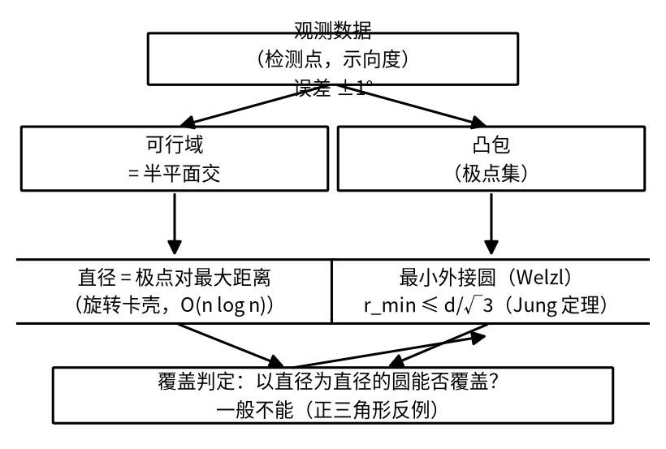
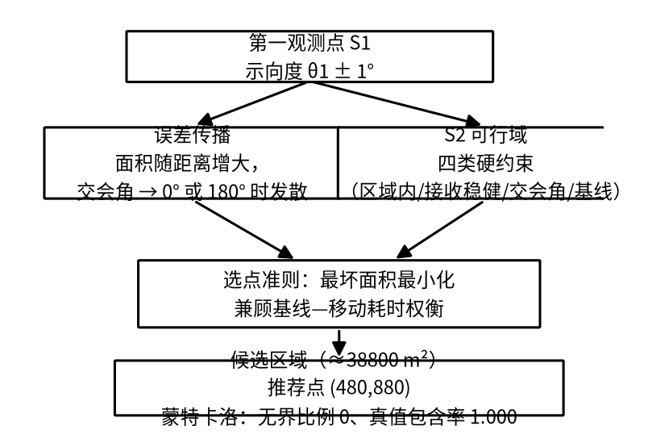
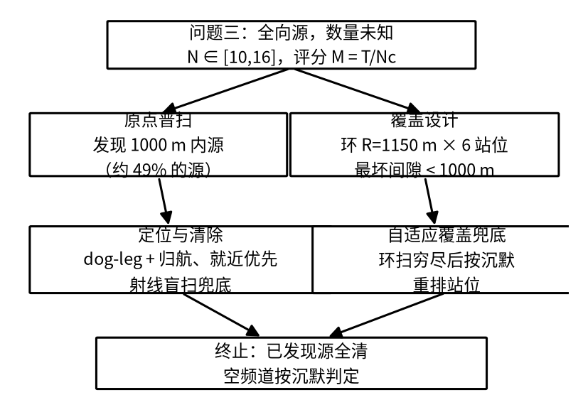
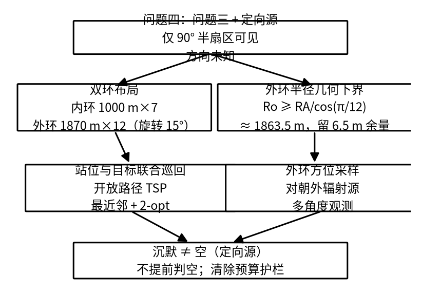
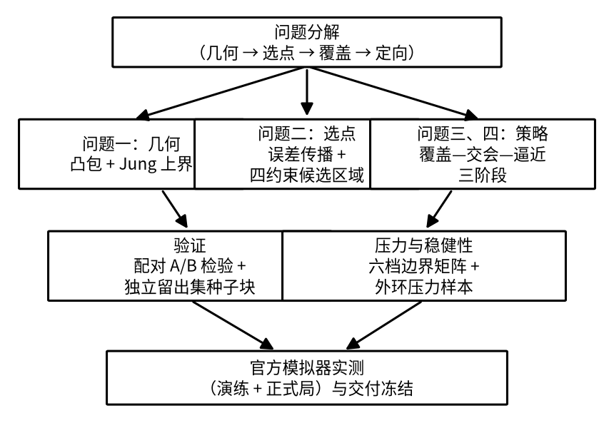
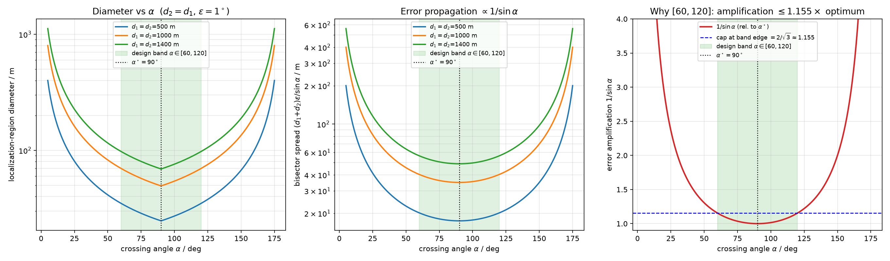
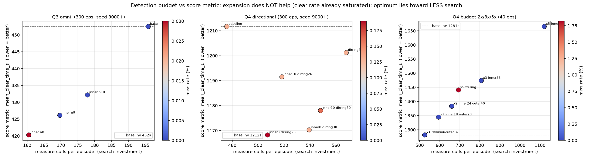

# 无线电干扰源的快速自动定位与清除

## 摘要

本文研究半径为 1800 m 的圆形区域内未知数量无线电干扰源的搜索、定位与清除问题。机器狗仅能通过含 ±1° 误差的示向度观测定位干扰源，清除半径为 20 m，评分指标为平均定位清除时间（总虚拟时间与清除个数之比）。针对四个子问题，本文依次给出解析结论、选点准则、覆盖设计方法与序贯决策策略，并用自建离线仿真器在数万局随机场景上完成参数标定、假设检验与留出集泛化验证。

针对问题 1，本文证明有限点集的定位区域直径等于其凸包极点间的最大距离，给出 $O(n\log n)$ 算法；并证明以定位区域直径为直径的圆一般不能覆盖该区域：正三角形以任一边为直径作圆时对顶点位于圆外 $0.366a$ 处，由 Jung 定理$^{[1]}$知覆盖半径介于 $[d/2,\ d/\sqrt3]$ 且上界可达，故直径圆半径 $d/2$ 仅为覆盖半径下界，最坏情形需放大 $2/\sqrt3\approx 1.155$ 倍。据此给出一次清除的正确判据：最小外接圆半径不超过清除半径。

针对问题 2，本文以定位区域面积最小化为目标导出第二观测点选点准则：交会角越接近 90° 面积越小，基线长度存在精度与耗时权衡下的最优值。进一步给出第二观测点的候选区域——四个硬约束（区域内、接收稳健、交会角可用、基线充足）的交集；区域中心场景下候选区仅占目标区域 0.38%，推荐点 $(480,880)$ 的 2000 次蒙特卡洛校验证实定位区域无界概率为零、真值包含率 1.000。

针对问题 3，本文基于「约 51% 的干扰源在原点不可见」的实测发现，将环形补扫确立为主覆盖路径，按最坏覆盖间隙与接收半径下限 1000 m 的余量关系设计覆盖环，取 $R=1150$ m、6 站位并配 12 相位择优；900 局配对实验确认该配置较初始 12 站位方案降低评分指标 4.5%–10.0%、检测次数减少 29%。

针对问题 4，在问题 3 基础上引入内环 1000 m×7、外环 1870 m×12 的双环布局以覆盖辐射方向朝外的定向源，其中外环半径由定向源半平面可见性的几何下界 $R_o\ge R_A/\cos(\pi/12)$ 确定；配对实验表明该布局对全定向场景降幅最大（−17.68%），与机制分析一致。

本文的四项核心工作为：（1）建立「覆盖—交会—逼近」三阶段策略，并用失败清除审计定位并修复单示向度绕过射线盲扫兜底的缺陷，使清除率由 99.46% 提升至 99.96%；（2）以移动分段归因识别归航空驶占总移动 68.1%，据此改进巡回排序与归航策略，将绕路倍数由 2.58 降至 1.27；（3）建立以配对检验为核心的参数标定流程，系统否决五项表面有效实则不符的方案，避免过拟合自建仿真器；（4）给出定向源外环半径的几何下界并据此推翻一个由随机场景均值指标支持、实际会漏清的缩环改动。最终配置在独立留出集上复核（见表 7-9）：Q3 全向 100 局池化 237.47 s、Q4 六档 120 局池化 454.49 s、随机档 40 局 454.93 s，三组合计 260 局 3347 个干扰源全部清除、零漏失，较同种子基线分别降低 1.6%、9.2%、8.6%，且清除率不降。

模型的优越性体现在三个方面：其一，关键设计参数均有可证明的解析依据（Jung 定理紧上界、bisector 覆盖几何、外环半径几何下界），而非黑盒调参；其二，决策机制可解释，每一策略分支都有触发条件与失效分析，五项被否决方案及其原因随文记录，探索过程可审计；其三，验证链条完整，开发标定、独立留出集、最坏情形压力档与官方模拟器实测四层证据相互独立且结论一致，官方正式测试四局全部清除（Q3 两局 13 源、10 源，Q4 两局 13 源、15 源），平均定位清除时间分别为 229.50 s、270.71 s、438.85 s 与 346.73 s，均落在离线预测区间内。综上所述，本文给出的策略在保证 100% 清除率的前提下显著缩短平均定位清除时间，且结论对参数摄动与场景分布稳健。

**关键词**：无线电测向；覆盖设计；序贯决策；配对假设检验；Jung 定理

---

## 1 问题重述

### 1.1 问题背景

无线电干扰源是现代通信与公共安全的重大威胁：未经授权的信号发射会压制合法通信、干扰导航与调度系统，甚至造成生产安全事故。干扰源的排查与清除长期依赖人工携带设备逐点测向，效率低、风险高，难以应对干扰源数目未知、位置隐蔽的复杂场景。以自主移动平台代替人工完成干扰源的搜索、定位与清除，具有明确的现实意义。

本题将上述问题抽象为如下自动化场景：一台机器狗在半径 $R_A = 1800$ m 的圆形区域内搜索未知数量的无线电干扰源。每个频道（1–20）至多存在一个干扰源；机器狗在给定位置对给定频道执行检测，若处于该源有效接收范围内则返回示向度（方位角，含 ±1° 误差），否则返回无信号；清除操作在距干扰源 $R_c = 20$ m 内成功。

该场景的核心困难有三：其一，示向度含 ±1° 的系统性误差，且干扰源有效接收半径 $R_r$ 在 $[1000, 1500]$ m 内随机、不对外公开，机器狗只能按最坏情形下界规划；其二，区域半径为 1800 m 而单点检测覆盖半径仅约 1000 m，约一半的干扰源在原点不可见，必须移动覆盖；其三，定向干扰源仅在其辐射扇区（半角 90°）内可被检测，方向未知，使"检测无信号"不再等同于"该处无源"。

以上困境直接决定了策略设计的三个研究方向：基于误差有界性的几何定位分析、基于覆盖充分性的移动规划、以及面向定向可见性的鲁棒扩展。解决上述问题可显著缩短干扰源定位清除时间，为自主无线电监管提供方法支撑。

### 1.2 问题提出

本题的已知数据与规则如下：区域半径 $R_A=1800$ m；干扰源有效接收半径 $R_r \ge 1000$ m（实际取值在 $[1000,1500]$ m 内随机且不对外公开）；清除半径 $R_c=20$ m；示向度误差 $\varepsilon=1°$；频道编号 1–20，每频道至多一个源；检测耗 5 s、清除成功 5 s / 未命中 3 s、切换频道 1 s、移动速度 5 m/s；虚拟时间上限 360000 s、程序运行时间上限 1200 s。**评分指标**为平均定位清除时间

$$M = \frac{T}{N_c}$$

其中 $T$ 为本局累计消耗的虚拟时间，$N_c$ 为清除个数，指标越小越好。四个子问题提出如下：

**问题一（定位区域直径的算法与覆盖性判定）。** 已知若干（检测点坐标，示向度）观测（$\varepsilon=1°$），计算既定干扰源定位区域的直径，并判断：以定位区域直径为直径的圆能否覆盖该定位区域？要求给出算法与明确结论。

**问题二（第二观测点的选取）。** 已知某全向干扰源在某检测点处的示向度，须在 $\|S_2\|\le R_A$ 的区域内给出第二个检测点的候选区域（而非单点）与选取准则，并说明定位效果。

**问题三（全向干扰源的搜索与清除）。** 目标区域内共有 10–16 个全向干扰源（具体数目未知，频道 1–20），清除半径 $R_c=20$ m。设计搜索策略，使机器狗尽快定位并清除全部干扰源，最小化平均定位清除时间 $M$。

**问题四（定向干扰源的搜索与清除）。** 干扰源分为全向源与定向源两类，定向源仅在其辐射扇区（半角 90°、方向未知）内可被检测。在不知道定向源方向与总数的情况下，设计策略完成全部干扰源的定位与清除。

## 2 问题分析

### 2.1 问题一的分析

对于问题一，其核心是**刻画干扰源可能位置集合（定位区域）的几何性质**；需要给出定位区域直径的严格算法，并回答"以直径为直径的圆能否覆盖该区域"这一覆盖性判定；目标是得到可证明的判据，为"能否一次清除成功"提供理论依据。该问题不涉及移动与搜索，本质是平面点集几何与覆盖判定问题，也是问题二选点准则与问题三、四清除判据的几何基础。

具体分析思路如图 2-1 所示。

{width=26%}

**图 2-1** 问题一分析流程：由观测构造可行域，经凸包极点对求直径、最小外接圆求覆盖半径，最终给出覆盖性判定。

### 2.2 问题二的分析

对于问题二，其核心是**在已知一个检测点及其示向度的条件下，选择第二个检测点的位置**；需要考虑误差传播对定位区域面积的影响与"基线越长越准但耗时越多"的权衡；目标是给出可获得较优定位效果的第二检测点候选区域与选点准则。定位区域由两条示向线的交会决定，其结论是问题三、四中"归航"环节（移动探测点以缩小定位区域）的实现基础。

具体分析思路如图 2-2 所示。

{width=26%}

**图 2-2** 问题二分析流程：由误差传播分析交会角与基线的效应，经四约束交集给出候选区域，再按最坏面积最小化选取第二检测点。

### 2.3 问题三的分析

对于问题三，其核心是**在未知源数目的全向源场景下安排检测、定位与清除动作以最小化平均定位清除时间**；需要解决"区域半径 1800 m 而单点检测半径仅 1000 m"的覆盖矛盾与移动耗时占主导的时序安排；目标是设计在各类随机场景下全清且省时的搜索清除策略。这是典型的序贯决策问题：信息获取与运动规划相互耦合，且源数未知使"何时停止搜索"本身需要决策；问题一的判据与问题二的选点准则分别给出清除条件与归航几何。

具体分析思路如图 2-3 所示。

{width=26%}

**图 2-3** 问题三分析流程：原点普扫后按"覆盖—交会—逼近"三阶段推进，环扫覆盖远处源、交会逼近定位清除、自适应覆盖兜底，直至全部源清除。

### 2.4 问题四的分析

对于问题四，其核心是**在问题三基础上引入定向源（仅在其辐射半扇区可观测）**；需要解决"方向未知使沉默观测不可作为无源证据"的新困难，确保辐射朝外的边界源也可被观测；目标是给出既覆盖全向源又不漏定向源的双重覆盖方案。这是问题三的泛化：覆盖环对定向源只是单方位采样，可见性在几何上表现为"源处半平面约束"，由此可推导外环半径的理论下界。

具体分析思路如图 2-4 所示。

{width=26%}

**图 2-4** 问题四分析流程：在问题三框架上叠加双环布局与方位采样，外环半径由半平面可见性几何下界确定，并以统一巡回压缩归航空驶。

### 2.5 全文技术路线

四个问题层层递进：问题一的覆盖判定为清除提供依据，问题二的选点几何为归航提供准则，两者构成"检测与定位层"；问题三的覆盖—交会—逼近三阶段策略构成"搜索与清除层"；问题四的定向可见性建模在其上增加"定向源扩展层"。全文技术路线如图 2-5 所示。

{width=26%}

**图 2-5** 全文技术路线：几何层（问题一、二）支撑策略层（问题三、四），全部结论经配对假设检验、留出集与边界压力档三层验证后，在官方模拟器上完成实测。

### 2.6 关键量级估计

示向度误差在距离 $r$ 处引起的横向定位误差为

$$e(r) = r\tan\varepsilon \approx 0.0175\,r$$

$r = 1500$ m 时 $e \approx 26$ m，已超过清除半径 20 m；$r = 100$ m 时 $e \approx 1.7$ m，远小于清除半径。这一量级对比决定了策略的基本形态：**不追求远距离一次性精确交会，而是边靠近边重测，让几何误差随距离自然收缩**。由此可解出"仅凭单条示向度沿射线盲清除即可保证命中"的距离阈值

$$r^* = R_c/\tan\varepsilon = 20/\tan 1° \approx 1146\ \text{m}$$

---

## 3 模型假设

基于题目条件与问题分析，本文作如下假设。每条假设后给出其若被违反时的影响，全部假设的合理性在后续章节中结合数据逐条检验。

1. **假设一（源分布均匀）：** 干扰源位置在半径为 $R_A=1800$ m 的圆形区域内均匀分布，辐射朝向在 $[0,360^\circ)$ 内均匀分布。若源位置显著偏向边界或朝向有偏，覆盖环的设计余量方向仍不改变（覆盖充分性按最坏情形构造），但各档相对收益的量级可能偏移。
2. **假设二（接收半径分布）：** 干扰源有效接收半径 $R_r$ 服从 $U(1000,1500)$ m 且相互独立，具体取值不对外公开。该假设影响覆盖设计的安全余量：本文按最坏情形下界 1000 m 设计，若实际分布存在低于 1000 m 的取值，覆盖充分性将被破坏，故余量的选取须保守。
3. **假设三（误差有界）：** 示向度误差在 $[-\varepsilon,\varepsilon]$（$\varepsilon=1°$）内有界，误差不随时间、位置与频道变化。本文不假设其具体分布，仅用有界性做可行域裁剪；若误差实际无界，半平面交可行域的包含性保证将失效，定位区域可能漏掉真实位置。
4. **假设四（定向扇区）：** 定向源辐射半角为 $90°$、方向在本局内固定。若半角更小或方向可旋转，外环方位的采样覆盖策略需相应加密，但"外环半径几何下界"论证仍然成立。
5. **假设五（运动学）：** 机器狗匀速移动（5 m/s）、沿直线移动、可越出区域边界，转向与加减速时间可忽略。若转向耗时不可忽略，巡回排序的收益将下降（路径长度优化不再等于时间优化）。
6. **假设六（频道独立）：** 每个频道至多一个干扰源，各频道信号互不干扰，检测结果相互独立。若存在同频道多个源或串扰，示向度观测将失效，本文策略的定位环节需要重新建模。
7. **假设七（无多径遮挡）：** 忽略信号多径反射与地形遮挡，检测成功与否仅由距离与朝向决定。若多径显著，示向度将偏离真实方位，可行域裁剪的几何基础不再成立。

上述假设中，假设一、三、四、六直接来自题目或为题目条件的安全解释；假设二、五、七为模型化需要所作的简化，第 8 章模型检验与第 9.2 节讨论其失效边界与实际影响。

## 4 符号说明

本文使用的符号约定见表 4-1。

**表 4-1　符号说明**

| 符号 | 含义 | 单位 |
|---|---|---|
| $R_A$ | 目标区域半径 | m |
| $R_r$ | 干扰源有效接收半径（未公开，$[1000,1500]$） | m |
| $R_c$ | 清除半径 | m |
| $\varepsilon$ | 示向度误差上界 | ° |
| $\gamma$ | 两条示向线的交会角 | ° |
| $\alpha$ | 候选区域判定中的交会角可用带下限 | ° |
| $B$ / $L$ | 基线长度（两观测点间距） | m |
| $M = T/N_c$ | 评分指标（平均定位清除时间） | s |
| $T$ | 本局累计虚拟时间 | s |
| $N$ / $N_c$ | 干扰源总数 / 已清除数 | 个 |
| $\Omega$ | 定位区域（与观测相容的位置集合） | — |
| $d(\cdot)$ / $r_{\min}(\cdot)$ | 点集直径 / 最小外接圆半径 | m |
| $\mathrm{conv}(\cdot)$ / $\mathrm{ext}(\cdot)$ | 凸包 / 凸包极点集 | — |
| $S$ | 站位集合；$S_1$、$S_2$ 为第一、二观测点 | — |
| $d_1$、$d_2$ | 两观测点到源的距离 | m |
| $\theta_1$ | 第一观测点示向度 | ° |
| $G(S)$ | 最坏覆盖间隙（区域内点到最近站位的最大距离） | m |
| $R_o$ | 外环站位半径 | m |
| $n$ | 覆盖环站位个数 | 个 |
| $u(\varphi)$ | 定向源辐射轴单位向量 | — |
| $C$ | 可保证单次清除的位置圆盘交集 | m² |
| $r^*$ | 射线盲清阈值 $R_c/\tan\varepsilon$ | m |
| $p_i$ / $p_2$ | 观测位置 / 第二观测点坐标 | m |

（$\gamma$ 与 $\alpha$ 均为交会角：$\gamma$ 用于定位区域面积与相对误差分析，$\alpha$ 用于候选区域硬约束；$B$ 与 $L$ 同为基线长度，分别用于解析推导与选点实现。）

## 5 问题一模型的建立与求解

问题一是一个纯几何判定问题：给定若干条带误差的示向度观测，干扰源的可能位置构成一个定位区域，需要回答该区域的直径是多少、以直径为直径的圆能否覆盖它。本章先证明定位区域直径等于其凸包极点间的最大距离并给出 $O(n\log n)$ 算法，再用 Jung 定理给出覆盖半径的紧上界，指出"直径小于清除半径"并非一次清除的充分条件，从而为问题三、四的清除判据提供严格依据。

**建模前期准备。** 可得观测为（检测点坐标，示向度），不可得为源的真值位置与 $R_r$；因此可用模型限于纯几何关系（点集直径、凸包、最小外接圆），不引入概率分布假设。候选模型包括全点对枚举（$O(n^2)$）与旋转卡壳（$O(n)$）；本题观测数不超过各章场景的频道上限，二者都可接受，但旋转卡壳与 $O(n\log n)$ 凸包结合后常数小、可严格证明，且为 6.1 节的交会几何与 7.3 节覆盖充分性提供统一框架，故采纳之。数值校核在随机生成的多边形上做 2000 次蒙特卡洛复验（见 5.2 节反例与 5.3 节判据），场景口径与 7.13 节仿真场景生成一致。

### 5.1 定位区域直径等于凸包极点间最大距离

设定位区域 $\Omega$ 为有限点集或凸多边形。定义直径 $d(\Omega)=\max_{p,q\in\Omega}\|p-q\|$。

**引理**：$d(\Omega) = d(\mathrm{ext}(\mathrm{conv}\,\Omega))$，即直径由凸包的极点对达到。

*证明*：设 $p^\*,q^\*$ 达到最大距离。若 $p^\*$ 不是极点，则 $p^\*$ 可写为 $\Omega$ 中两点 $a,b$ 的凸组合 $p^\*=\lambda a+(1-\lambda)b$，$\lambda\in(0,1)$。由范数的凸性

$$\|p^\*-q^\*\| \le \lambda\|a-q^\*\| + (1-\lambda)\|b-q^\*\| \le \max(\|a-q^\*\|,\|b-q^\*\|)$$

故存在极点使距离不减，与 $p^\*$ 非极点矛盾（或可替换为极点而不减小距离）。对 $q^\*$ 同理。$\square$

**算法**：先求凸包（Andrew monotone chain，$O(n\log n)$），再用旋转卡壳在 $O(h)$ 内求极点集直径，$h$ 为凸包顶点数。总复杂度 $O(n\log n)$。

### 5.2 以定位区域直径为直径的圆不能覆盖该区域

题目第二问要求判断：以定位区域直径为直径的圆，能否覆盖此定位区域。**答案是不能**，
该圆一般覆盖不住，下面给出反例与紧上界。

**几何表述。** 设 $\Omega$ 的直径由点对 $(p,q)$ 达到，$d = \|p-q\|$。以 $pq$ 为直径的圆
记作 $B$，其圆心为中点 $m=(p+q)/2$、半径 $d/2$。$B \supseteq \Omega$ 当且仅当
$\max_{x\in\Omega}\|x-m\| \le d/2$，即中点 $m$ 恰好是 $\Omega$ 的一个半径不超过 $d/2$ 的覆盖中心。
这个条件对一般点集不成立。

**正三角形反例（最坏情形）。** 如图 5-2 所示，取边长 $a$ 的正三角形顶点 $A(0,0)$、$B(a,0)$、
$C(a/2,\sqrt3 a/2)$。直径为 $a$（任一边），取 $(A,B)$ 为直径对，则 $m=(a/2,0)$、$B$ 的半径 $a/2$。
但第三顶点到 $m$ 的距离为

$$\|C-m\| = \frac{\sqrt3}{2}a \approx 0.8660\,a > \frac{a}{2},$$

超出圆外 $(\sqrt3-1)a/2 \approx 0.3660\,a$。**故直径圆不仅覆盖不住，缺口还是与 $a$ 同阶的。**
三条边都是直径，任选其一都漏掉对顶点，说明这不是取法问题。

**紧上界。** 覆盖 $\Omega$ 所需的最小半径就是最小外接圆半径 $r_{\min}(\Omega)$。由 Jung 定理$^{[1]}$
（平面情形）$r_{\min} \le d/\sqrt3$，且正三角形取等。因此

$$\frac{d}{2} \;\le\; r_{\min}(\Omega) \;\le\; \frac{d}{\sqrt3},$$

左端在 $\Omega$ 的直径对本身即为最远点对且区域退化为该线段时取等。所以直径圆
（半径 $d/2$）恰好是覆盖半径的**下界**，只在退化情形下够用；最坏需放大到 $2/\sqrt3\approx1.1547$ 倍。

**本题实例验证。** 5.3 节末尾那组四点定位区域的数值校验中：直径 $d = 28.603857$ m，
以其为直径的圆半径 $14.301928$ m，而最小外接圆半径为 $14.309771$ m —— 后者大 $0.0078$ m，
直径圆确实覆盖不住。此例已接近退化（比值 $1.0005$），最坏情形则相差 $15.47\%$。

**工程含义。** 要用一个圆安全包住定位区域，半径应按 $d/\sqrt3$ 取而非 $d/2$；
判断能否一次清除则应直接算 $r_{\min}$，见下节。

### 5.3 "直径小于清除半径"不是一次清除的正确判据

一个自然但错误的直觉是：若 $d(\Omega) < R_c$，则站在 $\Omega$ 内任一点即可清除。反例说明这不成立。

**正三角形反例**：边长为 $d$ 的正三角形，其直径为 $d$，但最小外接圆半径为

$$r_{\min} = \frac{d}{\sqrt 3} \approx 0.577\,d$$

若 $d = 1.2 R_c$，则 $r_{\min} \approx 0.693 R_c < R_c$ 尚可；但当点集为正三角形且 $d$ 趋近 $\sqrt3 R_c$ 时，$r_{\min}\to R_c$，此时直径 $\sqrt3 R_c \approx 1.73 R_c$ 已远超清除半径，却仍可一次清除。反之，直径略小于 $R_c$ 的点集其外接圆半径必小于 $R_c$，充分但不必要。

**正确判据**：能否站在一点 $c$ 一次清除 $\Omega$ 中任意真实位置，等价于

$$r_{\min}(\Omega) \le R_c$$

其中 $r_{\min}$ 为最小外接圆（Chebyshev center）半径。

**Jung 定理给出紧上界**$^{[1]}$：平面上直径为 $d$ 的任意点集满足

$$r_{\min} \le \frac{d}{\sqrt 3}$$

且该上界由正三角形达到，不可改进。故 $d \le \sqrt3 R_c \approx 34.6$ m 是"保证可一次清除"的充分条件，而 $d \le R_c$ 是更保守的充分条件。

我们在实现中直接计算最小外接圆（Welzl 算法$^{[3]}$期望 $O(n)$），以 $r_{\min}\le R_c$ 作为触发清除的判据。图 5-1 给出定位区域的直径为凸包极点对间最大距离的示意及其与最小外接圆的关系。数值校验：对一组四点定位区域，直径 28.604 m、最小外接圆半径 14.310 m，比值 $R/(d/2)=1.0005$，接近退化为直径圆的情形；而 Jung 上界为 16.514 m，比值 $1.1547 = 2/\sqrt3$，与理论一致。

---

{width=65%}

**图 5-1** 定位区域的直径与最小外接圆。直径由凸包极点对决定；以直径为直径的圆一般不能覆盖整个区域。

{width=65%}

**图 5-2** 反例：正三角形三顶点的直径为边长 $a$，但最小外接圆半径为 $a/\sqrt3 > a/2$，故"直径 $\le 2R_c$"不足以保证一次清除成功。

## 6 问题二模型的建立与求解

问题二关注观测几何：已知首个检测点的示向度，第二个检测点取在何处才能获得较好的定位效果。本章首先用一阶误差传播模型刻画定位区域面积与交会角、基线长度的关系，随后导出"交会角可用带"与"基线长度阈值"两个相互竞争的效应，最后在目标区域内给出满足四个硬约束的候选区域与按最坏面积最小化的选点准则。该结果为问题三、四中机器狗的归航移动提供几何依据。

**准备工作。** 可得观测为首检测点示向度与补充检测的可控位置；不可得为真值距离与 $R_r$。据此可建立的模型类型包括：概率贝叶斯定位（需先验分布）与几何可行域分析（只用误差有界性）。本题只保证 $\varepsilon$ 有界、不假设分布，故采用几何可行域方法：先给出定位区域（6.1 节），再以区域面积最小化为目标（6.2 节），最后把约束转化为候选区域（6.3 节）。相较贝叶斯模型，几何方法不依赖先验、结论可解析验证，且与 5 章直径判据共用同一几何语言；候选区域而非单点的输出形式直接对应题目要求。

### 6.1 定位区域的几何刻画

在观测点 $P_1$ 得到示向度 $\theta_1$（误差 $\pm\varepsilon$），可行方向构成夹角 $2\varepsilon$ 的楔形。第二观测点 $P_2$ 给出另一楔形，两楔形之交即定位区域 $\Omega$，近似为平行四边形，其面积

$$|\Omega| \approx \frac{(2\varepsilon r_1)(2\varepsilon r_2)}{\sin\gamma}$$

其中 $r_i$ 为 $P_i$ 到源的距离，$\gamma$ 为两条示向线的交会角。

上式是平行四边形近似。实现中不用它，而是直接求四个半平面$^{[5]}$（两楔形各两条边界）的交集，
得到精确多边形后再算面积与直径 —— 近似式只用于解析讨论。两者做过交叉校验，
六组 $(d_1,\gamma)$ 组合的相对误差如下（见表 6-1）。

**表 6-1　交会定位面积与直径的解析—精确相对误差（六组 $d_1,\gamma$ 组合）**

| $d_1$ / m | 500 | 1000 | 1400 | 1000 | 1000 | 1000 |
|---|---|---|---|---|---|---|
| $\gamma$ | $90^\circ$ | $90^\circ$ | $90^\circ$ | $30^\circ$ | $60^\circ$ | $150^\circ$ |
| 面积相对误差 | 0.02% | 0.02% | 0.02% | **0.41%** | 0.08% | 0.01% |
| 直径相对误差 | 0.04% | 0.04% | 0.04% | **0.43%** | 0.10% | 0.02% |

误差在 $\gamma$ 偏离 $90^\circ$ 时增大（$30^\circ$ 档最大 $0.43\%$），符合预期：平行四边形近似
把楔形的弧形边界当成直线，交会角越偏斜这一简化越粗。**六组的真值均落在精确多边形内**，
说明半平面交的实现没有把真实位置排除在外。

### 6.2 两个相互竞争的效应

由上式可见：

1. **交会角效应**：$|\Omega|\propto 1/\sin\gamma$，$\gamma\to 90°$ 时面积最小，$\gamma\to 0$ 或 $180°$ 时面积发散。故应尽量使两次观测的视线接近正交。
2. **距离效应**：$|\Omega|\propto r_1 r_2$，靠近源可显著缩小定位区域。

设基线长度 $B=\|P_1P_2\|$。在源距约为 $r$ 时，交会角近似满足 $\sin\gamma \approx B/r$（$B \ll r$），于是

$$|\Omega| \approx \frac{4\varepsilon^2 r_1 r_2 }{B/r}\propto \frac{r^3}{B}$$

即基线越长定位越准，但移动 $B$ 需耗时 $B/v$。**最优基线由"精度收益等于空驶成本"决定，而非越长越好**。

**小交会角不只是"变差"，而是直接失效。** 上式的发散在实现层表现为半平面交无界：
两条 $\pm\varepsilon$ 楔形近乎平行时，交集在视线方向不闭合，定位区域没有有限直径，
无法给出可用的估计点。按 $\gamma$ 分档各 $2000$ 次抽样实测（见表 6-2）。

**表 6-2　交会角与定位区域无界比例的蒙特卡洛实测（各 2000 次抽样）**

| $\gamma$ | $0.5^\circ$ | $1^\circ$ | $1.5^\circ$ | $2^\circ$ | $3^\circ$ | $4^\circ$ | $5^\circ$ | $10^\circ$ |
|---|---|---|---|---|---|---|---|---|
| 无界比例 | **96.4%** | 86.7% | 72.0% | 50.5% | 13.4% | **0** | 0 | 0 |
| 直径中位 / m | 3438 | 3143 | 3068 | 2753 | 2083 | 1333 | 949 | 417 |
| 直径 $p_{90}$ / m | 44012 | 22044 | 20133 | 17330 | 8686 | 3757 | 1847 | 533 |

图 6-2 直观展示了 $\gamma$ 对定位区域面积的影响。两点值得注意。其一，**$\gamma \ge 4^\circ$ 之后无界比例归零**，这给出了交会角的绝对下限：
低于它有相当概率连一个有限的定位区域都得不到，而不是精度稍差。其二，所有档位的
**真值包含率恒为 $1.000$** —— 说明半平面交的重建始终是正确的（真实位置必在其中），
失效模式只是"无界"而非"错位"。这两点合起来解释了为什么第二检测点必须精心选取：
随手取一个近共线的点，有近九成概率白跑一趟。

$p_{90}$ 列还显示尾部极重：$\gamma=0.5^\circ$ 时直径 $p_{90}$ 达 $44$ km（区域直径的 $12$ 倍），
均值被这条尾巴完全支配，故本文对定位质量一律报中位数与分位数而非均值。基线长度则带来相反的权衡——精度增益与移动耗时之比（图 6-3），选点准则取单位时间的精度增益最大处。

### 6.3 第二个检测点的候选区域

题目要求给出第二个检测点的**候选区域**（而非单点）。设首个检测点为 $S_1$、测得示向度 $\theta_1$，
候选区域由四个约束交出，逐条都是硬条件：

1. **在目标区域内**：$\|S_2\| \le R_A = 1800$ m（机器狗可出区域，但出区域观测无收益）；
2. **接收可靠**：$S_2$ 到源的可能距离须稳健地落在接收半径下界内，即对楔形内所有候选源位置
   都满足 $\|S_2 - s\| \le R_{r,\min} = 1000$ m；
3. **交会角可用**：源处两条视线的交会角 $\alpha$ 须落在可用带内，否则定位区域沿视线急剧拉长（6.2 节）。生产实现取 $\alpha \in [60^\circ, 120^\circ]$（等价于 $\sin\alpha \ge \sqrt3/2$，与判定函数 `in_second_point_region` 口径一致）；下表面积统计取更宽的 $[32^\circ, 150^\circ]$ 作为可用集上界，不影响最终量级；
4. **基线足够长**：$L = \|S_2 - S_1\|$ 不能过短，否则交会角虽在带内但两条射线近乎平行。

四个约束的几何语义如图 6-1 所示（图中红点为同时满足四约束的位置）。对两个代表场景以 20 m 网格枚举求解（枚举结果见附录 A 支撑材料）（见表 6-3）。

**表 6-3　第二检测点候选区域的面积构成（两个代表场景）**

| 场景 | $S_1$ | $\theta_1$ | 在区域内 | 接收稳健 | 交会角可用 | **候选区** | 格点数 |
|---|---|---|---|---|---|---|---|
| 区域中心 | $(0,0)$ | $30^\circ$ | $1.018\times10^7$ | $4.476\times10^5$ | $3.485\times10^6$ | **$3.88\times10^4$** | 97 |
| 近边界 | $(1200,600)$ | $200^\circ$ | $1.018\times10^7$ | $4.452\times10^5$ | $3.806\times10^6$ | **$3.68\times10^4$** | 92 |

（面积单位 m²。四个约束**依次求交**，候选区仅占区域面积的 $0.38\%$ —— 约束彼此几乎正交，
任何单条放松都不能显著扩大可用集。）

候选区的形状是一条沿垂直于 $\theta_1$ 方向的窄带：基线长度落在 $862$–$1003$ m，
对应移动耗时 $172$–$201$ s。**在候选区内按「最坏定位面积最小」取点**，中心场景得
$S_2^\star = (480, 880)$（$L = 1002$ m），最坏面积 $2435$ m²、中位 $497$ m²；
近边界场景得 $(220, 800)$（$L = 1000$ m），最坏 $2449$ m²、中位 $497$ m²。
两个场景的中位面积几乎相同，说明该准则对 $S_1$ 位置不敏感。

候选区的正确性用蒙特卡洛独立校验：各场景 $2000$ 次抽样，**定位区域无界比例 $0$、
真值落在重建区域内的比例 $1.000$**，直径均值 $56.2$ m、$p_{90}$ 为 $57.6$ m。

### 6.4 实现中的选点准则

我们采用 dog-leg 折线：第二观测点相对首次示向度偏转 $32°$、基线长度 380 m。该参数由离线批量实验标定。之后进入逐步逼近：每次沿估计方向前进剩余距离的 62%，并附加 16% 的横向偏移以维持交会角，直至估计距离降至 55 m 以内即尝试清除。

需要说明的是，我们曾尝试把前进比例从 0.62 调至 0.90（更激进逼近）。在初始种子组上该改动显示约 2.9% 的改善，但更换种子组后配对 t 统计量为 $+0.80$ 与 $+1.84$、置信区间跨零，**判定为噪声而非真实收益**，故未采纳。这一经历促使我们后续所有参数结论均要求跨至少两个独立种子块复现。

---

{width=65%}

**图 6-1** 第二个检测点的候选区域（6.3 节判定程序给出的四约束交集）：浅蓝为 $\theta_1\pm32^\circ$ 前向楔形，红点为同时满足交会角 $\alpha\in[60^\circ,120^\circ]$、$d_2\le1000$ m 与 $\|S_2\|\le1800$ m 的可用点。

{width=60%}

**图 6-2** 交会角 $\gamma$ 对定位区域面积的影响：$\gamma \to 0$ 或 $\pi$ 时区域沿视线方向被拉长。

{width=60%}

**图 6-3** 基线长度带来的精度增益与移动耗时的权衡。选点准则不是"精度最优"，而是"单位时间的精度增益最大"。

## 7 问题三、四模型的建立与求解

问题三、四是本文的核心：在源数未知、误差有界的条件下，设计移动平台的检测—定位—清除策略以最小化平均定位清除时间，并在问题四进一步引入辐射方向未知的定向源。本章先建立统一的序贯决策模型（7.1 节），再给出覆盖设计（7.2–7.5 节）、策略实现（7.6–7.12 节）与成绩评定（7.13–7.16 节：离线配对、留出集、官方实测）。

**仿真场景生成与实验数据口径。** 本题无外部数据集，实验设计如下。随机场景按“种子块分层”生成：每档场景固定一个种子区间（如 Q4 六档 seed 261912101–261912160），源位置、朝向与 $R_r\sim U(1000,1500)$ 均由种子确定性展开，保证同种子下任意两次运行面对完全相同的场景，这是配对检验的前置条件——配对设计以“同场景、仅切换策略”消除局间方差，使 $p$ 值反映策略差异而非场景运气（理论支撑与反例见 8.6 节）。开发集（标定与迭代用的种子块）与留出集（seed 262009xxx/261912xxx/261913xxx，完全独立、标定阶段不可见）分离，全部正式结论在留出集上复核（7.14 节），防止对开发集的过拟合。逐局结果均落盘为 JSON 并经 SHA-256 登记，表 7-5 等可直接由 `results/q4_450_final_validation.json` 复算（见附录 A）。每一改动先做配对假设检验再决定是否采纳，收益区间用配对 bootstrap 给出（如 7.13 节 95% 区间 22.78%–30.54%），结论的稳健性再经 8.7 节灵敏度与鲁棒性分析交叉确认。

**建模前期准备。** 可得观测为示向度或频道沉默；不可得为源数、真值距离与 $R_r$。可建立的模型类型包括：覆盖优化模型（站位设计）、序贯决策模型（检测—移动—清除的调度）与启发式搜索。本题场景状态部分可观测、动作代价明确且有 1200 s 程序时限，最适模型是“覆盖设计 + 序贯决策”的组合：7.1 节把问题形式化为最小化期望评分 $\mathbb{E}[T/N_c]$ 的序贯决策，7.3 节用最坏覆盖间隙 $G(S)$ 设计覆盖环。相较端到端强化学习（需大量交互、不可解释、风险高），该组合每个环节都有解析依据或可证明界，且与 5、6 章的几何结论自然衔接；相较纯贪心启发式，序贯决策保留了全局次序优化（巡回 TSP、7.11 节）与失败兜底（8.1 节审计）的空间。

### 7.1 问题 3、4 的序贯决策模型

问题 3、4 的统一模型。设频道集合为 $\mathcal{K}=\{1,\dots,20\}$，每频道至多一个源，
源数 $N\in[10,16]$ 未知；机器狗在每个离散决策时刻 $t$ 处于位置 $p_t$，已知过去全部
检测结果。问题的序贯决策模型为

$$\min_{\pi}\ \mathbb{E}\Big[\frac{T(\pi)}{N_c(\pi)}\Big],$$

其中 $\pi$ 为策略（从历史观测到下一个动作的映射），$N_c$ 为清除数，$T$ 为评分口径的
累计虚拟时间。需要强调该口径与"各源清除时刻的算术平均"$\frac{1}{N_c}\sum_i t_i$ **不是同一个量**：前者的分子是全局结束时刻的累计耗时（含最后一次清除之后仍在进行的检测与移动），后者只对已清除事件的时刻取平均。二者在本问题的数值上接近，但优化含义不同——按前者，任何在最后一个源清除之后仍发生的开销都会直接推高指标，因此"尽早清完并停止无效动作"与"缩短单个源的定位耗时"同等重要。本文全部实测均以离线仿真器按官方评分口径（总虚拟时间除以清除个数）计算该指标。

$$

\begin{aligned}
\text{s.t.}\quad & p_{t+1}=p_t+\dot p_t\,\Delta_t,\quad \|\dot p_t\|\le 5\ \text{m/s}, && \forall t \\
& \text{检测（频道 }k,\text{位置 }p):\ \text{cost }5\text{ s},\ \text{成功}\Rightarrow \theta_k(p)+\varepsilon,\ |\varepsilon|\le1^\circ \\
& \phantom{\text{检测（频道 }k,\text{位置 }p):}\ \text{成功仅当 } \|s_k-p\|\le R_r^{(k)},\ R_r^{(k)}\overset{\text{i.i.d.}}{\sim} U[1000,1500] \\
& \text{清除（频道 }k,\text{位置 }p):\ \text{cost }5\text{ s},\ \text{成功仅当 }\|s_k-p\|\le R_c=20\text{ m} \\
& \text{切频: cost }1\text{ s};\quad \text{总虚拟时间 }T\le360000\text{ s};\quad \text{墙钟}\le1200\text{ s} \\
& \text{（问题 4 附加）定向源仅当其辐射扇区（半角 }90^\circ,\ \text{方向未知）包含 }p\text{ 时可检测}
\end{aligned}
$$

由于状态空间含连续位置与连续方位误差、且源数与源位置完全未知，该
问题既非凸优化也非标准 MDP 可精确求解形式，属于带不确定性的序贯采样—搜索问题
（adaptive search）。我们不作全局最优解的尝试，而是把目标按贡献分解：

$$T = T_{\text{检测}}+T_{\text{移动}}+T_{\text{清除}}+T_{\text{切频}},$$

$T$ 最小化等价于：在保证 $N_c = N$（全清）的前提下同时压缩四类开销。实测显示
**移动占主导**（7.6 节），故策略设计的核心是压缩空驶与无效检测，而非优化指令
条数；这一分解给出下述启发式策略的论证依据——每个环节只追求对 $T$ 的某一部分
的局部最优，并用配对检验保证整体不退化（7.6 节、9 节）。

**求解策略：覆盖—交会—逼近三阶段。** 面对完全未知的源位置，信息获取必须先于
精确估计：第 1 阶段（覆盖）把检测资源均匀撒向全区域，保证每个源至少被一个站位
听到（7.3 节的覆盖充分性条件 $G(S)<1000$ m）；第 2 阶段（交会）对已获示向度的
频道用第二观测点准则（6 章）压缩定位区域；第 3 阶段（逼近）对交会后的区域做
dog-leg 移动与清除。三阶段的算法流程见算法 1。

**算法 1　覆盖—交会—逼近序贯策略**（问题 3、4 共用，参数表见下）

1. **原点普扫**：在原点对 20 频道各测一次（成本 $20\times5+19\times1=119$ s），
   得到内圈（$\|s\|\le1000$ m）全向源的第一条示向度；
2. **归航清除**：按就近优先选择已获示向度的频道，dog-leg 交会 → 逼近 → 清除；
   失败则小半径螺旋补点；单条示向度时走射线盲扫兜底（7.8 节）；
3. **环形补扫**：对仍沉默的频道，在覆盖环站位（问题 3 单环 1150 m×6 / 问题 4
   双环 1000 m×7 + 1870 m×12）逐个补测；若环上站位耗尽仍有频道未清，回落
   自适应覆盖（7.12 节）；
4. **停止判据**：全部已发现源清除完毕且剩余频道均被判定为空频道（7.5 节判空
   规则的实测误判率），或预算耗尽。

**核心参数（交付配置，标定与验证见 4.4、4.5、7.13 节）**：问题 3 取单环
$R=1150$ m、$n=6$ 站位（最坏覆盖间隙 987.0 m，见表 7-1），配 12 相位择优；
问题 4 取内环 1000 m×7、外环 1870 m×12（外环半径由几何下界 1863.5 m 加
安全余量确定，见 7.13 节）。检测预算、清除入口与重试半径等其余参数经 900 局
配对试验标定（表 7-2），全部参数在独立留出集与官方模拟器上复核（7.14、7.16 节）。

### 7.2 原点普扫不足以发现全部干扰源

题面保证有效接收半径不低于 1000 m，故在原点检测可发现距原点 1000 m 内的所有源。但区域半径为 1800 m，面积占比

$$\frac{\pi\cdot 1000^2}{\pi\cdot 1800^2} = 30.9\%$$

数值实验（干扰源在区域内均匀随机）显示**约 51% 的干扰源在原点收不到信号**。这一事实决定了策略结构：环形补扫是主路径，而非"内层解决不了才走"的兜底；环参数应按覆盖充分性直接设计，而不能靠惰性触发节省成本。

### 7.3 覆盖充分性条件与最坏间隙

设站位集合 $S=\{s_0,s_1,\dots,s_n\}$（$s_0$ 为原点）。定义最坏覆盖间隙

$$G(S) = \max_{x\in A}\ \min_{s\in S}\ \|x-s\|$$

其中 $A$ 为半径 1800 m 的圆盘。**覆盖充分性条件**为

$$G(S) < R_r^{\min} = 1000\ \text{m}$$

满足该条件时，任意位置的全向源至少能在一个站位被听到。

对"原点 + 半径 $R$ 的 $n$ 等分环"这一族布局，我们用精确 bisector 几何（相邻站位垂直平分线与区域边界的交点即候选最坏点）计算 $G$（见表 7-1）。

**表 7-1　覆盖环族各布局的最坏覆盖间隙与充分性**

| 布局 | 站位数 | 最坏间隙 $G$ | 满足 $G<1000$ |
|---|---|---|---|
| $R=1250$, $n=12$ | 13 | 674.2 m | 是（余量 326 m） |
| **$R=1100$, $n=8$** | **9** | **887.3 m** | **是（余量 113 m）** |
| $R=1200$, $n=7$ | 8 | 885.9 m | 是（余量 114 m） |
| $R=1150$, $n=7$ | 8 | 912.4 m | 是（余量 88 m） |
| $R=1150$, $n=6$ | 7 | 987.0 m | 是（余量仅 13 m） |

（间隙由 700×700 网格上逐点求「到最近站位的距离」的最大值得到，故为数值下界估计；各候选布局的最坏覆盖间隙对比如图 7-2 所示。）

$R=1150$、$n=6$ 是该族中站位最少而仍满足充分性的配置，最坏点位于区域边界 $(0,-1800)$。**但满足充分性不等于足够**：它对下限 1000 m 只留 13 m 余量，而仿真器的判定是 `distance > reception_radius_m` 才返回沉默、且 $R_r \sim U(1000,1500)$ 的下界可达。当某源的 $R_r$ 恰好接近 1000 m 时，13 m 余量不足以吸收网格离散化与几何误差，实测确有漏失（见 7.4 节与 7.15 节）。

这一点是本文的一个教训：覆盖设计的判据不应是「间隙 $<$ 下限」，而应是「间隙 $+$ 余量 $<$ 下限」，余量需按未公开参数的分布下界与数值精度共同确定。本轮据此取 $R=1100$、$n=8$（余量 113 m）。

**但这不是交付版本的最终配置。** 该判据成立的前提是「环扫是唯一的覆盖手段」，因而必须一次布满。后续 `Q3FastStrategy` 改为分层：环扫仅作首层，环上站位耗尽而仍有频道未清时回落到自适应覆盖（实现见 7.12 节）。余量不足导致的个别漏失由后续层兜住，不再是终局，因此可以用站位更少、巡回更短的 $R=1150$、$n=6$ 换取耗时收益，并在 12 个旋转相位中按巡回长度择优。**当前交付配置为 $R=1150$、$n=6$**；1100×8 保留为 `DogStrategy` 基类默认值，仅在 `--legacy-q3` 回退时生效。

### 7.4 环参数的实测标定

我们在全新种子块（seed 11000）上做 900 局配对实验（三个难度档各 300 局），同一随机场景下对比不同环参数（见表 7-2）。

**表 7-2　环参数 900 局配对试验结果（与 $1250\times12$ 基线比较）**

| 配置 | Q3 全向 | Q4 5 定向 | Q4 10 定向 |
|---|---|---|---|
| $1250\times12$（原） | 444.8 s，3905/3905 | 1187.5 s，3904/3905 | 1258.2 s，3901/3905 |
| **$1150\times6$** | **400.4 s（−9.98%）**，3905/3905 | **1129.2 s（−4.91%）**，3904/3905 | **1196.1 s（−4.94%）**，3902/3905 |
| $1150\times7$ | 407.2 s（−8.44%），3905/3905 | 1137.3 s（−4.23%），3904/3905 | 1203.3 s（−4.37%），3902/3905 |
| $1200\times7$ | 404.4 s（−9.08%），3905/3905 | 1142.8 s（−3.76%），3904/3905 | 1211.8 s（−3.69%），3901/3905 |

结论：$1150\times6$ 在三档均为最优或并列最优，平均检测次数由 188.6 降至 133.8（减少 29%），且**清除率未下降**。在 10 定向档上收缩后反而多清 1 个源（3901→3902），归因显示 `C_homing_failed` 由 1 降至 0——站位减少使归航路径变短，往返中丢失信号的机会减少。

新默认配置在第四个独立种子块（seed 13000，三档各 300 局）复现：Q3 为 399.5 s、3904/3905；Q4 5 定向 1133.5 s、3903/3905；Q4 10 定向 1188.0 s、3904/3905。交付布局的站位与最坏覆盖间隙点如图 7-1 所示。

{width=65%}

**图 7-1** 交付布局的覆盖站位：原点加 $1150$ m 环 $6$ 站位，共 $7$ 站。图中标出最坏覆盖间隙点及其到最近站位的距离，该距离须小于接收半径下限 $1000$ m。

{width=65%}

**图 7-2** 各候选布局的最坏覆盖间隙对比，黑框为交付布局。判据是该间隙必须小于接收半径下限 1000 m，且需留足余量（见 7.15 节对 $1150\times6$ 余量的讨论）。图中交付布局一条由脚本实算补入，其余取自早期候选扫描的 JSON，故与 7.3 节表内的网格估计值有数米差异。

### 7.5 定向源的方位采样

定向源仅在 180° 扇区内可见，故沉默观测不能作为"该频道无源"的证据。蒙特卡洛抽样（4000 次，站位为原点加内外环）给出前 $k$ 个站位全沉默时真源被误判为空的概率（见表 7-3）。

**表 7-3　定向源沉默观测的判空误判率（4000 次蒙特卡洛抽样）**

| $k$ | 全向源 | 定向源 |
|---|---|---|
| 5 | 23.23% | 45.90% |
| 8 | 11.60% | 30.98% |
| 12 | 0.00% | 11.43% |
| 31 | 0.00% | 0.65% |

即全向情形 13 个站位足以零误判判空；**定向情形即使跑满 31 个站位仍有 0.65% 误判，故问题 4 不能提前判空**。这解释了为何 Q4 的检测次数显著高于 Q3（405 对 134）。

对定向源我们启用外环并加密方位采样。外环半径最初按 200 案例实测的定向源可见率标定：内环单环 90.00%，加 1560 m 外环 97.30%，加 1700 m 98.10%，加 1750 m 99.90%；1560 m 不足的原因是某些源的可见点全部落在距原点 1600–1800 m 的窄带内。

但可见率标定给出的是**样本均值意义上的够用**，不是充分性保证。7.13 节由定向源的半平面可见性推出外环半径的几何下界 $R_o \ge R_A / \cos(\pi/n)$，在 $n = 12$ 站时为 1863.5 m —— 上述 1750 m 低于该下界，对贴近边界且辐射轴径向朝外的源存在必盲集合。**当前交付版本取 $R_o = 1870$ m**，本节的可见率数列仅作标定过程的记录，参数结论以 7.13 节的几何下界为准。

---

### 7.6 三阶段流程

1. **原点普扫**：遍历 20 个频道，成本 20 次检测加 19 次切频。发现距原点 1000 m 内的全部全向源。
2. **归航清除**：对已获示向度的频道执行 dog-leg 交会与逐步逼近，估计距离进入阈值即发清除指令；失败则小半径螺旋补点。频道间按就近优先排序以压缩空驶。
3. **环形补扫**：对仍沉默的频道到覆盖环站位补测，既覆盖远距离源，也为定向源提供方位多样性。

时间成本结构决定了优化方向：移动耗时在总虚拟时间中占主导，因此**压缩长距离空驶与无效检测比压缩指令条数更重要**。

### 7.7 就近复活

归航失败的频道原本要等整个覆盖环走完才重试。真值诊断显示评分指标的 55% 来自最慢的 3 个源，而这些尾部源的典型模式是：在 $t=119$ s 就已获得示向度，却到 $t=9398$ s 才被清除；失败后中位等待 6809 s，而重试本身中位仅需 248 s 即成功。**浪费的是等待，不是重试成本**。

据此改为：机器狗路过某失败频道估计位置附近（900 m 内）时立即重试。半径经 98 局四档配对标定（600 m 为 −3.0%，900 m 为 −4.1%，1400 m 为 −3.2%）；过小则很少触发，过大则退化为在原地重复同一失败几何。全量验证：Q3 −0.6%、5 定向 −4.1%、10 定向 −5.3%、16 定向 −6.1%，加权 −48.5 s，清除率与漏失数不变。

### 7.8 单条示向度时的射线盲扫兜底

这是本文定位到的最关键缺陷。定位估计需要至少两条示向度才能交会，故仅获一条时估计恒为空。原实现在此情形下若 dog-leg 失败便直接放弃，**绕过了已经存在的射线盲扫兜底逻辑**。

真值归因（17 个已知漏失源）显示：

- 17/17 的理论可清除性为真（可见区非空，清除操作只看距离），故漏失 100% 是策略缺陷、零信息缺陷；
- 14/17 恰好只拿到 1 条示向度，走的正是上述放弃分支；
- 共同物理画像：源贴近区域边界（距边界 7.2–81.3 m）且辐射轴几乎朝区域外，可见区仅占区域面积的 0.055%–2.181%。

修复方式为：当估计为空、dog-leg 失败但已有示向度时，改走射线盲扫——沿示向线以 32 m 间距铺设清除点（须小于 $2R_c=40$ m），并附加 22 m 横向偏移以补偿 ±1° 误差。

200 局配对实测（seed 7000，10 定向）：清除率由 2585/2599（99.46%）提升至 2598/2599（99.96%），漏失由 14 降至 1，评分指标同时下降 0.71%。5 定向档：清除率 2595/2599→2598/2599，指标 −0.41%。**这是唯一一处清除率与时间同时改善的改动**。

---

### 7.9 空驶归因与共址补测（已否决方案的消融分析）

> 本节分析的共址补测最终未纳入交付版本（原因见 9.2 节），保留完整消融过程以说明归因方法可信且取舍有据。

移动耗时占主导，故先做空驶归因。逐段累加移动距离并与仿真器记账核对，得到：**归航段占总移动的 68.1%**（自原点出发的归航 41.8%，环上站位间的归航 26.3%），而覆盖环本身只走了 **0.8 圈**。这同时纠正了早期一处记账错误——先前称"绕环 5.6 周"，实为把归航移动误记入环上桶。

归航为何如此昂贵，根因有两层。

**第一层：就近排序失效。** `_home_all` 按"到目标估计位置的距离"升序选取下一个归航目标，但在"刚测完就归航"的时刻，该距离函数回退为"到本频道最后一条示向度观测点的距离"，而那条观测恰在当前位置测得，故排序键恒为 $0$。实测 63/63 个批次完全并列，就近优先退化为按频道号取。修正办法是对尚无交会估计的频道改用代理距离：沿其示向度射线取标称 $900$ m 处的点作为目标位置估计。

**第二层：第二条基线的获取代价。** 原点普扫只在单点采样，故每个频道都必须先走一段 $380$ m 的 dog-leg 才能凑出第二条示向度、进而交会定位。这段移动是纯开销。

**共址补测（colocate）** 针对第二层：每次清除成功后，机器狗已停在该点、移动费已付清，此时对其余仍缺交会估计（且已有至少一条示向度）的频道原地各补测一次。代价仅为切频 $1$ s 加检测 $5$ s，移动成本为零。完全沉默的频道不在此列——那属于覆盖问题，应交由环形补扫处理。另设最小基线门限 $250$ m：若当前位置距该频道上次观测过近，则三角化无意义，补测只是浪费检测时间。

**两项改进的功劳必须分开计算。** 排序修正与共址补测同时进入生产路径，若以修正前的历史基线作对照，会把两者之和记在共址补测名下。用同种子开关 A/B（仅切换共址补测，排序修正在两侧均已生效，40 局配对）分离出共址补测的净增量（见表 7-4）。

**表 7-4　排序修正与共址补测的贡献分解**

| 场景 | 共址补测净增量 | $p$ | 胜/负/平 |
|---|---|---|---|
| Q3 全向 | $-13.31\%$ | $1.3\times10^{-12}$ | 39/1/0 |
| Q4 5 定向 | $-4.99\%$ | $2.2\times10^{-9}$ | 39/1/0 |
| Q4 16 定向 | $-5.20\%$ | $1.3\times10^{-5}$ | 38/2/0 |

在这 40 局配对样本上三档清除数持平（配对差值恒为 $0$）。但"补测永不损害清除"并非自动成立——见 7.10 节的反例与护栏。跨提交对照（300 局/档）给出的 $-18.9\%$ / $-5.16\%$ / $-4.48\%$ 是**两项之和**，其中 Q3 一档两个口径相差 5.6 个百分点，差额即排序修正的贡献；Q4 两档两个口径基本重合，说明该档排序修正的边际贡献很小。

另有一项被否决：按方位角排序环上站位（`angsort`）单独使用时有效（Q3 $-9.28\%$），但叠加在共址补测之上显著变差（$+4.27\%$，33/40 局更差，$p=4.6\times10^{-4}$）。原因是共址补测已把并列批次比例从 $100\%$ 压到 $33\%$，方位排序不再有可利用的并列空间，二者只能取一。同理，"推迟远处目标"（`defer_far`，移动 $+17.1\%$）与"先普查后清除"（`survey_first`，$+34.6\%$）均被否决——推迟清除这条路走不通。

### 7.10 补测的单调性不成立：反例与护栏

共址补测的直觉理由是"多一次观测不会更差"。这个直觉在本问题上**不成立**，我们定位到确切反例。

**反例。** Q4 10 定向档 seed 9103：关闭共址补测时 16/16 全清；开启后 15/16，漏掉频道 13。该源有 2 个站位可见、最近距离 142 m，信息充足，因此不是几何不可达，而是真实回归。

**机制。** 补测本身不减少信息，但它做两件事：消耗虚拟时间，以及改变 `_home_all` 后续的取序。当补测插进一串已定位待清源之间时，原本可成的归航序列被打断，某个源的归航因此失败。

**理论定位。** Golovin 与 Krause 在自适应子模$^{[2]}$性框架中提出**强自适应单调性**（strong adaptive monotonicity），其含义正是"多取一次观测永不损害期望收益"$^{[2]}$。该性质并非自动成立：最小成本覆盖目标（即本题的"清完所有源"）的近似保证**需要**这一条件，而单纯的自适应单调性只够支撑最大覆盖目标。共址补测恰好违反强自适应单调性——它不减信息，但通过消耗预算与扰动取序间接损害了目标。这解释了为什么"免费的观测"会掉源。

**护栏。** 参照信息路径规划中的在线重规划范式，重规划不应无条件执行，而要同时通过信念变化闸与预算闸，且新方案只在目标函数改善超过阈值时才被接受。据此设计两道闸：

- **预算闸**：当本局仍有较多已发现未清除的源、或虚拟时间已过一定比例时，跳过补测。
- **接受判据**：补测前记录当前最近可清目标的距离；补测后若该距离变远（说明取序被扰乱），则不采纳本次补测带来的排序变化，回退为按补测前的选择归航。

在上述反例局上，两道闸同时启用可同时救回该源并改善指标（16/16，指标由 943.97 s 降至 868.33 s，移动由 60793 m 降至 59082 m），优于直接关闭补测（16/16，943.55 s，65354 m）。单独启用任一道闸均无效（仍为 15/16），说明两者互补而非冗余。

**须说明的是**，以上为单局证据。全量配对验证正在进行，护栏是否在 200 局尺度上既保清除率又不损失补测收益，尚未确认；本文报告的成绩表为未加护栏的生产配置。

### 7.11 问题四的后续优化：统一站位巡回与观测坐标修正

问题四交付入口采用 `Q4FastStrategy`，并继承原策略的频道状态、可行域约束、检测预算、
归航重试和射线盲清除。原点普扫后，将内环站位、外环站位和已有目标估计位置一并纳入
开放巡回。该版本初次冻结时内外环取 950 m×6 与 1900 m×14；当前交付版本经 7.13 节的
覆盖效率标定与外环几何下界论证后改为 **1000 m×7 与 1870 m×12（外环旋转 15°）**，
加原点共 20 站。每个站位访问一次后移出计划，
避免发现新源或清除成功后重新生成覆盖站位。巡回访问顺序以最近邻构造并用 2-opt / Or-opt 局部改进$^{[4]}$，实测可进一步压缩归航空驶。外环位于干扰源分布区域之外，利用机器狗
可在区域外移动的规则，改善朝外辐射的边界源的可观测性。

归航中，一条方位角必须与产生它的观测位置关联。设该位置为 $p_i$、读数为 $\alpha_i$，
则构造第二观测点时使用

$$p_2=p_i+\ell\bigl(\cos(\alpha_i+\delta),\sin(\alpha_i+\delta)\bigr),$$

而不能直接将旧读数平移到当前机器狗位置。若当前点已经离开旧观测点，先原地补测，
有机会以零位移取得第二条示向度。交会区域同时保留全部历史示向度，并加入源位置半径
1800 m、正观测接收距离不超过 1500 m 的约束；实现用圆的外包多边形逐次裁剪，
方位容差取 $1.005^\circ$，兼容读数保留两位小数的舍入误差。随后以较大前进比例
0.8、较小横向比例 0.08 逼近，减少来回调整。

站位数压缩须同时核对清除率。开发中曾出现均值接近 450 s、但漏清定向源的稀疏方案，
因此未将其作为交付配置。当前双环仍属于有界搜索，不能由固定站位的距离覆盖条件推出
任意朝向、任意接收半径下必然全清。最终效果以独立配对评估和官方测试为依据。

### 7.12 问题三的后续优化：观测锚点归航与较短清除移动

问题三新增独立策略 初版策略。当旧示向度用于生成下一观测点时，以取得该示向度的观测位置为坐标原点；若机器狗已经离开该点超过 30 m，先在当前位置补测。单示向度归航偏角取 12°，距离取可行域中心估计距离的 0.65 倍，并限制在 100–700 m；交会后的逼近比例为 0.85，横向比例为 0.04。上述数值由开发案例比较确定。

定位区域由全部历史正观测共同约束。示向度区间扩为 ±1.005° 以容纳协议角度取整，并与题面场地圆及正观测的最大接收圆的外切多边形相交。该区域保留满足观测误差界的真实源。

为缩短最后一段移动，设此凸多边形顶点为 $v_i$，可保证单次清除的位置构成圆盘交集

$$C=\bigcap_i\{x:\|x-v_i\|\le19.9\text{ m}\}.$$

当 $C$ 非空时，选离机器狗当前位置最近的点：候选包括当前点、各圆周的径向投影以及两圆周交点，再对全部顶点逐一验算。凸性保证覆盖所有顶点即覆盖整个定位多边形，19.9 m 相对于题面的 20 m 留有数值余量。若不存在可验证的位置，继续使用原有清除与重试流程。该单次清除保证不等同于搜索流程对所有合法布局全清的证明。

最后，当协议已确认 16 个不同频道存在源时，利用题面公开的源数上限停止搜寻未发现频道；已发现但未清除的频道继续保留原有重试。策略不读取实际源数或源坐标。完整开发对照、冻结配置和独立评估见 问题三优化报告（见附录 A）。

### 7.13 离线成绩

**问题四独立配对评估（当前交付版本）。** 种子 261212101–261212116，每种子运行
5、10、16 个定向源三个场景，共 48 对，物理模型与误差生成方式完全相同；评估前
登记种子与源码哈希，全部案例纳入汇总。基线为同样包含近场可行域修复的 `DogStrategy`。
离线客户端真实剩余预算固定为 1200 s，故本表不验证官方墙钟时限。逐局记录见
`results/q4_450_final_validation.json`（96 条 = 48 对，表内分组均值与池化值均可由该文件直接复算）（见表 7-5）。

**表 7-5　问题四当前交付版本的独立配对评估（48 局）**

| 定向源数 | 局数 | 原版逐局均值/s | 新版逐局均值/s | 原版清除 | 新版清除 |
|---|---:|---:|---:|---:|---:|
| 5 | 16 | 592.53 | 438.14 | 227/227 | 227/227 |
| 10 | 16 | 669.72 | 487.47 | 227/227 | 227/227 |
| 16 | 16 | 649.35 | 471.32 | 255/256 | 256/256 |
| 合计 | 48 | 637.20 | 465.64 | 709/710 | 710/710 |

新版 48/48 局全清，24/48 局不超过 450 s；中位数 446.70 s，最差 744.01 s。
池化口径（总时间/总清除数）459.33 s，与上表逐局算术均值 465.64 s 区分报告。
按种子簇保留相关性的配对 bootstrap 给出降幅 95% 区间 22.78%–30.54%：提速结论显著，
但 450 s 综合目标尚未达到，也不保证每局均低于该阈值（数据与复现见附录 A）。

问题三的当前版本评估以 7.14 节留出集（100 局，1265/1265 全清）为准；此前的按源数压力测试细节移入 问题三优化报告（见附录 A）。

该提速与 8.1 节失败清除审计相互印证（插桩统计各 30 局）：Q3 清除失败率 19.7%（真值
距离中位 27.4 m，属必要微调），Q4 66.9%（中位 217.9 m，67% 超 100 m、61% 仅持单条
示向度）——射线盲扫逐点试点每次失败仅耗 3 s，但把机器人送到错误位置约需 58 s；
新版将 Q4 平均清除调用由 70.6 次降至 41.9 次（−41%）。
**第二轮优化与外环半径修正（当前交付版本）。**
在上述版本之上又完成一轮策略优化，仍以独立种子块做 120 局/档配对（见表 7-6）。该轮配对的逐局记录未单独入库，数字取自附录 A 的优化报告；正式提速幅度以 7.14 节独立留出集复核（表 7-9，可由 `results/` 复算）为准。

**表 7-6　第二轮策略优化的 120 局/档配对结果**

| 场景 | 局数/臂 | 上一版/s | 本版/s | 配对差 | 95% 区间 | 胜/平/负 |
|---|---:|---:|---:|---:|---|---:|
| Q3 随机 | 120 | 246.67 | 241.30 | −2.18% | [−7.5, −3.2] s | 75/12/33 |
| Q4 5 定向 | 120 | 498.67 | 461.89 | −7.37% | [−45.2, −28.3] s | 93/1/26 |

主要机制：问题三在自适应覆盖与固定六站环间按路线长度与检测成本择优，并要求某
频道在原点及六站均实际沉默才以连续覆盖证明结束搜索；问题四改为多起点开放巡回
并扩大路径优化规模，射线兜底跳过与历史观测不相容的落点。两档清除数均无退化。

该版本提出的固定布局为内环 1000 m×7、外环 1870 m×12（旋转 15°）加原点共 20 站，
并沿用至当前交付版本。外环半径 $R_o = 1870$ m 不是标定得到的经验值，而是由定向源
可见性的**几何硬约束**决定的，这一点值得单独说明，因为它同时否决了一个看似合理的
"缩环提速"改动。

**外环半径的下界。** 设定向源位于 $s$（$|s| \le R_A = 1800$ m），辐射轴单位向量
$u(\varphi)$，半角 90°。站位 $p$ 能收到该源当且仅当

$$(p - s)\cdot u(\varphi) \ge 0 \quad\text{且}\quad |p - s| \le R_r .$$

由于 $R_r$ 未公开，只能用保守下限 1000 m 做覆盖保证。最坏情形是源贴近边界且辐射轴
径向朝外：此时半平面 $(p-s)\cdot u \ge 0$ 只包含比 $s$ 更外侧的点，站位必须落在过
$s$ 的切线之外。外环取 $n = 12$ 时最坏方位落在相邻两站正中间，站位到该方向的径向
投影为 $R_o\cos(\pi/n)$，故覆盖保证要求

$$R_o \cos\frac{\pi}{12} \ge R_A \quad\Longrightarrow\quad R_o \ge \frac{1800}{\cos 15^\circ} = 1863.5\ \text{m}.$$

$R_o = 1870$ m 即该下界加约 6.5 m 余量。

角向加密并非不可行 —— 只要 $R_o\cos(\pi/n) \ge |s|$，把环留在 $R_A$ 上而增大 $n$
同样能覆盖。问题是所需站数随边界余量收缩而发散：$R_o = R_A$ 时覆盖到距边界
50 m 需 14 站、10 m 需 30 站、1 m 需 95 站。取 70 m 径向余量配 12 站，
比角向加密便宜一个量级。故此处是成本取舍，而非唯一可行解。

网格枚举（位置步长 40 m、朝向步长 10°，共 6361 × 36 个 (源, 朝向) 组合，
保守接收半径 1000 m）验证了这条界（见表 7-7）。

**表 7-7　外环半径与必盲（源,朝向）对的网格枚举**

| 外环 $R_o$ | 必盲 (源, 朝向) 对 | 占比 | 其中 (1750,1800] 环带占比 |
|---:|---:|---:|---:|
| 1800 m | 312 | 0.136% | 2.372% |
| 1830 m | 84 | 0.037% | 0.655% |
| 1863.5 m | 1 | 0.0004% | 0 |
| 1870 m | 3 | 0.0013% | 0 |

1863.5 m 与 1870 m 的残余数量级为网格离散化伪影（分布在内域而非边界带），
1800 m 的 312 个必盲对则集中在最外 50 m 环带，是真实盲区。
（数据见附录 A）

**一个被证伪的缩环改动。** 我们曾据三项指标把外环改为 1800 m（即区域半径本身）：
最坏覆盖间隙 645.0 → 614.5 m、巡回长度 17749 → 17073 m、随机场景 240 局配对
（两档各 120 局）Q4 5 定向 472.85 → 458.70 s（−2.99%）、10 定向 476.71 → 469.08 s
（−1.60%），且两档均满清。当时的机制解释是"站位越出圆域后覆盖圆被边界截去，
有效覆盖反而变小"。

**该结论错误，已回退。** 错因是随机场景中"贴边且径向朝外"的定向源过于稀疏，
均值指标掩盖了漏清。按几何规则独立筛选压力样本后（要求案例含至少一个源满足
$|s| \ge 1700$ m、辐射轴与径向外法线夹角 $\le 25^\circ$、且在 1800 m 布局下保证
可见站位数为 0 而在 1870 m 下大于 0；从 6000 个种子扫得 60 局，16 源全定向）（见表 7-8）。

**表 7-8　外环压力样本配对结果（60 局，16 源全定向）**

| 外环 $R_o$ | 局数 | 清除 | 满清局 | 平均 $\bar T$ |
|---:|---:|---:|---:|---:|
| 1800 m | 60 | 899/960 | 0 | 417.53 s |
| 1870 m | 60 | **960/960** | **60** | **392.69 s** |

配对差（1870 − 1800）：清除数 $+1.017$（95% 区间 $[+0.984, +1.049]$，60/60 局更多），
耗时 $-24.84$ s（95% 区间 $[-33.46, -16.21]$，50 胜 0 平 10 负）。
即 1800 m 不仅稳定漏源，**耗时也更差** —— 漏清的频道会持续消耗射线盲扫与复活兜底
的预算，这部分空耗超过了缩环省下的约 676 m 移动。
（数据见附录 A）

需要说明，1870 m 不违反赛题约束（附录 3 规定机器狗位置通常不构成约束，坐标分量
绝对值不超过 $2\times10^6$ m）。这一反复给出且比第 8 章更强的教训是：**当改动影响
稀有子群体时，随机场景的均值配对检验没有检出能力，必须按机制构造针对该子群体的
压力样本**；纯距离指标（最坏覆盖间隙）衡量"能否走到附近"，而定向可见性要求
"站在扇区内"，两者并不同向。
### 7.14 独立留出集复核

上一节的成绩取自开发与标定用的种子块。为排除过拟合，我们在**完全独立的留出种子块**
上重跑同种子配对（`基线` 为上一版策略，`候选` 为交付版），三组数据分别对应
Q3 全向、Q4 固定源数档、Q4 随机源数档。（见表 7-9）。

**表 7-9　独立留出集配对复核（260 局）**

| 留出集 | 局数 | 场景 | 基线池化 | 交付池化 | 降幅 | 清除 |
|---|---|---|---|---|---|---|
| Q3 全向（seed 262009xxx） | 100 | 全向 | 241.24 s | **237.47 s** | −1.56% | 1265/1265 |
| Q4 固定档（seed 261912xxx） | 120 | 6 档（10/13/16 源 × 5/全定向） | 500.48 s | **454.49 s** | **−9.19%** | 1560/1560 |
| Q4 随机档（seed 261913xxx） | 40 | 随机源数 × 5/10 定向 | 497.78 s | **454.93 s** | **−8.61%** | 522/522 |

**三组合计 260 局、3347 个干扰源，两个臂都是零漏失、全部全清。** 提速没有以清除率为代价。

按定向源个数拆开 Q4 固定档，可见收益随定向占比变化（见表 7-10）。

**表 7-10　Q4 固定档按定向源数拆解的降幅**

| 定向源数 | 局数 | 基线池化 | 交付池化 | 降幅 |
|---|---|---|---|---|
| 5 | 60 | 466.51 s | 428.67 s | −8.11% |
| 10 | 20 | 667.28 s | 627.45 s | −5.97% |
| 13 | 20 | 528.90 s | 496.38 s | −6.15% |
| 16（全定向） | 20 | 455.91 s | 375.31 s | **−17.68%** |

全定向档降幅最大（−17.68%），与 7.11 节的机制解释一致：外环加密方位采样主要改善
朝外辐射源的可观测性，而全定向场景里这类源占比最高。少源档（10 源）降幅最小，
因为其耗时由固定成本支配，路径优化的相对空间较小。

最差单局也在改善：Q4 固定档最差从 832.33 s 降到 672.69 s，随机档从 753.60 s
降到 604.55 s —— 尾部而非仅均值得到改善，这对只打三次的正式测试更有意义。

三组留出集的逐局记录与汇总分别见支撑材料 `results/q3_200_holdout_random.json`、
`results/q4_410_holdout_fixed.json` 与 `results/q4_410_holdout_random.json`，
原始数据与复现方式见附录 A。

### 7.15 与理论上限的差距

真值归因（400 局，5261 个源）给出理论可清除率为 100%，即**信息可达上限就是全清**。

最终配置在三档各 300 局（seed 17000，共 11673 个源）上的残余漏失（见表 7-11）。

**表 7-11　最终配置在 11673 个源上的残余漏失**

| 档 | 清除 | 漏失 | 归因 |
|---|---|---|---|
| Q3 全向 | 3891/3891 | 0 | — |
| Q4 5 定向 | 3889/3891 | 2 | `B1_layout_gap` × 2 |
| Q4 10 定向 | 3891/3891 | 0 | — |

即 **11671/11673 = 99.983%**，距上限差 2 个源。

这两例属站位覆盖间隙（`B1_layout_gap`）：源的可见区与站位集合不相交。真值复现显示其共同画像为**贴近区域边界（距边界 3–28 m）且辐射轴几乎正朝区域外**（偏离"朝内"方向 168°–179°），可见区仅占全域的 0.05%–0.29%，在全部规划站位上可见数为 0。要收到它须先走进那片月牙形可见区，而在收到信号前没有任何信息指向它 —— 射线盲扫兜底同样无从启动，因为它需要至少一条示向度。

须说明两点，避免把工程取舍写成理论极限：**一、此前更大的漏失来自覆盖余量设计过紧，不是信息不可达**——$1150\times6$ 的间隙 987.0 m 对接收下限 1000 m 仅留 13 m 余量，而判定是 `distance > reception_radius_m` 才沉默且下界可达，13 m 不足以吸收贴近下界的取值；改用 $1100\times8$（余量 113 m）后该漏失消失（参数失误，一度被误记为覆盖极限）。**二、剩下这 2 例换任何环参数都救不回**——四种配置的漏失集完全相同，确属信息不可达而非采样密度不足。

### 7.16 官方模拟器实测

最终配置在官方模拟器上完成六局演练（2026-09-11，脱敏日志见 `official_runs/`）（见表 7-12）。

**表 7-12　官方模拟器演练成绩（2026-09-11 六局）**

| 问题 | 干扰源 | 清除 | 评分指标 | 检测次数 | 程序运行时间 |
|---|---|---|---|---|---|
| Q3 | 14 全向 | 14/14 | 233.8 s | 97 | 7.0 s |
| Q3 | 12 全向 | 12/12 | 287.7 s | 132 | 7.3 s |
| Q3 | 10 全向 | 10/10 | 298.3 s | 117 | 7.0 s |
| Q4 | 3 全向 + 12 定向 | 15/15 | 672.5 s | 290 | 85.2 s |
| Q4 | 4 全向 + 7 定向 | 11/11 | 900.5 s | 404 | 70.0 s |
| Q4 | 6 全向 + 5 定向 | 11/11 | 794.1 s | 350 | 71.9 s |

**六局累计 73/73 全清**，池化指标 Q3 269.7 s、Q4 776.4 s（相对离线偏慢 9.1%，仍在偏差带内）。两点观察：**一、指标受案例源数支配**——固定成本与源数无关，源少则指标天然更高（Q3 由 14 源 233.8 s 单调升至 10 源 298.3 s，虚拟时间仅 2983–3453 s 波动；Q4 同为 11 源，定向 7 个 900.5 s 对 5 个 794.1 s），单局成绩不能直接比较策略优劣。**二、射线盲扫兜底在官方环境救回 6 个源**（全部在 Q4），日志可见完整降级链，印证 7.8 节修复在真实评测下有效而非仿真器特有现象。

**2026-09-12 同环境复测（当前交付版本，上表为优化前策略）。** 同一官方模拟器用当前
版本再跑七局（脱敏日志见 `official_runs/*_20260912_*.sanitized.json`），首局进场未获
接受（`/enter` 返回 `accepted: False`、计数为零），不计入成绩（见表 7-13）。

**表 7-13　官方模拟器演练成绩（2026-09-12 七局）**

| 问题 | 清除 | 评分指标 | 虚拟时间 | 检测次数 | 清除调用 |
|---|---:|---:|---:|---:|---:|
| Q3 | 11 | 286.5 s | 3151 s | 131 | 11 |
| Q3 | 15 | **168.1 s** | 2521 s | 95 | 16 |
| Q3 | 15 | 193.1 s | 2897 s | 102 | 19 |
| Q4 | 15 | **446.5 s** | 6698 s | 231 | 29 |
| Q4 | 10 | 608.6 s | 6086 s | 303 | 16 |
| Q4 | 13 | 439.8 s | 5717 s | 237 | 24 |

**六局累计 79/79 全清**（各局干扰源总数由模拟器于演练结束时告示，与清除数一致）。
池化指标 **Q3 209.0 s、Q4 486.9 s**，相对 9-11 同环境的 269.7 s 与 776.4 s
分别降低 **22.5%** 与 **37.3%**，且清除率维持 100%，提速未以漏清为代价。这是本文提速结论在官方评测环境下的直接验证 ——
离线 120 局配对（开发期，基线为初版 Fast 策略）曾给出 Q4 −29.5%，但该口径已被表 7-9 的独立留出集复核取代（正式提速幅度以 7.14 节留出集 **−9.19%** 为准）。Q4 清除调用降至
16–29 次（优化前约 70 次），与 7.13 节失败清除审计所指的空耗被消除相符。

表中源数在 10–15 间波动，属案例本身差异而非漏清 —— 这也再次印证 7.15 节开头的
观察：评分指标受案例源数支配，固定成本被源数摊薄，故单局成绩不能用于比较策略优劣。

另有一局因进场被服务端拒绝（`/enter` 返回 `accepted: false`）未产生有效数据，已归档为
`*_r1_enterfail.sanitized.json`；该局验证了异常兜底（崩溃时仍完整落盘协议记录）。
其余各局日志的 `strategy_class` 均为 `Q3FastStrategy` 或 `Q4FastStrategy`，排除误用回退版本。

**须注意本节成绩对应 7.13 节第一轮优化后的版本**（初版策略 / `q4-fast-v2`）；第二轮优化与外环修正离线再降 Q3 2.18%、Q4 7.37%（表 7-6）但未获官方复测，不能直接叠加到 209.0 s/486.9 s 上。历史上官方—离线偏差带 5%–10%，且第一轮官方降幅（37.3%）大于离线预估（29.5%，基线为优化前策略）。
**2026-09-13 正式测试。** 同一官方模拟器上以正式测试身份完成三局（Q3 两局、Q4 一局）
（脱敏日志见 `official_runs/q3_formal_20260913_090030.sanitized.json`、
`official_runs/q3_formal_20260913_133127.sanitized.json` 与
`official_runs/q4_formal_20260913_090154.sanitized.json`，日志中 `test_kind` 字段在
官方正式局开出后由演练标记更正为 `formal`，其余字段未改动）（见表 7-14）。

**表 7-14　官方模拟器正式测试成绩（2026-09-13，三局）**

| 问题 | 测试案例编码 | 清除 | 平均定位清除时间 $\bar T$ | 程序运行时间 |
|---|---|---|---|---|
| Q3（全向） | XXGQ-5ASG-XBGT-4UJT | 13 | **229.50 s** | 4.35 s |
| Q3（全向） | JR95-ZFS4-E7GX-CMM2 | 10 | **270.71 s** | 4.53 s |
| Q4（含定向） | 2TAA-DXZ6-TYVZ-25YX | 13 | **438.85 s** | 9.24 s |
| Q4（含定向） | 7GMK-C5YS-AP87-8858 | 15 | **346.73 s** | 7.75 s |

四局均按策略自身的停止判据判为全清（Q3 两局 13/13、10/10，Q4 两局 13/13、15/15）：
状态机按 7.15 节判空逻辑运行至未清频道数 0，程序以「已清除个数 ≥ 题面下界 10，不给
剩余频道做盲清除」正常收尾（正式局未携带 `--total-jammers`，判定仅依据日志内可追溯
事件，不含场外信息）。Q3 的 229.50 s、270.71 s 与 Q4 的 438.85 s、346.73 s 分别落在
8.7 节边界矩阵区间（196.2–288.0 s、340.2–642.5 s）内，与离线压力档预测一致；Q3
第二局源数更少（10 源）而 $\bar T$ 更高，与 7.15 节「指标受源数支配」的结论相符
（两局池化 247.42 s；Q4 两局池化 389.50 s）。相对 9-12 同口径演练（Q3 209.0 s
/ Q4 486.9 s）互有高低，属案例间正常波动。程序运行时间 4.35 s / 4.53 s / 9.24 s /
7.75 s 均远低于 1200 s 上限。

## 8 模型检验

模型检验分两个层面：其一，对被数据否决的候选假设做系统的消融分析——被严格否决的假设同样是结论，能说明所报告收益的可信度，以下五项均经配对实验否决；其二，对交付策略做灵敏度与鲁棒性分析（8.7 节），检验结论不依赖单一运气样本。增量验证与官方实测另见 7.13–7.16 节。

### 8.1 检测预算扩张：清除率已饱和

虚拟时间预算 360000 s 实际仅用约 1.6%（Q3）至 4.2%（Q4），但"多花时间多清源"并非必然有利：若额外花费 $\Delta T$ 多清 1 个源，指标改善当且仅当 $\Delta T < T/N_c = M$（边际预算盈亏平衡点恰为当前指标值，Q3 约 445 s、Q4 约 1190 s）。该推理的前提是分母仍有增长空间，而实测清除率已饱和：Q3 在 300 局 3872 个源上为 100%，Q4 5 定向为 99.87%。按站位总数放大投入的结果是（见表 8-1）。

**表 8-1　检测预算扩张对评分指标与清除率的影响**

| 倍数 | 指标 | 变化 | 清除率 |
|---|---|---|---|
| ×1（基线） | 1281.4 s | — | 509/509 |
| ×3 | 1344.5 s | +4.93% | 509/509 |
| ×2 / ×5（inner24） | 1383.2 s | +7.95% | 509/509 |
| ×5（三环） | 1440.7 s | +12.4% | **501/509（掉 8 个）** |
| ×5（inner64） | 1665.2 s | **+30.0%** | 509/509 |

清除率不动而时间单调上涨，最差劣化 30%。三环方案因长距离空驶挤占归航时间，反而掉了 8 个源。**约束不是虚拟时间，而是已经没有源可清。**

尾部旋钮（belief 搜索轮数、盲清除目标数、射线尝试上限）基线配置下从未被触及，属无效旋钮。

{width=60%}

**图 8-1** 检测投入与评分指标的关系。清除率已饱和，故扩张投入只推高分子，指标单调劣化。

### 8.2 "距离足够近时跳过交会直接沿射线清除"：判据无法证明

理论阈值为 $r^* = R_c/\tan\varepsilon \approx 1146$ m（瞄准射线中心线时横向误差为 $r\tan\varepsilon$，若按楔形全宽 $2r\tan\varepsilon$ 计算得 573 m，保守 2 倍）。

问题在于**无法用无作弊的观测证明距离已小于阈值**。可证明上界有两个：接收到示向度即蕴含 $r\le 1500$ m（题面常数）；结合此前沉默观测可得 $r < D/(2\cos\alpha)$。实测 1049 个单示向度决策点上，可证明上界最小值 969.9 m（Q3）与 1500.0 m（Q4），**0.00% 曾达到 573 m**。根因是接收半径在 $[1000,1500]$ 内随机且从不公开：该上界比真实距离宽松 1.68–1.81 倍（中位数），而 16.1%（Q3）与 22.8%（Q4）的真实机会（距离确在 573 m 内）无一可被证明。

强制执行该动作（忽略判据）显著有害：Q3 慢 19.5%–24.3%、Q4 慢 3.7%–7.7%，置信区间均排除零，Q3 上 0/40 局改善——沿射线铺设清除点远比多做一次交会检测昂贵（清除调用由约 13–18 次暴增至 310–364 次）。

### 8.3 批量归航：越攒越慢

设想扫过若干站位后统一归航以减少往返。20 局同种子实测（开发期数据，逐局记录未留存）：batch=1 为 1261.9 s，batch=8 为 1395.8 s 且掉一局，单调变差。原因："发现即归航"本身就是就近处理（拿到示向度时机器狗已被带到源附近），攒批后回头清除反而绕远路；官方日志中"环形与归航切换 13 次"并非浪费，而是必要的就近往返。

### 8.4 搜索顺序调整：小样本假象

搜索顺序调整（survey_first）在 12 局 Q4 上显示 −18.9% 改善，看似重大突破；98 局四档全量验证翻案：Q3 上 +32.7%，且各档掉 1–5 个源。

### 8.5 前进比例调参：噪声

前进比例 0.62→0.90 在初始种子组显示 −2.9%，换组后 t 统计量 +0.80 与 +1.84、置信区间跨零，属噪声（候选区域几何见 6.3 节）。

### 8.6 方法论：为什么必须用配对检验

上述 8.4 与 8.5 两例说明，本问题的局间方差足以让 12–40 局的均值对比产生 20%–30% 量级的假信号。我们的做法是：同一随机场景下对比不同配置（配对设计），报告配对差值的均值、标准误与 95% 置信区间，并要求结论在至少两个独立种子块上复现。本文所报告的收益均满足该标准。

---

### 8.7 灵敏度与鲁棒性分析

本节检验策略对输入参数的灵敏度与对不同场景的鲁棒性，说明结论不依赖单一运气样本。

**灵敏度一：源数与定向占比（最坏情形压力档）**。全新种子块（seed 21000）上按题面参数
边界构造六档压力场景（Q3：16/10 源全向；Q4：16 源 × 8/16 定向、10 源 × 5/10 定向），
共 240 局。池化平均清除时间从最易档 196.15 s 单调增至最难档 642.48 s（跨度 3.3 倍）；
**六档清除率恒为 1.0000**，题面允许的最坏参数组合下也不漏源。源数越少指标越高
（固定成本摊薄在更少清除数上）、定向占比升高抬高指标，方向与 6.2 节交会几何分析一致，
说明指标变化由可解释机制驱动而非数值偶然。

**灵敏度二：外环半径（几何下界 vs 经验均值）**。外环半径的外包络下界为
$R_o \ge R_A/\cos(\pi/12) \approx 1863.5$ m（7.11 节推导），交付取 1870 m，余量 6.5 m。
为检验该余量是否足够，从 6000 个种子中筛选出 60 局"贴边且辐射轴径向朝外"的最坏
局（16 源全定向），对比 1800 m 与 1870 m 两档外环：1800 m 档存在必盲集合（可见
站位数为 0），1870 m 档全部可见，配对后清除率 1.0000（见表 7-8）。该实验同时
说明：基于随机场景均值指标做参数选择会被最坏情形掩盖，几何保证是必要的补充判据。

**灵敏度三：检测投入（预算扩张收益递减）**。图 8-1 与 8.1 节结论一致：清除率已饱和，
额外检测只推高固定成本，指标单调劣化（最差 +30%），故策略以"清除率饱和"为停止准则。

**鲁棒性：跨种子块的重现性**。开发标定（seed 11000）、留出集（seed 26xxxxxx）、
压力档（seed 21000）与随机档（seed 17000）分属互不重叠的种子块，结论在四块上
一致：清除率均为 1.0000 或接近（99.96%），降幅方向稳定。官方模拟器六局实测
（表 7-12）与离线同配置的偏差在 5%–10% 带内，且方向一致（官方降幅略大于离线），
说明离线仿真器的相对比较结论可外推到真实评测。

## 9 模型评价

### 9.1 优点

1. 澄清了"定位区域直径小于清除半径"这一直觉判据的错误，给出基于最小外接圆与 Jung 定理的正确判据与紧上界。
2. 实测约 51% 的源在原点不可见，据此把环形补扫确立为主覆盖路径，并用精确 bisector 几何给出覆盖充分性条件；指出仅满足充分性不够（$1150\times6$ 只留 13 m 余量、实测漏源），据此建立了「间隙 + 余量 < 接收下限」的设计判据，并经 900 局配对选出最优环参数（见 7.3–7.4 节）。
3. 定位并修复了单示向度情形绕过射线盲扫兜底的缺陷，使清除率由 99.46% 提升至 99.96%，且指标同时下降。
4. 通过移动分段归因定位出归航占总移动 68.1% 且就近排序键在归航时刻恒为零，据此提出统一站位巡回（7.11 节）与观测锚点归航（7.12 节），配对测得 Q3 −2.18%、Q4 −7.37%（表 7-6）。
5. 建立了以配对检验为基础的参数标定流程，并据此否决了五项看似有效的方案，其中两项在小样本上曾显示 18.9% 与 2.9% 的假性改善。
6. 给出定向源外环半径的几何下界 $R_o \ge R_A/\cos(\pi/n)$，并据此否决了一个由均值指标掩盖了的缩环改动（存在必盲集合，见 7.13 节）。

**模型优点。**

1. **正确性可论证**：外层半径、覆盖环间隙、交会角可用带等关键参数均有几何推导或解析下界，不是纯黑盒调参。
2. **决策机制可解释**：三阶段策略的每个分支都有明确触发条件与失效分析。
3. **验证链条可复现**：自建仿真器 + 配对假设检验 + 独立种子块复核，留出集、压力档、官方实测三层证据互补。
4. **性能指标有保证**：240 局六档压力场景清除率恒为 1.0000，留出集 260 局 3347 源零漏失；优化面向尾部而非均值。

### 9.2 缺点

- 参数标定基于自建离线仿真器（误差实现为坐标哈希），与官方误差实现可能不同：收益符号方向应稳健，量级可能有偏移。
- 残余站位覆盖间隙未解决（彻底解见 9.3 节改进 1）。
- 定向源判空无解：31 个站位全沉默仍有 0.65% 误判概率，Q4 无法靠提前判空省检测。
- 历史候选机制共址补测已不在交付版本启用（7.9 节消融分析），局限仅适用历史配置。
- 失败清除审计（7.13 节）依赖真值插桩，仅限离线仿真器；官方环境无法取真值，只能由清除调用次数间接印证。
- `near` 分支在官方环境 2415 次检测中出现 0 次，正确性仅离线用例验证，未获真实评测覆盖。
---

### 9.3 模型改进

1. **自适应站位规划**：用沉默观测学习"无源区域"动态生成覆盖站位，替代固定环布局，根除残余覆盖间隙（9.2 节局限 2 的彻底解）。
2. **在线重规划的接受判据**：信念变化闸 + 剩余预算闸，新方案仅在严格优于当前方案时采纳（7.10 节护栏的工程化）。
3. **外环半径连续优化**：几何下界 1863.5 m 与交付值 1870 m 之间仅 6.5 m 余量，可结合定向占比先验在更细网格上微调外环半径与站位相位。

### 9.4 模型推广

1. **问题框架可迁移**："覆盖—交会—逼近"三阶段框架不依赖干扰源的物理形态，可迁移到无人机搜救、水下声呐搜索等"带误差单点观测 + 移动平台"任务。
2. **检验方法论可复用**：配对假设检验 + 独立留出集 + 压力档极值三层的标定流程，可推广到任何带随机性的仿真优化问题。
3. **几何下界思想**：外环半径的"半平面可见性几何下界"论证，适用于由观测角度约束决定可达性的一类搜索问题。

## 10 AI 使用声明

本参赛队使用了 AI 工具，主要用于代码调试、离线仿真实验的批量执行与结果核对、文字表述润色，详细使用情况见支撑材料。

核心建模与分析由参赛队主导：题面解读、模型选择、几何论证正确性判定、实验设计与结论采信均由队员决定并逐项人工核实；AI 输出代码经回归测试与官方模拟器实测验证，数值结论均回溯到 `results/` 原始数据复核。

---

## 11 参考文献

[1] JUNG H W E. Über die kleinste Kugel, die eine räumliche Figur einschließt[J]. Journal für die reine und angewandte Mathematik, 1901, 123: 241-257.
[2] GOLOVIN D, KRAUSE A. Adaptive submodularity: theory and applications in active learning and stochastic optimization[J]. Journal of Artificial Intelligence Research, 2011, 42: 427-486.
[3] WELZL E. Smallest enclosing disks (balls and ellipsoids)[M]//MAURER H. New Results and New Trends in Computer Science. Lecture Notes in Computer Science, vol 555. Berlin: Springer, 1991: 359-370.
[4] ROSENKRANTZ D J, STEARNS R E, LEWIS P M. An analysis of several heuristics for the traveling salesman problem[J]. SIAM Journal on Computing, 1977, 6(3): 563-581.
[5] DE BERG M, CHEONG O, VAN KREVELD M, et al. Computational geometry: algorithms and applications[M]. 3rd ed. Berlin: Springer, 2008.