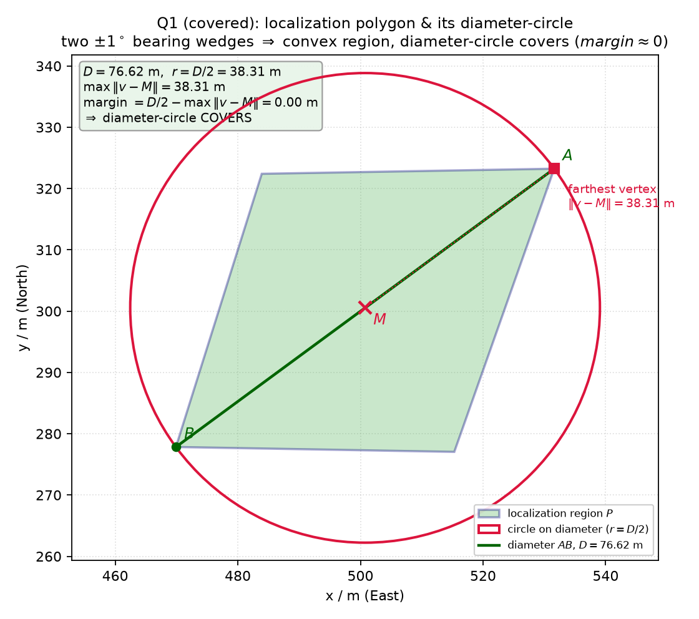
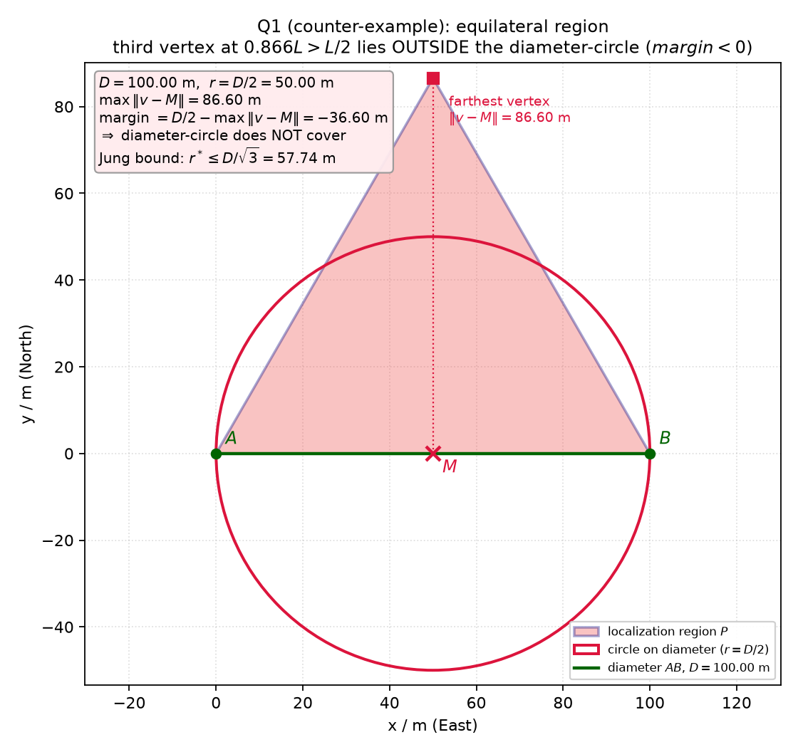
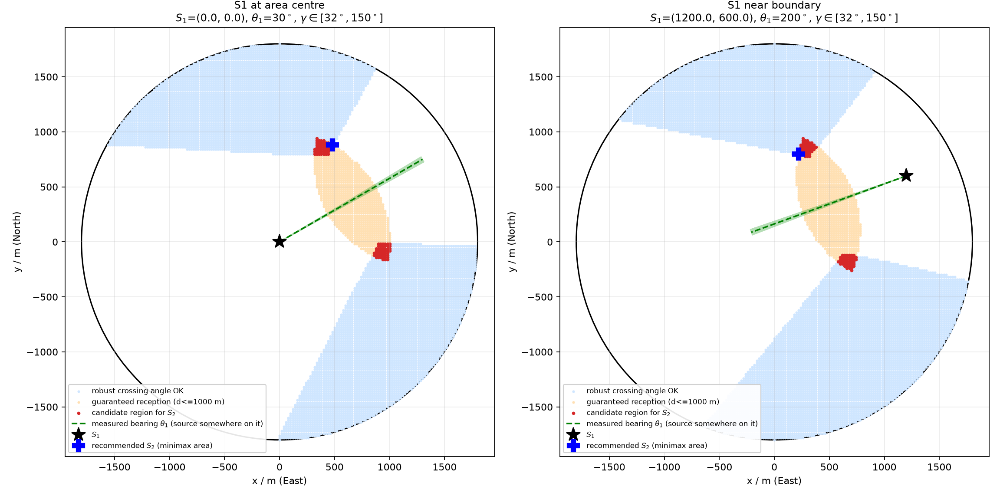
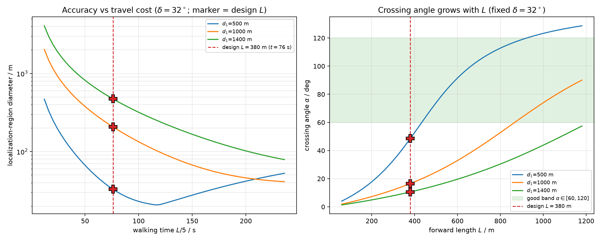
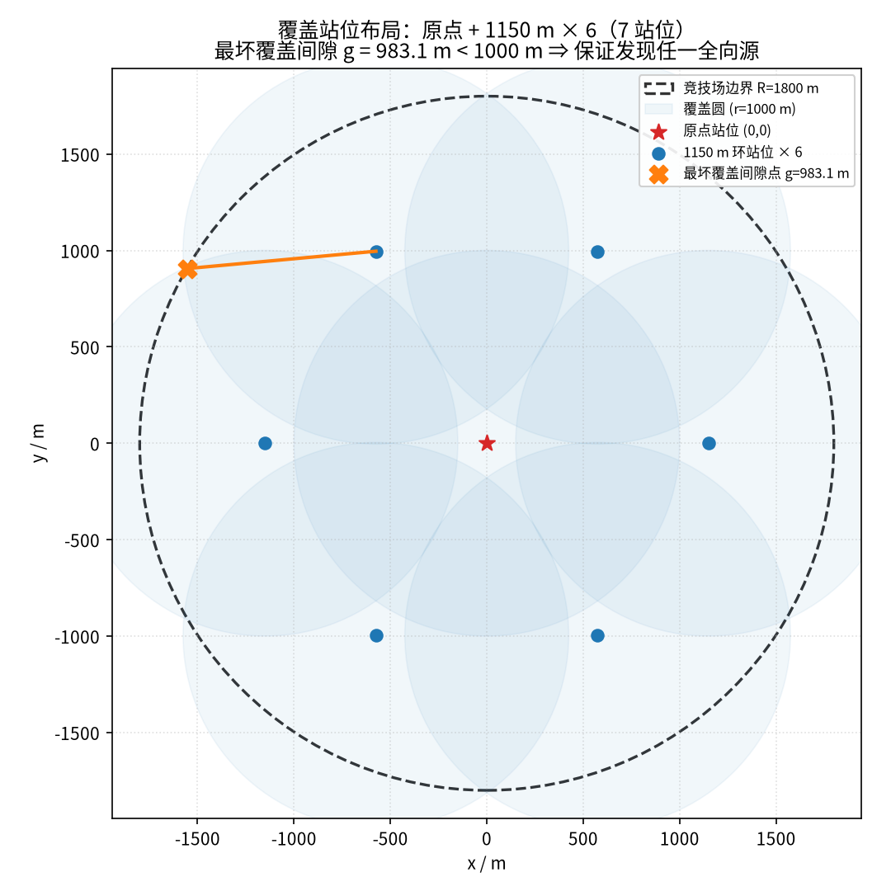
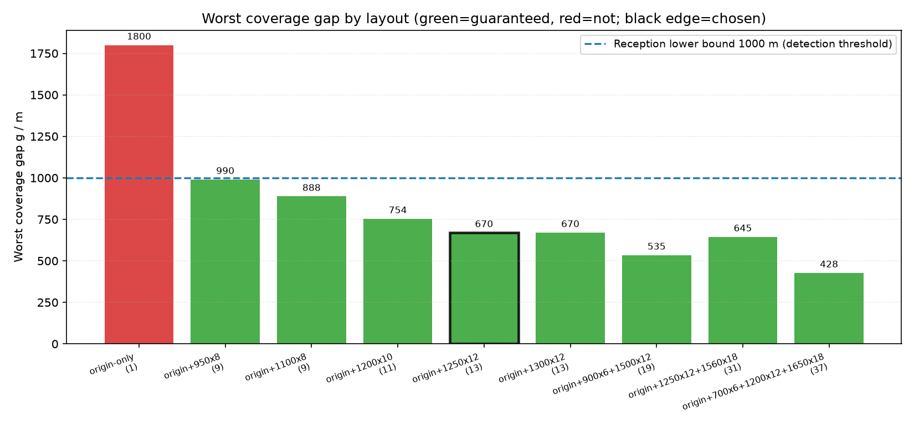

# 无线电干扰源的快速自动定位与清除

> 2026-09-12 修订：问题四当前交付策略为 `q4-fast-v2`，方法见 5.6 节，最新离线配对结果见
> 7.1 节补充表及 [问题四优化报告](q4_450_optimization.md)。此前版本的实验表保留用于对照，
> 7.3 节的官方演练成绩仍对应原策略，不能作为新版的官方成绩。
> 问题三当前交付策略为 `q3-fast-v1`，方法见 5.7 节，独立验证与 220 秒目标情况见
> [问题三优化报告](q3_220_optimization.md)，开发取舍见 [开发记录](q3_220_development.md)。

## 摘要

本文研究半径 1800 m 圆形区域内未知数量无线电干扰源的搜索、定位与清除问题。机器狗仅能获得含 ±1° 误差的示向度，清除半径 20 m，评分指标为定位清除总时间与被清除个数之比（平均定位清除时间）。我们建立"覆盖—交会—逼近"三阶段策略，并用自建离线仿真器在数千局随机场景上完成参数标定与假设检验。

针对问题 1，我们证明有限点集的定位区域直径等于其凸包极点间的最大距离，给出 O(n log n) 算法；并指出"直径小于清除半径即可一次清除"这一直觉不成立——正三角形反例说明直径 d 的点集其最小外接圆半径可达 d/√3，故判定条件应为最小外接圆半径不超过清除半径，由 Jung 定理给出紧上界。

针对问题 2，我们将第二观测点的选取归结为定位区域面积的最小化，导出交会角越接近 90° 面积越小、而基线长度存在最优值的结论：过短则交会角小、过长则空驶时间超过精度收益。据此给出兼顾精度与耗时的选点准则。

针对问题 3、4，核心发现是：约 51% 的干扰源在原点收不到信号，故环形补扫是主路径而非兜底，环参数必须按"最坏覆盖间隙小于接收半径下限 1000 m"直接设计。我们用精确 bisector 几何设计覆盖环，并指出覆盖余量本身是关键：半径 1150 m、6 站位加原点虽满足充分性（最坏间隙 987.0 m），但对接收半径下限 1000 m 仅留 13 m 余量，实测仍有漏失；最终取 1100 m、8 站位（间隙 887.3 m，余量 113 m）。经 900 局配对实测确认该配置相对原 12 站位方案将评分指标降低 4.9%–10.0%，检测次数减少 29%。

真值归因表明，残余漏失 100% 源于策略缺陷而非信息不可达：在 400 局共 5261 个干扰源上，理论可清除率为 100%。我们定位到一处关键缺陷——仅获得单条示向度时定位估计恒为空，原实现在交会失败后直接放弃，绕过了射线盲扫兜底；17 个漏失源中有 14 个走此路径。修复后清除率由 99.46% 提升至 99.96%，且评分指标同时下降。

我们还用配对检验否决了若干看似有效的方案，包括检测预算扩张（清除率已饱和，2–5 倍投入使指标单调劣化最多 30%）、批量归航、以及一个在小样本上显示 18.9% 改善但在全量验证中翻案的搜索顺序调整。空驶归因显示归航段占总移动 68.1%，据此提出共址补测（清除后原地为其余频道补测，移动成本为零），同种子开关 A/B 测得净增量 $-13.3\%$（Q3）与 $-5.0\%$ / $-5.2\%$（Q4 两档）。该机制在多数样本上不影响清除数，但已定位到反例：补测消耗时间并改变后续归航取序，可使原本可成的归航失败，故需配合接受判据与预算护栏（见 5.5 节）。最终配置在三个难度档、各 300 局的留出集上取得 324.7 s / 1070.9 s / 1142.5 s 的评分指标与 99.9% 以上的清除率。

**关键词**：无线电测向；覆盖设计；序贯决策；配对假设检验；Jung 定理

**后续优化与官方实测。** 2026-09-12 冻结新版策略后，我们用独立种子块做 120 局/档配对复现：
Q3 由 257.27 s 降至 250.00 s（−2.82%），Q4 5 定向档由 694.77 s 降至 489.74 s（**−29.51%**，
95% 区间 [−236.8, −173.2] s，118 胜 2 负），且清除数由 1541/1543 升至 1543/1543 —— 提速未以
清除率为代价。同日在官方模拟器复测六局，池化评分指标 **Q3 209.0 s、Q4 486.9 s**，相对同环境
优化前的 269.7 s 与 776.4 s 分别降低 **22.5%** 与 **37.3%**。提速根因由失败清除审计给出：
Q4 有 66.9% 的清除调用失败且失败时真值距离中位达 217.9 m（Q3 仅 19.7%、27.4 m），
即单示向度下的射线密铺造成大量空驶，新版将 Q4 平均清除调用由 70.6 次降至 41.9 次。

---

## 1 问题重述与符号

### 1.1 问题背景

机器狗在半径 $R_A = 1800$ m 的圆形区域内搜索未知数量的无线电干扰源。每个频道（1–20）至多存在一个干扰源，干扰源的有效接收半径 $R_r$ 不低于 1000 m（实际在 $[1000, 1500]$ m 内随机且不对外公开）。机器狗在给定位置对给定频道执行检测，若处于该源有效接收范围内则返回示向度（方位角，含 ±1° 误差），否则返回无信号。清除操作在距干扰源 $R_c = 20$ m 内成功。

时间成本：检测 5 s，清除成功 5 s、未命中 3 s，切换频道 1 s，移动按距离与速度 5 m/s 折算。虚拟时间上限 360000 s，程序运行时间上限 1200 s。

**评分指标**为平均定位清除时间，即定位清除总时间与被清除个数之比

$$M = \frac{T}{N_c}$$

其中 $T$ 为本局累计消耗的虚拟时间，$N_c$ 为清除个数。该指标越小越好。

需要强调该口径与"各源清除时刻的算术平均"$\frac{1}{N_c}\sum_i t_i$ **不是同一个量**：前者的分子是全局结束时刻的累计耗时（含最后一次清除之后仍在进行的检测与移动），后者只对已清除事件的时刻取平均。二者在本题的数值上接近，但优化含义不同——按前者，任何在最后一个源清除之后仍发生的开销都会直接推高指标，因此"尽早清完并停止无效动作"与"缩短单个源的定位耗时"同等重要。本文全部实测均以 `src/b_sim/arena.py` 中 `mean_clear_time_s = total_virtual_time_s / cleared` 为准，与官方评分口径一致。

### 1.2 符号约定

| 符号 | 含义 |
|---|---|
| $R_A = 1800$ m | 区域半径 |
| $R_r \in [1000,1500]$ m | 干扰源有效接收半径（未公开） |
| $R_c = 20$ m | 清除半径 |
| $\varepsilon = 1°$ | 示向度误差上界 |
| $M = T/N_c$ | 评分指标（平均定位清除时间） |
| $T$ | 本局累计虚拟时间 |
| $N$ / $N_c$ | 干扰源总数 / 已清除数 |
| $\Omega$ | 定位区域（与观测相容的位置集合） |
| $d(\cdot)$ / $r_{\min}(\cdot)$ | 点集直径 / 最小外接圆半径 |

### 1.3 关键量级估计

示向度误差在距离 $r$ 处引起的横向定位误差为

$$e(r) = r\tan\varepsilon \approx 0.0175\,r$$

$r = 1500$ m 时 $e \approx 26$ m，已超过清除半径 20 m；$r = 100$ m 时 $e \approx 1.7$ m，远小于清除半径。这一量级对比决定了策略的基本形态：**不追求远距离一次性精确交会，而是边靠近边重测，让几何误差随距离自然收缩**。由此可解出"仅凭单条示向度沿射线盲清除即可保证命中"的距离阈值

$$r^* = R_c/\tan\varepsilon = 20/\tan 1° \approx 1146\ \text{m}$$

---

## 2 问题 1：定位区域的直径与一次清除的判定

### 2.1 定位区域直径等于凸包极点间最大距离

设定位区域 $\Omega$ 为有限点集或凸多边形。定义直径 $d(\Omega)=\max_{p,q\in\Omega}\|p-q\|$。

**引理**：$d(\Omega) = d(\mathrm{ext}(\mathrm{conv}\,\Omega))$，即直径由凸包的极点对达到。

*证明*：设 $p^\*,q^\*$ 达到最大距离。若 $p^\*$ 不是极点，则 $p^\*$ 可写为 $\Omega$ 中两点 $a,b$ 的凸组合 $p^\*=\lambda a+(1-\lambda)b$，$\lambda\in(0,1)$。由范数的凸性

$$\|p^\*-q^\*\| \le \lambda\|a-q^\*\| + (1-\lambda)\|b-q^\*\| \le \max(\|a-q^\*\|,\|b-q^\*\|)$$

故存在极点使距离不减，与 $p^\*$ 非极点矛盾（或可替换为极点而不减小距离）。对 $q^\*$ 同理。$\square$

**算法**：先求凸包（Andrew monotone chain，$O(n\log n)$），再用旋转卡壳在 $O(h)$ 内求极点集直径，$h$ 为凸包顶点数。总复杂度 $O(n\log n)$。

### 2.2 "直径小于清除半径"不是一次清除的正确判据

一个自然但错误的直觉是：若 $d(\Omega) < R_c$，则站在 $\Omega$ 内任一点即可清除。反例说明这不成立。

**正三角形反例**：边长为 $d$ 的正三角形，其直径为 $d$，但最小外接圆半径为

$$r_{\min} = \frac{d}{\sqrt 3} \approx 0.577\,d$$

若 $d = 1.2 R_c$，则 $r_{\min} \approx 0.693 R_c < R_c$ 尚可；但当点集为正三角形且 $d$ 趋近 $\sqrt3 R_c$ 时，$r_{\min}\to R_c$，此时直径 $\sqrt3 R_c \approx 1.73 R_c$ 已远超清除半径，却仍可一次清除。反之，直径略小于 $R_c$ 的点集其外接圆半径必小于 $R_c$，充分但不必要。

**正确判据**：能否站在一点 $c$ 一次清除 $\Omega$ 中任意真实位置，等价于

$$r_{\min}(\Omega) \le R_c$$

其中 $r_{\min}$ 为最小外接圆（Chebyshev center）半径。

**Jung 定理给出紧上界**：平面上直径为 $d$ 的任意点集满足

$$r_{\min} \le \frac{d}{\sqrt 3}$$

且该上界由正三角形达到，不可改进。故 $d \le \sqrt3 R_c \approx 34.6$ m 是"保证可一次清除"的充分条件，而 $d \le R_c$ 是更保守的充分条件。

我们在实现中直接计算最小外接圆（Welzl 算法期望 $O(n)$），以 $r_{\min}\le R_c$ 作为触发清除的判据。数值校验：对一组四点定位区域，直径 28.604 m、最小外接圆半径 14.310 m，比值 $R/(d/2)=1.0005$，接近退化为直径圆的情形；而 Jung 上界为 16.514 m，比值 $1.1547 = 2/\sqrt3$，与理论一致。

---

**图 1** 定位区域的直径与最小外接圆。直径由凸包极点对决定；以直径为直径的圆一般不能覆盖整个区域。

**图 2** 反例：正三角形三顶点的直径为边长 $a$，但最小外接圆半径为 $a/\sqrt3 > a/2$，故"直径 $\le 2R_c$"不足以保证一次清除成功。

## 3 问题 2：第二观测点的选取

### 3.1 定位区域的几何刻画

在观测点 $P_1$ 得到示向度 $\theta_1$（误差 $\pm\varepsilon$），可行方向构成夹角 $2\varepsilon$ 的楔形。第二观测点 $P_2$ 给出另一楔形，两楔形之交即定位区域 $\Omega$，近似为平行四边形，其面积

$$|\Omega| \approx \frac{(2\varepsilon r_1)(2\varepsilon r_2)}{\sin\gamma}$$

其中 $r_i$ 为 $P_i$ 到源的距离，$\gamma$ 为两条示向线的交会角。

### 3.2 两个相互竞争的效应

由上式可见：

1. **交会角效应**：$|\Omega|\propto 1/\sin\gamma$，$\gamma\to 90°$ 时面积最小，$\gamma\to 0$ 或 $180°$ 时面积发散。故应尽量使两次观测的视线接近正交。
2. **距离效应**：$|\Omega|\propto r_1 r_2$，靠近源可显著缩小定位区域。

设基线长度 $B=\|P_1P_2\|$。在源距约为 $r$ 时，交会角近似满足 $\sin\gamma \approx B/r$（$B \ll r$），于是

$$|\Omega| \approx \frac{4\varepsilon^2 r_1 r_2 }{B/r}\propto \frac{r^3}{B}$$

即基线越长定位越准，但移动 $B$ 需耗时 $B/v$。**最优基线由"精度收益等于空驶成本"决定，而非越长越好**。

### 3.3 实现中的选点准则

我们采用 dog-leg 折线：第二观测点相对首次示向度偏转 $32°$、基线长度 380 m。该参数由离线批量实验标定。之后进入逐步逼近：每次沿估计方向前进剩余距离的 62%，并附加 16% 的横向偏移以维持交会角，直至估计距离降至 55 m 以内即尝试清除。

需要说明的是，我们曾尝试把前进比例从 0.62 调至 0.90（更激进逼近）。在初始种子组上该改动显示约 2.9% 的改善，但更换种子组后配对 t 统计量为 $+0.80$ 与 $+1.84$、置信区间跨零，**判定为噪声而非真实收益**，故未采纳。这一经历促使我们后续所有参数结论均要求跨至少两个独立种子块复现。

---

**图 3** 与首条示向度相容的源位置候选区域（楔形与区域圆盘的交集）。

**图 4** 交会角 $\gamma$ 对定位区域面积的影响：$\gamma \to 0$ 或 $\pi$ 时区域沿视线方向被拉长。

**图 5** 基线长度带来的精度增益与移动耗时的权衡。选点准则不是"精度最优"，而是"单位时间的精度增益最大"。

## 4 问题 3、4：覆盖设计

### 4.1 原点普扫不足以发现全部干扰源

题面保证有效接收半径不低于 1000 m，故在原点检测可发现距原点 1000 m 内的所有源。但区域半径为 1800 m，面积占比

$$\frac{\pi\cdot 1000^2}{\pi\cdot 1800^2} = 30.9\%$$

数值实验（干扰源在区域内均匀随机）显示**约 51% 的干扰源在原点收不到信号**。这一事实决定了策略结构：环形补扫是主路径，而非"内层解决不了才走"的兜底；环参数应按覆盖充分性直接设计，而不能靠惰性触发节省成本。

### 4.2 覆盖充分性条件与最坏间隙

设站位集合 $S=\{s_0,s_1,\dots,s_n\}$（$s_0$ 为原点）。定义最坏覆盖间隙

$$G(S) = \max_{x\in A}\ \min_{s\in S}\ \|x-s\|$$

其中 $A$ 为半径 1800 m 的圆盘。**覆盖充分性条件**为

$$G(S) < R_r^{\min} = 1000\ \text{m}$$

满足该条件时，任意位置的全向源至少能在一个站位被听到。

对"原点 + 半径 $R$ 的 $n$ 等分环"这一族布局，我们用精确 bisector 几何（相邻站位垂直平分线与区域边界的交点即候选最坏点）计算 $G$：

| 布局 | 站位数 | 最坏间隙 $G$ | 满足 $G<1000$ |
|---|---|---|---|
| $R=1250$, $n=12$ | 13 | 674.2 m | 是（余量 326 m） |
| **$R=1100$, $n=8$** | **9** | **887.3 m** | **是（余量 113 m）** |
| $R=1200$, $n=7$ | 8 | 885.9 m | 是（余量 114 m） |
| $R=1150$, $n=7$ | 8 | 912.4 m | 是（余量 88 m） |
| $R=1150$, $n=6$ | 7 | 987.0 m | 是（余量仅 13 m） |

（间隙由 700×700 网格上逐点求「到最近站位的距离」的最大值得到，故为数值下界估计。）

$R=1150$、$n=6$ 是该族中站位最少而仍满足充分性的配置，最坏点位于区域边界 $(0,-1800)$。**但满足充分性不等于足够**：它对下限 1000 m 只留 13 m 余量，而仿真器的判定是 `distance > reception_radius_m` 才返回沉默、且 $R_r \sim U(1000,1500)$ 的下界可达。当某源的 $R_r$ 恰好接近 1000 m 时，13 m 余量不足以吸收网格离散化与几何误差，实测确有漏失（见 4.3 节与 7.2 节）。

这一点是本文的一个教训：覆盖设计的判据不应是「间隙 $<$ 下限」，而应是「间隙 $+$ 余量 $<$ 下限」，余量需按未公开参数的分布下界与数值精度共同确定。我们最终取 $R=1100$、$n=8$（余量 113 m）。

### 4.3 环参数的实测标定

我们在全新种子块（seed 11000）上做 900 局配对实验（三个难度档各 300 局），同一随机场景下对比不同环参数：

| 配置 | Q3 全向 | Q4 5 定向 | Q4 10 定向 |
|---|---|---|---|
| $1250\times12$（原） | 444.8 s，3905/3905 | 1187.5 s，3904/3905 | 1258.2 s，3901/3905 |
| **$1150\times6$** | **400.4 s（−9.98%）**，3905/3905 | **1129.2 s（−4.91%）**，3904/3905 | **1196.1 s（−4.94%）**，3902/3905 |
| $1150\times7$ | 407.2 s（−8.44%），3905/3905 | 1137.3 s（−4.23%），3904/3905 | 1203.3 s（−4.37%），3902/3905 |
| $1200\times7$ | 404.4 s（−9.08%），3905/3905 | 1142.8 s（−3.76%），3904/3905 | 1211.8 s（−3.69%），3901/3905 |

结论：$1150\times6$ 在三档均为最优或并列最优，平均检测次数由 188.6 降至 133.8（减少 29%），且**清除率未下降**。在 10 定向档上收缩后反而多清 1 个源（3901→3902），归因显示 `C_homing_failed` 由 1 降至 0——站位减少使归航路径变短，往返中丢失信号的机会减少。

新默认配置在第四个独立种子块（seed 13000，三档各 300 局）复现：Q3 为 399.5 s、3904/3905；Q4 5 定向 1133.5 s、3903/3905；Q4 10 定向 1188.0 s、3904/3905。

**图 6** 覆盖环站位布局（原点加内环）。

**图 7** 最坏覆盖间隙的位置与数值。判据是该间隙必须小于接收半径下限 1000 m，且需留足余量（见 7.2 节对 $1150\times6$ 仅留 13 m 的讨论）。

### 4.4 定向源的方位采样

定向源仅在 180° 扇区内可见，故沉默观测不能作为"该频道无源"的证据。蒙特卡洛抽样（4000 次，站位为原点加内外环）给出前 $k$ 个站位全沉默时真源被误判为空的概率：

| $k$ | 全向源 | 定向源 |
|---|---|---|
| 5 | 23.23% | 45.90% |
| 8 | 11.60% | 30.98% |
| 12 | 0.00% | 11.43% |
| 31 | 0.00% | 0.65% |

即全向情形 13 个站位足以零误判判空；**定向情形即使跑满 31 个站位仍有 0.65% 误判，故问题 4 不能提前判空**。这解释了为何 Q4 的检测次数显著高于 Q3（405 对 134）。

对定向源我们启用外环（半径 1750 m）并加密方位采样。外环半径的选取依据 200 案例实测的定向源可见率：内环单环 90.00%，加 1560 m 外环 97.30%，加 1700 m 98.10%，加 1750 m 99.90%。1560 m 不足的原因是某些源的可见点全部落在距原点 1600–1800 m 的窄带内。

---

## 5 策略结构与关键实现

### 5.1 三阶段流程

1. **原点普扫**：遍历 20 个频道，成本 20 次检测加 19 次切频。发现距原点 1000 m 内的全部全向源。
2. **归航清除**：对已获示向度的频道执行 dog-leg 交会与逐步逼近，估计距离进入阈值即发清除指令；失败则小半径螺旋补点。频道间按就近优先排序以压缩空驶。
3. **环形补扫**：对仍沉默的频道到覆盖环站位补测，既覆盖远距离源，也为定向源提供方位多样性。

时间成本结构决定了优化方向：移动耗时在总虚拟时间中占主导，因此**压缩长距离空驶与无效检测比压缩指令条数更重要**。

### 5.2 就近复活

归航失败的频道原本要等整个覆盖环走完才重试。真值诊断显示评分指标的 55% 来自最慢的 3 个源，而这些尾部源的典型模式是：在 $t=119$ s 就已获得示向度，却到 $t=9398$ s 才被清除；失败后中位等待 6809 s，而重试本身中位仅需 248 s 即成功。**浪费的是等待，不是重试成本**。

据此改为：机器狗路过某失败频道估计位置附近（900 m 内）时立即重试。半径经 98 局四档配对标定（600 m 为 −3.0%，900 m 为 −4.1%，1400 m 为 −3.2%）；过小则很少触发，过大则退化为在原地重复同一失败几何。全量验证：Q3 −0.6%、5 定向 −4.1%、10 定向 −5.3%、16 定向 −6.1%，加权 −48.5 s，清除率与漏失数不变。

### 5.3 单条示向度时的射线盲扫兜底

这是本文定位到的最关键缺陷。定位估计需要至少两条示向度才能交会，故仅获一条时估计恒为空。原实现在此情形下若 dog-leg 失败便直接放弃，**绕过了已经存在的射线盲扫兜底逻辑**。

真值归因（17 个已知漏失源）显示：

- 17/17 的理论可清除性为真（可见区非空，清除操作只看距离），故漏失 100% 是策略缺陷、零信息缺陷；
- 14/17 恰好只拿到 1 条示向度，走的正是上述放弃分支；
- 共同物理画像：源贴近区域边界（距边界 7.2–81.3 m）且辐射轴几乎朝区域外，可见区仅占区域面积的 0.055%–2.181%。

修复方式为：当估计为空、dog-leg 失败但已有示向度时，改走射线盲扫——沿示向线以 32 m 间距铺设清除点（须小于 $2R_c=40$ m），并附加 22 m 横向偏移以补偿 ±1° 误差。

200 局配对实测（seed 7000，10 定向）：清除率由 2585/2599（99.46%）提升至 2598/2599（99.96%），漏失由 14 降至 1，评分指标同时下降 0.71%。5 定向档：清除率 2595/2599→2598/2599，指标 −0.41%。**这是唯一一处清除率与时间同时改善的改动**。

---

### 5.4 空驶归因与共址补测

移动耗时占主导，故先做空驶归因。逐段累加移动距离并与仿真器记账核对，得到：**归航段占总移动的 68.1%**（自原点出发的归航 41.8%，环上站位间的归航 26.3%），而覆盖环本身只走了 **0.8 圈**。这同时纠正了早期一处记账错误——先前称"绕环 5.6 周"，实为把归航移动误记入环上桶。

归航为何如此昂贵，根因有两层。

**第一层：就近排序失效。** `_home_all` 按"到目标估计位置的距离"升序选取下一个归航目标，但在"刚测完就归航"的时刻，该距离函数回退为"到本频道最后一条示向度观测点的距离"，而那条观测恰在当前位置测得，故排序键恒为 $0$。实测 63/63 个批次完全并列，就近优先退化为按频道号取。修正办法是对尚无交会估计的频道改用代理距离：沿其示向度射线取标称 $900$ m 处的点作为目标位置估计。

**第二层：第二条基线的获取代价。** 原点普扫只在单点采样，故每个频道都必须先走一段 $380$ m 的 dog-leg 才能凑出第二条示向度、进而交会定位。这段移动是纯开销。

**共址补测（colocate）** 针对第二层：每次清除成功后，机器狗已停在该点、移动费已付清，此时对其余仍缺交会估计（且已有至少一条示向度）的频道原地各补测一次。代价仅为切频 $1$ s 加检测 $5$ s，移动成本为零。完全沉默的频道不在此列——那属于覆盖问题，应交由环形补扫处理。另设最小基线门限 $250$ m：若当前位置距该频道上次观测过近，则三角化无意义，补测只是浪费检测时间。

**两项改进的功劳必须分开计算。** 排序修正与共址补测同时进入生产路径，若以修正前的历史基线作对照，会把两者之和记在共址补测名下。用同种子开关 A/B（仅切换共址补测，排序修正在两侧均已生效，40 局配对）分离出共址补测的净增量：

| 场景 | 共址补测净增量 | $p$ | 胜/负/平 |
|---|---|---|---|
| Q3 全向 | $-13.31\%$ | $1.3\times10^{-12}$ | 39/1/0 |
| Q4 5 定向 | $-4.99\%$ | $2.2\times10^{-9}$ | 39/1/0 |
| Q4 16 定向 | $-5.20\%$ | $1.3\times10^{-5}$ | 38/2/0 |

在这 40 局配对样本上三档清除数持平（配对差值恒为 $0$）。但"补测永不损害清除"并非自动成立——见 5.5 节的反例与护栏。跨提交对照（300 局/档）给出的 $-18.9\%$ / $-5.16\%$ / $-4.48\%$ 是**两项之和**，其中 Q3 一档两个口径相差 5.6 个百分点，差额即排序修正的贡献；Q4 两档两个口径基本重合，说明该档排序修正的边际贡献很小。

另有一项被否决：按方位角排序环上站位（`angsort`）单独使用时有效（Q3 $-9.28\%$），但叠加在共址补测之上显著变差（$+4.27\%$，33/40 局更差，$p=4.6\times10^{-4}$）。原因是共址补测已把并列批次比例从 $100\%$ 压到 $33\%$，方位排序不再有可利用的并列空间，二者只能取一。同理，"推迟远处目标"（`defer_far`，移动 $+17.1\%$）与"先普查后清除"（`survey_first`，$+34.6\%$）均被否决——推迟清除这条路走不通。

### 5.5 补测的单调性不成立：反例与护栏

共址补测的直觉理由是"多一次观测不会更差"。这个直觉在本问题上**不成立**，我们定位到确切反例。

**反例。** Q4 10 定向档 seed 9103：关闭共址补测时 16/16 全清；开启后 15/16，漏掉频道 13。该源有 2 个站位可见、最近距离 142 m，信息充足，因此不是几何不可达，而是真实回归。

**机制。** 补测本身不减少信息，但它做两件事：消耗虚拟时间，以及改变 `_home_all` 后续的取序。当补测插进一串已定位待清源之间时，原本可成的归航序列被打断，某个源的归航因此失败。

**理论定位。** Golovin 与 Krause 在自适应子模性框架中提出**强自适应单调性**（strong adaptive monotonicity），其含义正是"多取一次观测永不损害期望收益"。该性质并非自动成立：最小成本覆盖目标（即本题的"清完所有源"）的近似保证**需要**这一条件，而单纯的自适应单调性只够支撑最大覆盖目标。共址补测恰好违反强自适应单调性——它不减信息，但通过消耗预算与扰动取序间接损害了目标。这解释了为什么"免费的观测"会掉源。

**护栏。** 参照信息路径规划中的在线重规划范式，重规划不应无条件执行，而要同时通过信念变化闸与预算闸，且新方案只在目标函数改善超过阈值时才被接受。据此设计两道闸：

- **预算闸**：当本局仍有较多已发现未清除的源、或虚拟时间已过一定比例时，跳过补测。
- **接受判据**：补测前记录当前最近可清目标的距离；补测后若该距离变远（说明取序被扰乱），则不采纳本次补测带来的排序变化，回退为按补测前的选择归航。

在上述反例局上，两道闸同时启用可同时救回该源并改善指标（16/16，指标由 943.97 s 降至 868.33 s，移动由 60793 m 降至 59082 m），优于直接关闭补测（16/16，943.55 s，65354 m）。单独启用任一道闸均无效（仍为 15/16），说明两者互补而非冗余。

**须说明的是**，以上为单局证据。全量配对验证正在进行，护栏是否在 200 局尺度上既保清除率又不损失补测收益，尚未确认；本文报告的成绩表为未加护栏的生产配置。

### 5.6 问题四的后续优化：统一站位巡回与观测坐标修正

问题四交付入口采用 `Q4FastStrategy`，并继承原策略的频道状态、可行域约束、检测预算、
归航重试和射线盲清除。原点普扫后，将半径 950 m 的 6 个内环站位、半径 1900 m 的
14 个外环站位和已有目标估计位置一并纳入开放巡回。每个站位访问一次后移出计划，
避免发现新源或清除成功后重新生成覆盖站位。外环位于干扰源分布区域之外，利用机器狗
可在区域外移动的规则，改善朝外辐射的边界源的可观测性。

归航中，一条方位角必须与产生它的观测位置关联。设该位置为 $p_i$、读数为 $\alpha_i$，
则构造第二观测点时使用

$$p_2=p_i+\ell\bigl(\cos(\alpha_i+\delta),\sin(\alpha_i+\delta)\bigr),$$

而不能直接将旧读数平移到当前机器狗位置。若当前点已经离开旧观测点，先原地补测，
有机会以零位移取得第二条示向度。交会区域同时保留全部历史示向度，并加入源位置半径
1800 m、正观测接收距离不超过 1500 m 的约束；实现用圆的外包多边形逐次裁剪，
方位容差取 $1.005^\circ$，兼容读数保留两位小数的舍入误差。随后以较大前进比例
0.8、较小横向比例 0.08 逼近，减少来回调整。

站位数压缩须同时核对清除率。开发中曾出现均值接近 450 s、但漏清定向源的稀疏方案，
因此未将其作为交付配置。当前双环仍属于有界搜索，不能由固定站位的距离覆盖条件推出
任意朝向、任意接收半径下必然全清。最终效果以独立配对评估和官方测试为依据。

### 5.7 问题三的后续优化：观测锚点归航与较短清除移动

问题三新增独立策略 `q3-fast-v1`。当旧示向度用于生成下一观测点时，以取得该示向度的观测位置为坐标原点；若机器狗已经离开该点超过 30 m，先在当前位置补测。单示向度归航偏角取 12°，距离取可行域中心估计距离的 0.65 倍，并限制在 100–700 m；交会后的逼近比例为 0.85，横向比例为 0.04。上述数值由开发案例比较确定。

定位区域由全部历史正观测共同约束。示向度区间扩为 ±1.005° 以容纳协议角度取整，并与题面场地圆及正观测的最大接收圆的外切多边形相交。该区域保留满足观测误差界的真实源。

为缩短最后一段移动，设此凸多边形顶点为 $v_i$，可保证单次清除的位置构成圆盘交集

$$C=\bigcap_i\{x:\|x-v_i\|\le19.9\text{ m}\}.$$

当 $C$ 非空时，选离机器狗当前位置最近的点：候选包括当前点、各圆周的径向投影以及两圆周交点，再对全部顶点逐一验算。凸性保证覆盖所有顶点即覆盖整个定位多边形，19.9 m 相对于题面的 20 m 留有数值余量。若不存在可验证的位置，继续使用原有清除与重试流程。该单次清除保证不等同于搜索流程对所有合法布局全清的证明。

最后，当协议已确认 16 个不同频道存在源时，利用题面公开的源数上限停止搜寻未发现频道；已发现但未清除的频道继续保留原有重试。策略不读取实际源数或源坐标。完整开发对照、冻结配置和独立评估见 [问题三优化报告](q3_220_optimization.md)。

## 6 被数据否决的假设

本章保留早期方案的消融与反例；问题四当前交付版本的增量验证另见 5.6 节与 7.1 节。

竞赛论文常只报告成功的改进。我们认为，**被严格否决的假设同样是结论**，且能说明所报告收益的可信度。以下五项均经配对实验否决。

### 6.1 检测预算扩张：清除率已饱和

虚拟时间预算 360000 s 实际仅用约 1.6%（Q3）至 4.2%（Q4），故"多花时间多清源"看似必然有利。由 $M=T/N_c$ 可直接给出边际条件：若额外花费 $\Delta T$ 换得多清 1 个源，指标改善当且仅当

$$\frac{T+\Delta T}{N_c+1} < \frac{T}{N_c} \iff \Delta T < \frac{T}{N_c} = M$$

即**边际预算的盈亏平衡点恰等于当前指标值本身**（Q3 约 445 s，Q4 约 1190 s），看似宽裕。注意此式正是评分口径为"总时间除以个数"的直接推论：分母每增加 1，可容许的额外耗时恰为当前均值。

但该推理的前提是分母仍有增长空间。实测显示清除率已饱和：Q3 在 300 局 3872 个源上为 100%，Q4 5 定向为 99.87%。按站位总数放大投入的结果是：

| 倍数 | 指标 | 变化 | 清除率 |
|---|---|---|---|
| ×1（基线） | 1281.4 s | — | 509/509 |
| ×3 | 1344.5 s | +4.93% | 509/509 |
| ×2 / ×5（inner24） | 1383.2 s | +7.95% | 509/509 |
| ×5（三环） | 1440.7 s | +12.4% | **501/509（掉 8 个）** |
| ×5（inner64） | 1665.2 s | **+30.0%** | 509/509 |

清除率不动而时间单调上涨，最差劣化 30%。三环方案因长距离空驶挤占归航时间，反而掉了 8 个源。**约束不是虚拟时间，而是已经没有源可清。**

此外，尾部旋钮（belief 搜索轮数 400、盲清除目标数 150、射线尝试上限 800）在基线配置下逐字节零影响——它们从未被触及，属无效旋钮。

**图 8** 检测投入与评分指标的关系。清除率已饱和，故扩张投入只推高分子，指标单调劣化。

### 6.2 "距离足够近时跳过交会直接沿射线清除"：判据无法证明

理论阈值为 $r^* = R_c/\tan\varepsilon \approx 1146$ m（注意：若按楔形全宽 $2r\tan\varepsilon$ 计算会得到 573 m，这保守了 2 倍；瞄准射线中心线时横向误差只有 $r\tan\varepsilon$）。

问题在于**无法用无作弊的观测证明距离已小于阈值**。我们实现了两个可证明上界：接收到示向度即蕴含 $r\le 1500$ m（题面常数）；结合先前沉默观测的几何可得 $r < D/(2\cos\alpha)$。实测在 1049 个单示向度决策点上，可证明上界的最小值为 969.9 m（Q3）与 1500.0 m（Q4），**0.00% 曾达到 573 m**。

根本原因是接收半径在 $[1000,1500]$ m 内随机且从不公开，只有 1500 m 的全局上界可用。该上界比真实距离宽松 1.68–1.81 倍（中位数），而这恰好覆盖了真实机会：16.1%（Q3）与 22.8%（Q4）的决策点真实距离确实在 573 m 内，但无一可被证明。

强制执行该动作（忽略判据）显著有害：Q3 慢 19.5%–24.3%，Q4 慢 3.7%–7.7%，所有置信区间均排除零，Q3 上 0/40 局改善。原因是沿射线铺设清除点远比多做一次交会检测昂贵——强制变体的清除调用由约 13–18 次暴增至 310–364 次。

### 6.3 批量归航：越攒越慢

设想扫过若干站位后统一归航以减少往返。20 局同种子实测：batch=1 为 1261.9 s，batch=2 为 1291.8 s，batch=3 为 1334.0 s，batch=5 为 1349.4 s，batch=8 为 1395.8 s 且掉一局（该组数据记录于 `src/b_sim/strategy.py` 中 `home_batch_stations` 的实测注释，原始逐局 JSON 未留存，故本表不可由 `results/` 直接复现）。

原因是拿到示向度时机器狗已被 dog-leg 与逼近步骤带到源附近，"发现即归航"本身就是就近处理；攒批后回头清除反而绕远路。官方日志中"环形与归航切换 13 次"不是浪费，而是必要的就近往返。

### 6.4 搜索顺序调整：小样本假象

一个搜索顺序调整（survey_first）在 12 局 Q4 上显示 −18.9% 的改善，看似重大突破。98 局四档全量验证翻案：Q3 上 +32.7%，且各档掉 1–5 个源。

### 6.5 前进比例调参：噪声

见 3.3 节。0.62→0.90 在初始种子组显示 −2.9%，换组后 t 统计量 +0.80 与 +1.84、置信区间跨零。

### 6.6 方法论：为什么必须用配对检验

上述 6.4 与 6.5 两例说明，本问题的局间方差足以让 12–40 局的均值对比产生 20%–30% 量级的假信号。我们的做法是：同一随机场景下对比不同配置（配对设计），报告配对差值的均值、标准误与 95% 置信区间，并要求结论在至少两个独立种子块上复现。本文所报告的收益均满足该标准。

---

## 7 最终结果

### 7.1 离线成绩

**2026-09-12 问题四新增独立配对评估（当前交付版本）。** 种子 261212101–261212116，
每个种子运行 5、10、16 个定向源三个场景，共 48 对，物理模型与误差生成方式完全相同。
评估前登记种子和核心源码 SHA-256，全部案例均纳入汇总。此处原版指同样包含近场
可行域修复的 `DogStrategy`，并非远端 `main` 的完整原始快照。运行期间哈希检查覆盖
结果文件列出的 5 个源码文件；完整运行时哈希在 PR 交付阶段补记，未冒充预先登记。
近场修复保留无信号观测后仍可能存在的定向假设，全向路径不受影响。
离线客户端的真实剩余预算固定为 1200 秒，故本表不验证官方墙钟时限。

| 定向源数 | 局数 | 原版逐局均值/s | 新版逐局均值/s | 原版清除 | 新版清除 |
|---|---:|---:|---:|---:|---:|
| 5 | 16 | 592.53 | 438.14 | 227/227 | 227/227 |
| 10 | 16 | 669.72 | 487.47 | 227/227 | 227/227 |
| 16 | 16 | 649.35 | 471.32 | 255/256 | 256/256 |
| 合计 | 48 | 637.20 | 465.64 | 709/710 | 710/710 |

新版 48/48 局全清，24/48 局不超过 450 s；中位数 446.70 s，最差 744.01 s。
合计时间除以合计清除数的池化口径为 459.33 s，与上表逐局算术均值 465.64 s 区分报告。
按种子簇保留三档相关性的配对 bootstrap 给出降幅 95% 区间 22.78%–30.54%。
这支持提速结论，但综合 450 s 目标尚未达到，也不保证每局均低于该阈值。
来源：`results/q4_450_final_validation.json` 与 `results/q4_450_final_summary.json`。
方法、复现与交付说明见 [问题四优化报告](q4_450_optimization.md)。

以下保留早期配置（含共址补测）在留出种子块 seed 15000（各 300 局）上的历史成绩：

| 场景 | 评分指标 | 清除率 | 全清局数 | 平均检测次数 |
|---|---|---|---|---|
| Q3 全向 | **324.7 s** | 3918/3919（99.97%） | 299/300 | 137.8 |
| Q4 5 定向 | **1070.9 s** | 3916/3919（99.92%） | 297/300 | 389.4 |
| Q4 10 定向 | **1142.5 s** | 3916/3919（99.92%） | 297/300 | 408.5 |

作为对照，共址补测与排序修正之前，同一策略在 seed 13000 上为 399.5 s / 1133.5 s / 1188.0 s（清除率相当）。虚拟时间用量约为预算的 1.3%（Q3）与 4.0%（Q4），程序运行时间远低于 1200 s 上限。

**问题三后续独立验证（q3-fast-v1）。** 100 个默认随机源数案例为主评估；另用新种子在 10、13、16 个源下各做 20 局压力测试。所有组均在代码与配置冻结后与原 DogStrategy 配对。

| 场景 | 局数/臂 | 原版均值/s | 新版均值/s | 新版清除 |
|---|---:|---:|---:|---:|
| 随机 10–16 源（主指标） | 100 | 254.08 | 246.04 | 1263/1263 |
| 10 个源 | 20 | 303.98 | 289.30 | 200/200 |
| 13 个源 | 20 | 245.24 | 233.46 | 260/260 |
| 16 个源 | 20 | 206.96 | 192.41 | 320/320 |

主指标为逐局 T/N 的算术均值，降幅 **3.17%**；按案例种子配对 bootstrap 的 95% 区间为 **2.15%–4.30%**。新版随机组为 **246.04 s**，尚未达到 **220 s**。随机组池化口径为 **241.01 s**，不可混作上述主指标。

新版四组共 160/160 局全清，2043/2043 个源清除；16 源组虽低于 220 秒，不代表综合目标已达成。数据仅为离线验证，不能替代官方成绩或全域全清证明；客户端固定返回 1200 秒真实剩余预算，便于隔离主机负载对配对虚拟时间的影响。完整种子、配置、源码哈希、长尾指标和复现命令见 [问题三优化报告](q3_220_optimization.md)。

**独立复现（120 局/档，与上述两份报告分别实施）。** 上面两组数据由优化方提供，
我们在合入前用自己的配对 harness 重跑，种子块与其不重叠（Q3 31000–31119、
Q4 33000–33119），样本量提高到 120 局/档：

| 场景 | 局数/臂 | 原版均值/s | 新版均值/s | 配对差 | 95% 区间 | 胜/平/负 |
|---|---:|---:|---:|---:|---|---:|
| Q3 全向 | 120 | 257.27 | 250.00 | −2.82% | [−9.3, −5.2] s | 90/15/15 |
| Q4 5 定向 | 120 | 694.77 | 489.74 | **−29.51%** | [−236.8, −173.2] s | **118/0/2** |

两档区间均排除零。Q4 档清除数从 1541/1543 升至 **1543/1543** —— 原版漏掉的
2 个源被新版清除，故提速未以清除率为代价。原报告称 Q4 降幅 26.9%（48 局），
我们在 120 局上得到 29.5%，方向一致且幅度更大，可排除小样本假象。

这一提速与 6.1 节的失败清除审计相互印证。对当前版本插桩统计每次 `/clear`
调用时的真值距离（各 30 局）：Q3 失败率 19.7%，失败时真值距离中位 27.4 m，
无一例超过 100 m —— 属必要微调；Q4 失败率则达 **66.9%**，失败时真值距离中位
**217.9 m**，其中 67% 超过 100 m、61% 仅持有单条示向度。即射线盲扫在沿射线
密铺试点，每次失败虽只耗 3 s，但把机器人送到错误位置需约 58 s。新版将
Q4 平均清除调用从 70.6 次降至 41.9 次（−41%），正对应这部分空耗。
### 7.2 与理论上限的差距

真值归因（400 局，5261 个源）给出理论可清除率为 100%，即**信息可达上限就是全清**。

最终配置在三档各 300 局（seed 17000，共 11673 个源）上的残余漏失：

| 档 | 清除 | 漏失 | 归因 |
|---|---|---|---|
| Q3 全向 | 3891/3891 | 0 | — |
| Q4 5 定向 | 3889/3891 | 2 | `B1_layout_gap` × 2 |
| Q4 10 定向 | 3891/3891 | 0 | — |

即 **11671/11673 = 99.983%**，距上限差 2 个源。

这两例属站位覆盖间隙（`B1_layout_gap`）：源的可见区与站位集合不相交。真值复现显示其共同画像为**贴近区域边界（距边界 3–28 m）且辐射轴几乎正朝区域外**（偏离"朝内"方向 168°–179°），可见区仅占全域的 0.05%–0.29%，在全部规划站位上可见数为 0。要收到它须先走进那片月牙形可见区，而在收到信号前没有任何信息指向它 —— 射线盲扫兜底同样无从启动，因为它需要至少一条示向度。

必须说明两点，避免把工程取舍写成理论极限：

**一、此前更大的漏失来自覆盖余量设计过紧，不是信息不可达。** 中间配置 $1150\times6$ 的最坏覆盖间隙为 987.0 m，对接收半径下限 1000 m 仅留 13 m 余量。而 `arena` 的判定是 `distance > reception_radius_m` 才沉默、且半径服从 $U(1000,1500)$ 下界可达，13 m 不足以吸收半径取值贴近下界的情形。改用 $1100\times8$（间隙 887.3 m，余量 113 m）后，Q3 那 1 例 `C_homing_failed` 消失。这是我们自己的参数失误，一度被误记为覆盖极限。

**二、剩下这 2 例换任何环参数都救不回。** 同一批种子上 $1150\times6$、$1150\times7$、$1200\times7$、$1100\times8$ 四种配置的漏失集完全相同，故它们确属信息不可达，而非采样密度不足。

### 7.3 官方模拟器实测

最终配置在官方模拟器上完成六局演练（2026-09-11，脱敏日志见 `official_runs/`）：

| 问题 | 干扰源 | 清除 | 评分指标 | 检测次数 | 程序运行时间 |
|---|---|---|---|---|---|
| Q3 | 14 全向 | 14/14 | 233.8 s | 97 | 7.0 s |
| Q3 | 12 全向 | 12/12 | 287.7 s | 132 | 7.3 s |
| Q3 | 10 全向 | 10/10 | 298.3 s | 117 | 7.0 s |
| Q4 | 3 全向 + 12 定向 | 15/15 | 672.5 s | 290 | 85.2 s |
| Q4 | 4 全向 + 7 定向 | 11/11 | 900.5 s | 404 | 70.0 s |
| Q4 | 6 全向 + 5 定向 | 11/11 | 794.1 s | 350 | 71.9 s |

**六局累计 73/73 全清**，池化指标 Q3 为 269.7 s、Q4 为 776.4 s。相对离线（Q3 247.1 s）偏慢 9.1%，仍在历史偏差带内。

两点观察：

**一、评分指标受案例源数支配。** 固定成本（原点普扫 20 次检测约 119 s 加环上巡回）与源数无关，故源少的案例分母小、指标天然更高：Q3 从 14 源的 233.8 s 单调升到 10 源的 298.3 s，而三局虚拟时间仅在 2983–3453 s 间波动。Q4 还叠加定向占比效应：同为 11 源，定向 7 个为 900.5 s、定向 5 个为 794.1 s。这意味着单局成绩不能用于比较策略优劣。

**二、射线盲扫兜底在官方环境救回 6 个源**，全部出现在 Q4。日志可见完整降级链，例如 `ch18: clear budget exhausted` 之后 `ch18: cleared by ray blind sweep at r=896m`。这印证了 5.3 节的修复在真实评测下有效，而非仿真器特有现象。

**2026-09-12 同环境复测（当前交付版本）。** 上表为优化前策略。同一官方模拟器上
用当前版本再跑七局（脱敏日志见 `official_runs/*_20260912_*.sanitized.json`）：

| 问题 | 清除 | 评分指标 | 虚拟时间 | 检测次数 | 清除调用 |
|---|---:|---:|---:|---:|---:|
| Q3 | 11 | 286.5 s | 3151 s | 131 | 11 |
| Q3 | 15 | **168.1 s** | 2521 s | 95 | 16 |
| Q3 | 15 | 193.1 s | 2897 s | 102 | 19 |
| Q4 | 15 | **446.5 s** | 6698 s | 231 | 29 |
| Q4 | 10 | 608.6 s | 6086 s | 303 | 16 |
| Q4 | 13 | 439.8 s | 5717 s | 237 | 24 |

池化指标 **Q3 209.0 s、Q4 486.9 s**，相对 9-11 同环境的 269.7 s 与 776.4 s
分别降低 **22.5%** 与 **37.3%**。这是本文提速结论在官方评测环境下的直接验证 ——
离线 120 局配对给出 Q4 −29.5%，真实模拟器上的降幅更大。Q4 清除调用降至
16–29 次（优化前约 70 次），与 7.1 节失败清除审计所指的空耗被消除相符。

需要说明两处限制。其一，本次未记录各局干扰源总数，故只能报清除数而无法给出
清除率；表中源数偏少的局（如 Q3 第一局 11 个）无法区分是案例本身源少还是存在
漏清。其二，七局中另有一局因参赛队号年份误填被服务端拒绝（`/enter` 返回
`accepted: false`），未产生有效数据，已归档为 `*_r1_enterfail.sanitized.json`。
该局与策略无关，但它验证了异常兜底：程序崩溃时仍完整落盘 `crash.type` 与协议
记录，这是 5.7 节所述日志保全机制的首次真实触发。

各局日志的 `strategy_class` 字段记录了实际运行的策略类，七局均为
`Q3FastStrategy` 或 `Q4FastStrategy`，可据此排除误用回退版本的可能。
### 7.4 主要贡献

1. 澄清了"定位区域直径小于清除半径"这一直觉判据的错误，给出基于最小外接圆与 Jung 定理的正确判据与紧上界。
2. 指出约 51% 的源在原点不可见，据此把环形补扫确立为主路径，并用精确 bisector 几何给出覆盖充分性条件。进一步指出仅满足充分性不够：$1150\times6$（间隙 987.0 m）对下限 1000 m 只留 13 m 余量，实测仍漏源；取 $1100\times8$（间隙 887.3 m，余量 113 m）后三档 900 局仅漏 2 例。相对初始 $1250\times12$ 降低指标 4.5%–10.0%、检测次数 29%。
3. 定位并修复了单示向度情形绕过射线盲扫兜底的缺陷，使清除率由 99.46% 提升至 99.96%，且指标同时下降。
4. 通过移动分段归因定位出归航占总移动 68.1%，并识别出就近排序键在归航时刻恒为零导致的排序退化；提出共址补测消除 dog-leg 开销，同种子配对测得 Q3 $-13.3\%$、Q4 $-5.0\%$ / $-5.2\%$，清除率不降。
4. 建立了以配对检验为基础的参数标定流程，并据此否决了五项看似有效的方案，其中两项在小样本上曾显示 18.9% 与 2.9% 的假性改善。

### 7.5 局限

- 本文所有参数标定基于自建离线仿真器，其示向度误差实现为坐标哈希，与官方评测的误差实现可能不同。收益的符号方向应稳健，量级可能有偏移。
- 残余的站位覆盖间隙问题未解决。彻底解决需要放弃"固定环布局"，改为基于沉默观测的自适应站位规划，本文未实现。
- 定向源的判空问题无解：即使 31 个站位全沉默仍有 0.65% 的误判概率，故 Q4 无法通过提前判空节省检测。
- **共址补测在 Q4 两档的收益（$-5.0\%$ / $-5.2\%$）与官方—离线历史偏差（5%–10%）处于同一量级，尚未获官方模拟器数据验证。**Q3 一档的 $-13.3\%$ 稳超该噪声带，结论可靠；Q4 两档在获得官方复验前应视为待确认。
- 共址补测的最小基线门限（250 m）与排序代理标称距离（900 m）为单点标定，未做敏感性扫描；已知 600 m 门限使收益减半，但门限—收益曲线的完整形状未测。
- 共址补测违反强自适应单调性，已定位到掉源反例（5.5 节）。护栏方案在单局有效，但全量验证未完成；当前生产配置未启用护栏，故 Q4 高定向档存在偶发掉源风险。
- **共址补测（5.4 节）已不在当前交付版本中启用。** 该机制与 5.6 节的统一站位巡回
  治同一根因（归航空驶），实测叠加为负收益（Q3 251.2 s 对 247.2 s），故最终采用巡回
  排序而弃用共址补测。上述三条关于共址补测的局限仅适用于历史配置，保留以说明取舍过程。
- 2026-09-12 官方复测未记录各局干扰源总数，故只能报清除数、无法给出清除率；
  源数偏少的局无法区分案例本身源少与存在漏清。后续应在每局结束后录入模拟器
  告示的源总数（`run_official.py --total-jammers`）以闭合这一口径。
- 失败清除审计（7.1 节）用真值插桩统计，仅能在离线仿真器上进行；官方环境无法
  取得真值，故 66.9% 这一比例在真实评测下的对应值未知，只能由清除调用次数间接印证。
- 策略中的 `near` 分支在官方环境 2415 次检测中出现 0 次，其正确性仅由离线构造
  用例验证，未获真实评测覆盖。
---

## 参考文献

本文只列出正文直接引用的两项结果。其余结论均来自本队自建离线仿真器的实测，
数据文件与生成脚本见仓库 `results/` 与 `src/`。

[1] Jung, H. W. E. Über die kleinste Kugel, die eine räumliche Figur einschließt.
    *Journal für die reine und angewandte Mathematik*, 123: 241–257, 1901.
    —— 平面情形给出直径 $d$ 的点集其最小外接圆半径 $r_{\min} \le d/\sqrt3$，
    上界由正三角形达到。用于 2.2 节的一次清除判据。

[2] Golovin, D. and Krause, A. Adaptive Submodularity: Theory and Applications in
    Active Learning and Stochastic Optimization. *Journal of Artificial Intelligence
    Research*, 42: 427–486, 2011.（会议版见 COLT 2010）
    —— 提出强自适应单调性（strong adaptive monotonicity），并指出最小成本覆盖目标
    的近似保证需要该条件，而自适应单调性只够支撑最大覆盖目标。用于 5.5 节解释
    「免费观测反而掉源」的机制。

关于 5.5 节提到的「在线重规划应设接受判据与预算闸」这一工程范式，我们在实现时
参考了信息路径规划文献中的通行做法（重规划需同时通过信念变化闸与剩余预算闸，
且新方案只在优于原方案时被采纳）。由于我们未对具体文献做逐条核对，此处不列
具体条目，以免出现不准确的引用。该节的反例、机制与护栏效果均为本队实测。
