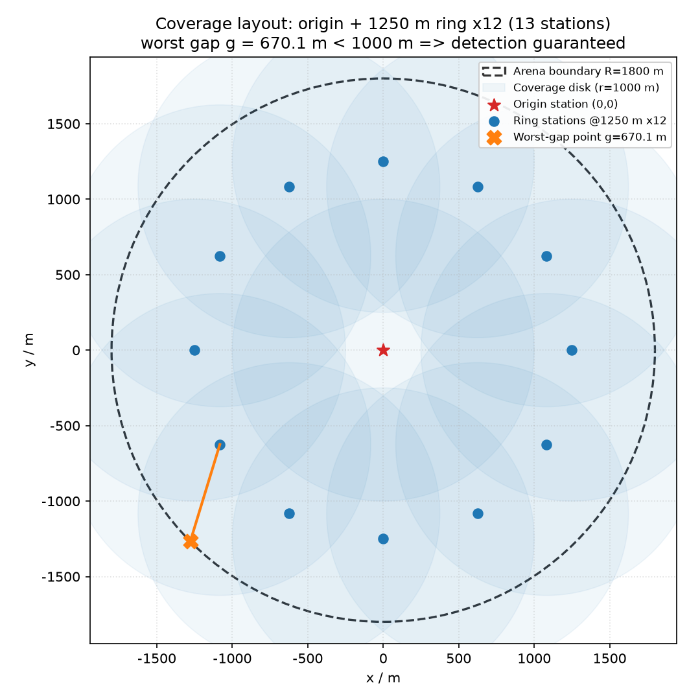
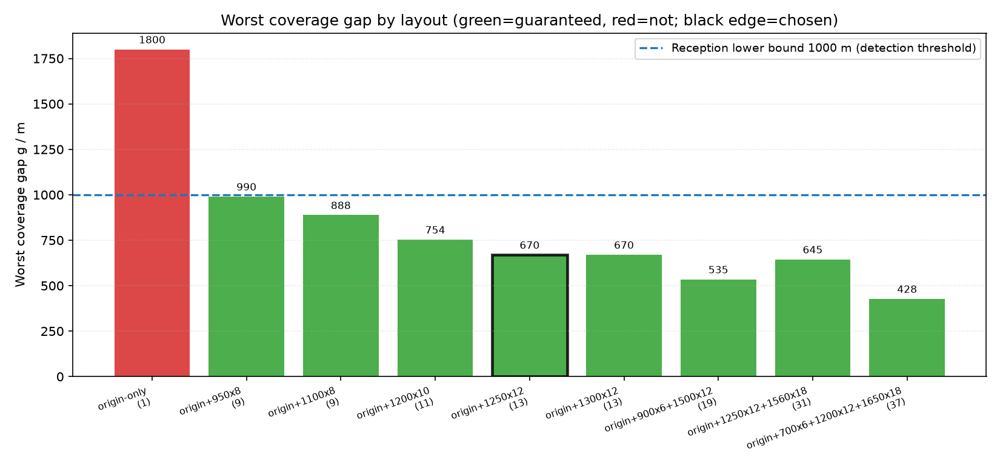

# 覆盖站位设计论证（Q3/Q4）

> 本节对应任务 10.3，论证机器狗巡检站位集合的选取依据。所有数值均由
> `python -m src.b_sim.coverage_design` 重新生成的 `results/b_coverage_design.json`
> 给出（竞技场半径 `ARENA_RADIUS = 1800 m`、全向源有效接收半径下限
> `RECEPTION_MIN_M = 1000 m`），配图由 `python -m src.b_coverage_figures` 生成。
> 满足需求 **R3.2**（全向覆盖站位集合）与 **R4.8**（定向源改用推理 + 盲清除）。

## 1. 覆盖判据：最坏覆盖间隙与"保证发现"

题面保证任一全向干扰源的有效接收半径 `R_s ∈ [1000, 1500] m`。据此可给出一个**充分**的发现判据：

> 若目标区域 `Ω`（半径 1800 m 圆域）内**任意一点** `p` 到某个站位的距离都不超过接收半径下限 1000 m，则任一全向源必落在某站位的接收范围之内，从而**一定能被检测到**（返回 `near` 或 `direction`）。

形式化地，定义布局 `S = {s_1, …, s_n}` 的**最坏覆盖间隙（worst coverage gap）**：

$$ g(S) = \max_{p \in \Omega}\ \min_{s \in S}\ \lVert p - s \rVert. $$

发现判据即 `g(S) < 1000 m`（严格小于接收半径下限）。间隙 `g` 由 `worst_coverage_gap()` 在 300×300 网格上数值求得，同时返回取到最坏间隙的**最坏点** `argmax`。这把"站位怎么摆"化为一个可判定、可比较的纯几何量，无需依赖任何随机采样。

## 2. 布局对比表（数据源：`results/b_coverage_design.json`）

下表列出九种候选布局的站位数、最坏覆盖间隙、是否保证发现，以及对定向源的可见率（200 案例统计口径见 §4）。

| 布局 | 站位数 | 最坏间隙 g (m) | 保证发现 (g<1000) | 定向源可见率 |
| --- | ---: | ---: | :---: | ---: |
| 仅原点 | 1 | 1799.9 | 否 | —（基线） |
| 原点 + 950 m×8 | 9 | 990.4 | 是 | 79.3% |
| 原点 + 1100 m×8 | 9 | 888.5 | 是 | 84.0% |
| 原点 + 1200 m×10 | 11 | 753.7 | 是 | 88.0% |
| **原点 + 1250 m×12（选定）** | **13** | **670.1** | **是** | 89.7% |
| 原点 + 1300 m×12 | 13 | 670.3 | 是 | 91.0% |
| 原点 + 900 m×6 + 1500 m×12 | 19 | 534.8 | 是 | 96.0% |
| 原点 + 1250 m×12 + 1560 m×18 | 31 | 644.7 | 是 | 97.0% |
| 原点 + 700 m×6 + 1200 m×12 + 1650 m×18 | 37 | 427.7 | 是 | 98.7% |

关键读数：

- **仅原点**布局最坏间隙高达 **1799.9 m**（≈ 竞技场直径的一半，最坏点在边缘 `(-1686, -630)` 附近），远超 1000 m，**无法保证发现**。
- **原点 + 1250 m×12（13 站位）** 最坏间隙 **670.1 m < 1000 m**，最坏点位于 `(-1278, -1266)`（相邻环站位之间、靠近边缘的三角空隙），**保证发现任一全向源**——这是满足判据的最小站位规模档位中裕度最充分的一档。

## 3. 全向覆盖：为何选"原点 + 1250 m×12"

### 3.1 覆盖间隙论证（配图 `figures/b_coverage_stations.png`）

主配图给出选定布局的 13 个站位散点、每站以 1000 m 为半径的接收覆盖圆、1800 m 竞技场边界，并以叉号高亮最坏覆盖间隙点及其到最近站位的连线：



图中所有覆盖圆的并集完整包住整个竞技场圆域，最坏点到最近站位的距离恰为 **670.1 m**，明显短于 1000 m。由于 `670.1 m < 1000 m ≤ R_s`，无论源落在何处、接收半径取 `[1000, 1500]` 中的哪个值，都至少被一个站位覆盖，故**保证发现**成立。

从 9 站位（990.4 m，裕度仅 ≈10 m）到 13 站位（670.1 m，裕度 ≈330 m）逐档加密的最坏间隙对比见辅图 `figures/b_coverage_worstgap.png`（绿色柱为满足判据的布局、蓝色虚线为 1000 m 门限、黑框为选定布局）：



选定 13 站位而非勉强达标的 9 站位（990.4 m），是为了对接收半径估计误差、机器狗定位误差与网格离散化留出工程裕度：990.4 m 一旦叠加任何数十米量级的扰动即可能越过 1000 m 门限而漏检，670.1 m 则有约 330 m 的安全余量。

### 3.2 与双环方案的成本对比

若继续加密到双环规模以追求更小的间隙，成本上升显著而收益边际递减：

| 方案 | 站位数 | 最坏间隙 (m) | 相对 13 站位成本 |
| --- | ---: | ---: | ---: |
| **原点 + 1250 m×12（选定）** | **13** | **670.1** | 基准 |
| 双环（950 m×8 + 1560 m×14，设计 §2.4 口径） | 23 | 539 | **+77%** |
| 原点 + 1250 m×12 + 1560 m×18 | 31 | 644.7 | +138% |
| 原点 + 700 m×6 + 1200 m×12 + 1650 m×18 | 37 | 427.7 | +185% |

双环方案（23 站位）把最坏间隙从 670 m 压到约 539 m，但站位数从 13 增至 23（**+77%**）——而 670 m 早已满足"保证发现"判据，多出的 131 m 间隙压缩对全向源检测**没有任何增量收益**。站位数直接决定巡检移动路程，而移动约占官方总时间的 81%（见 §5 与设计 §2.1），因此在**已满足充分判据**的前提下，站位越少越优。故选定 13 站位方案，较双环成本低约 43%（即双环较之高 77%）。

## 4. 原点盲区比例：环形补扫是主路径而非兜底

在 100 个随机案例（种子 `range(2000, 2100)`，共 1281 个全向源）中统计"站在原点收不到信号"（`hypot(x, y) > R_s`）的源比例：

$$ \text{origin-blind fraction} = \frac{659}{1281} \approx \mathbf{51.4\%}. $$

**超过一半的源在原点不可见。** 这一事实决定了策略结构：原点普扫只能捕获约 49% 的源，**必须**依赖 1250 m 覆盖环逐站补扫才能覆盖其余源。因此环形补扫（`_probe_ring` / `_walk_ring`）是主搜索路径，而非"原点扫不到时才启用"的兜底手段——这与需求 R3.1（原点普扫后离开）、R3.2（覆盖站位集合）和 R3.8（沿覆盖环补扫沉默频道）的情节循环设计一致。

## 5. 定向源：盲扫可见率天花板 ⇒ 推理 + 盲清除（R4.8）

定向源仅在其朝向的 ±90° 扇区内、且距离 `≤ R_s` 时才可见。这意味着单纯"加密站位做盲扫"存在**结构性天花板**：无论站位多密，若真值恰好背对所有站位，就无法被"看见"。在 200 案例 × 每案例 5 个定向源（种子 `range(3000, 3060)`，共 300 个定向源）的统计下，可见率随站位数上升但收敛：

| 布局 | 站位数 | 定向源可见率 |
| --- | ---: | ---: |
| 原点 + 1250 m×12（选定全向布局） | 13 | 89.7% |
| 原点 + 900 m×6 + 1500 m×12 | 19 | 96.0% |
| 原点 + 1250 m×12 + 1560 m×18 | 31 | 97.0% |
| 原点 + 700 m×6 + 1200 m×12 + 1650 m×18 | **37** | **98.7%** |

即便把站位加密到 **37 站位**（成本较 13 站位翻倍有余），可见率也只到 **98.7%**——**仍达不到 100%**，且提升越来越小（19→37 站位，成本近乎翻倍，可见率仅从 96.0% 升至 98.7%）。靠加密盲扫追全清率在成本与上限两方面都不可行。

**结论（R4.8）**：对定向源应改用**约束推理 + 盲清除**，而非盲目加密站位：

1. 把每次"无信号"观测当作约束，删除"本应可见却报了 `no_signal`"的候选，压缩三维候选网格 `(x, y, φ)`（见设计 §4.2–4.3）；
2. 候选被压缩到足够少后，对候选格点直接发起 `/clear`——**清除动作只依据到目标的距离，与辐射方向无关**，因此完全绕开了"看不见就清不掉"的可见率天花板。

这把定向源的清除率从"受可见率上限约束"解放为"受候选推理与预算约束"，是 Q4 相较 Q3 的核心策略差异，也解释了为何 Q4 采用信念搜索（`DirectionalBelief`）+ 射线/网格盲清除而非更密的覆盖环。

## 6. 复现命令

```bash
# 重新生成数值依据（写 results/b_coverage_design.json，并打印对比表）
python -m src.b_sim.coverage_design

# 生成配图（写 figures/b_coverage_stations.png、figures/b_coverage_worstgap.png）
python -m src.b_coverage_figures
```

> 说明：配图脚本在检测到系统无中文（CJK）字体时，自动将图内标签回退为等义英文，
> 以避免缺字方块；表格与正文的中文论证不受影响，数值口径与 JSON 完全一致。
